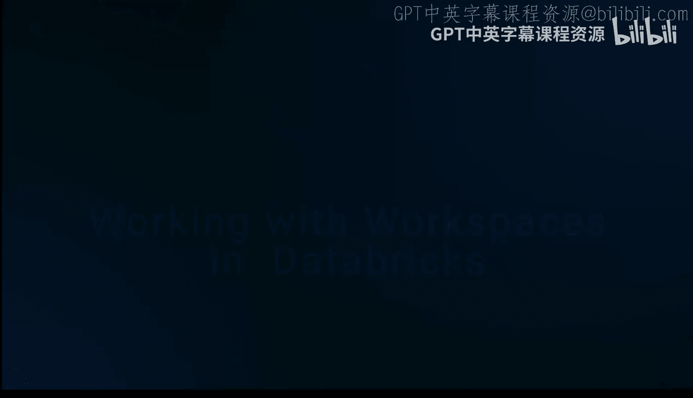
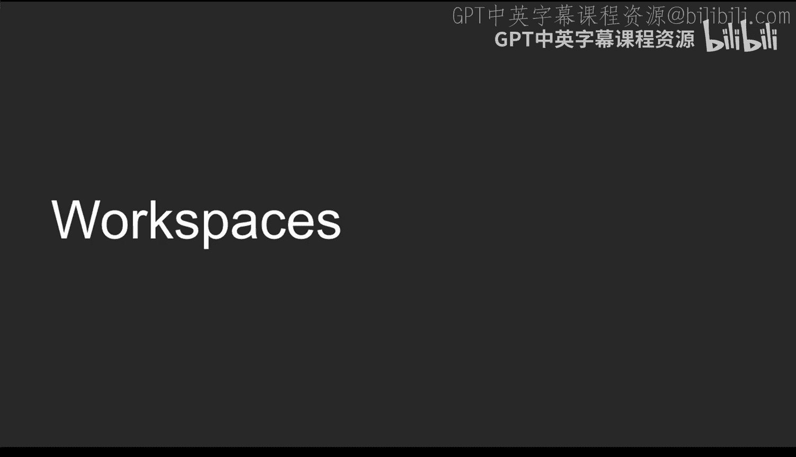
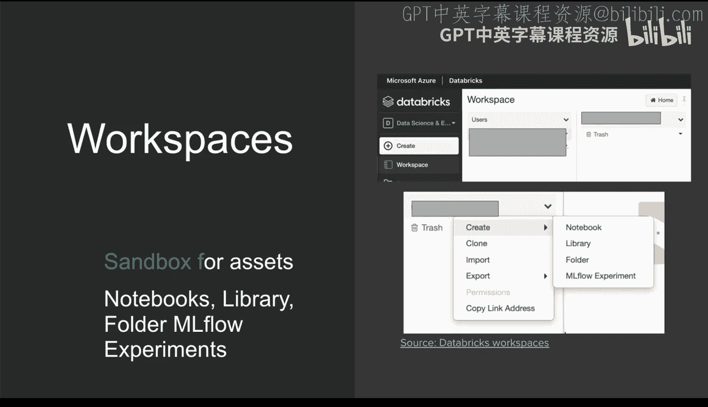
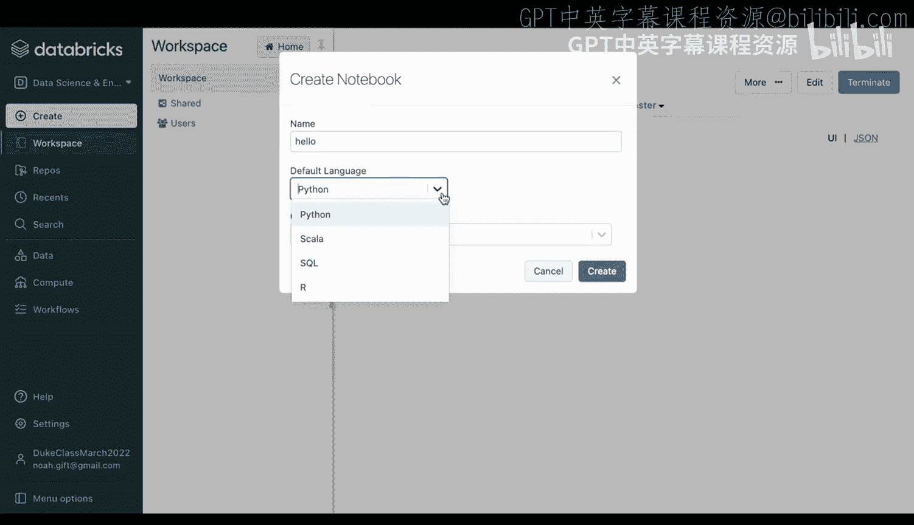
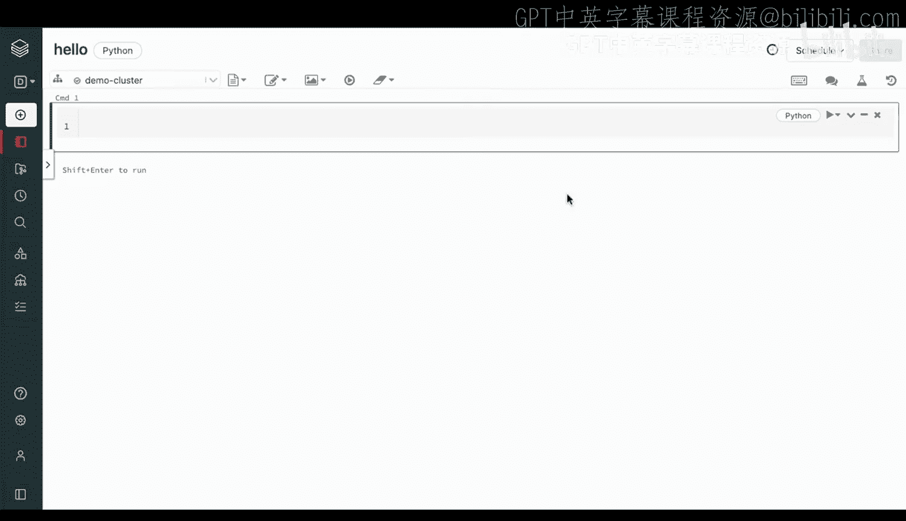
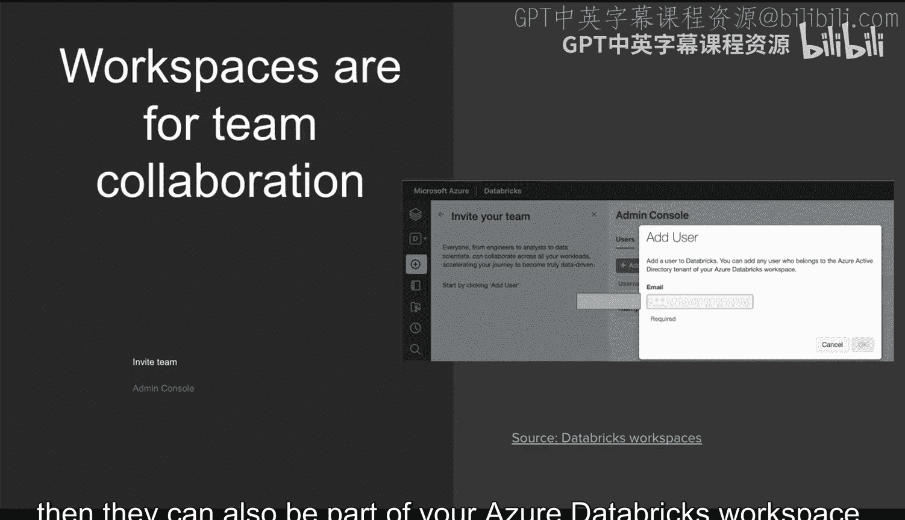
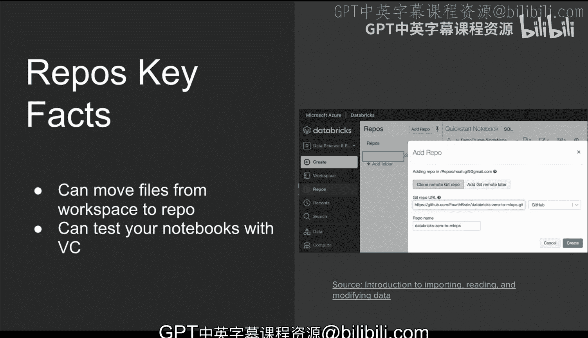

#  022：在Databricks中管理工作空间 🧱

在本节课中，我们将要学习Databricks平台的核心概念之一——工作空间。工作空间是您与团队成员协作、组织项目资产（如笔记本和库）以及管理代码版本的中心区域。我们将详细介绍如何创建和管理工作空间，并探索其协作与版本控制功能。

## 工作空间简介

工作空间是Databricks平台上的一个位置，您可以在其中执行多种操作，以帮助您与其他用户协作并组织项目。

首先，当您查看工作空间时，需要注意的一点是，您可以在左上角创建新用户。这些新用户随后便能在您的工作空间内工作。

您还可以执行其他操作，例如将其视为一个包含笔记本、库、电子邮件流、实验等资产的沙箱。这里展示了一个如何创建新笔记本、新库文件夹或执行任何所需操作的示例。此外，您可以导入其他笔记本，例如来自Databricks的文档。

## 创建工作空间与资产

现在，让我们具体看看如何操作。

如果我转到我的Azure账户，深入“计算”部分，然后进入工作空间，我就可以在这里进行操作。我只需右键单击，即可创建新笔记本、新库、新文件夹或执行任何所需操作。

接下来，让我们创建一个笔记本。我们将其命名为“hello”。此时，我需要选择默认语言。假设我们使用Python。创建该笔记本后，它将位于我的工作空间中，并且我可以与其他用户共享它。

## 团队协作功能

工作空间的另一个核心理念是支持团队协作。对于大数据项目而言，这至关重要。在基于团队的环境中，您希望让许多不同的人员（例如数据科学团队、数据工程师、机器学习工程师）一起工作。请注意，一旦您拥有了一个工作空间，就可以开始执行诸如与集群协作、摄取数据、邀请人员加入您的团队等操作。因此，它确实是协作工作流程的起点。

如果您想邀请某人加入您的团队，只需右键单击，将他们添加到您的团队中。然后，他们也可以成为您Azure Databricks工作空间的一部分。

## 版本控制与代码仓库

代码仓库是另一个令人兴奋的组件，因为它可以让您的代码处于版本控制之下。这样做的好处是，您可以实际执行持续集成，或为项目维护行业标准的软件工程实践所需的一切操作。它不仅与GitHub配合使用，还能与Bitbucket Cloud、GitLab、Azure DevOps、AWS CodeCommit等平台紧密集成。您可以看到，添加一个仓库并连接到远程Git仓库是相当简单的。一旦完成，您就可以将文件在仓库和工作空间之间来回移动。

## 工作空间与仓库的交互

关于仓库的一些关键事实是：您可以将文件从工作空间移动到仓库。这是一种最佳实践，您可以将工作空间视为沙箱，将文件移到仓库后，再将其签入。这样，您的笔记本就能处于版本控制之下。因此，使用仓库可以完成许多出色的工作。

## 总结

本节课中，我们一起学习了Databricks工作空间的管理。我们了解了工作空间作为协作和项目组织中心的基本功能，包括如何创建用户、管理笔记本等资产。我们探讨了工作空间在促进数据科学团队、工程师等多角色协作中的关键作用。最后，我们介绍了代码仓库如何与工作空间集成，以实现版本控制和行业标准的开发实践，从而确保项目的可维护性和团队的高效协作。