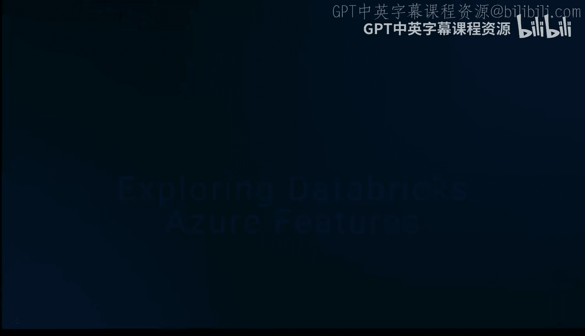
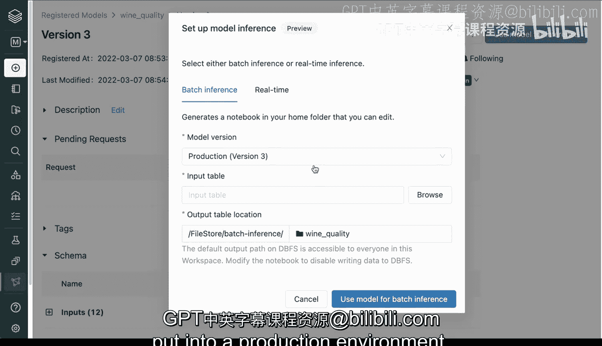

#  025：探索Databricks Azure功能

在本节课中，我们将要学习如何在Azure云计算平台上探索和使用Databricks平台的核心功能。我们将了解不同的工作模式、关键组件以及如何开始使用各项服务。

## 工作模式切换

首先，我们来看看Databricks平台与Azure云计算平台的集成界面。请注意，在界面的最上方，你可以在两种模式之间进行切换。

这是一个非常重要的考量点。**数据科学与工程模式**主要用于进行Notebook开发，其工作流程针对此类任务进行了优化。如果你选择此工作流程，从资源到搜索、数据再到计算的所有设置，都是为了让你能够快速启动计算资源并处理不一定与机器学习直接相关的任务。因此，默认的集群启动配置中不一定包含GPU。

如果你切换到**机器学习模式**，界面和功能会有所变化。你会注意到，系统会引导你使用其他类型的功能，包括AutoML、模型训练，以及查看**特征存储**等。所以，了解这两种不同的模式非常重要。

## 核心创建功能

现在，如果你想探索这里的一些功能，让我们开始深入了解。首先，你拥有“创建”这一核心概念。以下是你可以创建的主要资源类型：

*   **Notebook**：用于编写和运行代码。
*   **Table**：用于管理数据表。
*   **Cluster**：用于创建计算集群。
*   **Job**：用于安排和运行作业。
*   **Repo**：用于与GitHub集成。
*   **AutoML Experiment**：用于启动自动机器学习实验。
*   **Experiment**：用于管理机器学习实验。
*   **Model**：用于注册和管理模型。

根据你想要完成的任务，这里是很好的起点。

## 工作区与数据管理

正如我们之前讨论过的，**工作区**是你实际存放Notebook的地方。**Repo**则是你与GitHub进行代码版本控制集成的地方。

接下来，如果你向下滚动到**数据**部分，这里是你将数据上传到DBFS（Databricks文件系统）的地方。你也可以查询已集成的现有数据表。例如，对于这里的“diamonds”表，我可以查看其**模式**、**样本数据**，并对其执行一些操作。

需要注意的是，执行这些数据操作需要关联一个**计算集群**，以便系统能够查询数据并进行描述性统计分析。

## 计算集群配置

如果你想配置计算实例，这里有几个要点需要指出。如果我进入“计算”部分并选择“创建集群”，有一个需要注意的地方可能会让人感到意外：当你选择**Databricks运行时版本**时，需要了解有**标准模式**和**ML模式**之分。

如果你选择标准模式，一些机器学习库可能没有预装。如果你尝试运行一个示例Notebook，它们可能无法工作。如果你选择ML模式，请注意软件版本实际上略有不同。在许多情况下，你希望选择最新的ML版本（可能从非GPU版本开始以控制成本），然后在这里设置你的集群。

## 其他功能模块

最后，还有一些其他需要注意的功能。你可以访问**工作流**选项卡、**实验**选项卡、**特征存储**选项卡，甚至这里的**模型**选项卡，来查看已加载的不同模型。

当你进入并查看这里的模型时，你还可以深入查看详细信息，了解其状态，查看它是否已被部署到生产环境，甚至使用模型进行**推理预测**。

## 课程总结

本节课中，我们一起学习了如何在Azure Databricks平台上导航。我们了解了数据科学/工程模式与机器学习模式的区别，探索了创建各种资源（如Notebook、集群和作业）的入口，并熟悉了工作区、数据管理、计算集群配置以及其他高级功能（如工作流、实验和模型管理）的基本操作。掌握这些界面和功能是有效利用Databricks进行数据工程和机器学习项目的基础。