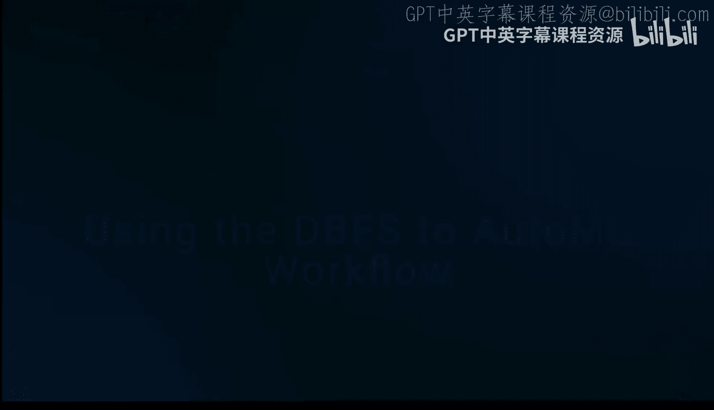
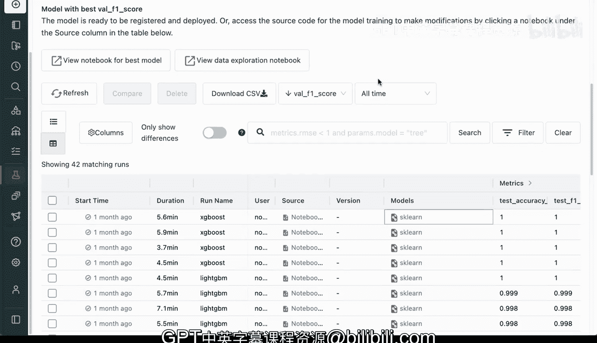

#  026：从DBFS到AutoML工作流



在本节课中，我们将学习如何将存储在Databricks文件系统（DBFS）中的数据，通过AutoML功能，快速构建一个高级的机器学习工作流。整个过程旨在让初学者也能轻松上手。

## 概述：从数据到模型

首先，我们需要理解起点和终点。我们的起点是存储在DBFS中的数据表。我们的终点是创建一个可以预测特定目标的机器学习模型。本节将演示如何利用Databricks的界面化工具，无需编写复杂代码，即可完成这一过程。

## 探索DBFS中的数据

上一节我们介绍了DBFS作为数据存储的位置。本节中，我们来看看如何探索其中的数据，并确定可用于机器学习模型的特征。

Databricks的数据探索工具能直观地展示数据。例如，打开“diamonds”表，工具会显示数据表的**schema**（结构）并提供数据样本。这有助于我们了解潜在的特征，如`carat`、`cut`、`color`等。

```python
# 示例：数据表可能包含的列
columns = ['carat', 'cut', 'color', 'clarity', 'depth', 'table', 'price', 'x', 'y', 'z']
```

同样，如果我们查看“people”表，可以看到其中包含`id`、`first_name`、`middle_name`、`last_name`、`gender`等列。基于这些数据，我们可以构建一个预测性别（`gender`）的分类模型。

## 配置AutoML实验

在了解了数据之后，下一步是配置一个AutoML实验来自动化模型构建过程。

首先，在Databricks界面中转到“Experiments”部分。创建一个新的AutoML实验时，需要进行几项关键配置：

以下是配置AutoML实验的主要步骤：
1.  **选择计算集群**：选择一个已设置好的集群。例如，一个拥有12个核心、运行DBR 11.0版本的集群。
2.  **选择问题类型**：由于我们的目标是预测性别，这是一个分类问题，因此选择“Classification”。
3.  **指定数据位置**：从数据目录中选择我们想要使用的数据集，本例中选择“people”数据库。系统会自动读取其**schema**并处理数据插补等问题。
4.  **设置预测目标**：在下拉菜单中选择我们想要预测的列，即“gender”。

完成这些设置后，系统会为我们创建一个实验。点击开始，AutoML便会自动进行数据预处理、模型训练和超参数调优。

## 分析与部署模型

实验运行完成后，我们可以查看所有训练运行的结果。系统会列出每次实验的详细信息。

例如，在实验历史中，可以看到每次运行的时间、使用的模型类型（如**scikit-learn**模型）、执行用户以及源代码笔记本。模型追踪系统在此发挥着重要作用。

```python
# 示例：模型追踪可能记录的信息
run_info = {
    'experiment_id': '123',
    'run_time': '2.5 minutes',
    'model_type': 'sklearn.ensemble.RandomForestClassifier',
    'accuracy': 0.95
}
```

如果对某个模型结果满意，可以直接将其选中并部署到生产环境。此外，Databricks还会自动生成两个非常有用的笔记本：
*   **最佳模型查看笔记本**：展示如何部署该最佳模型。
*   **最佳模型数据探索笔记本**：展示用于该模型的探索性数据分析代码。

这意味着，即使你后续打算完全自己编写代码，这个AutoML工作流也为你提供了绝佳的起点和参考。

## 总结：高效的工作流起点

本节课中，我们一起学习了如何在Databricks上构建一个从数据到模型的快速工作流。我们首先探索了DBFS中的数据表，然后通过配置AutoML实验自动构建了一个分类模型，最后分析了实验结果并了解了如何部署模型。



这个工作流的核心价值在于其简洁性：无论是将数据上传到DBFS，还是直接使用已有的数据，你都可以通过AutoML快速获得一个初步的、可投入生产的模型方案，作为你Databricks项目一个高效的开端。