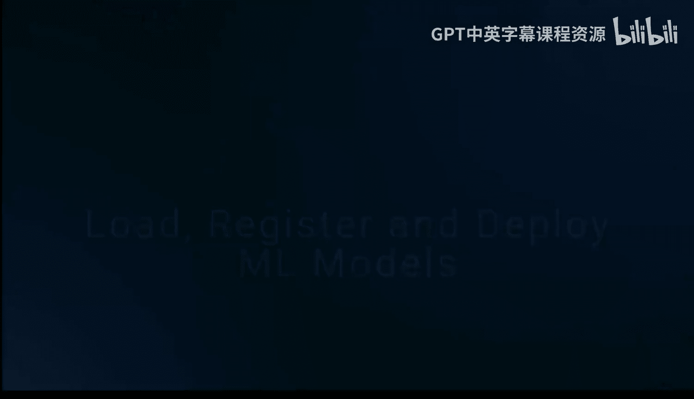
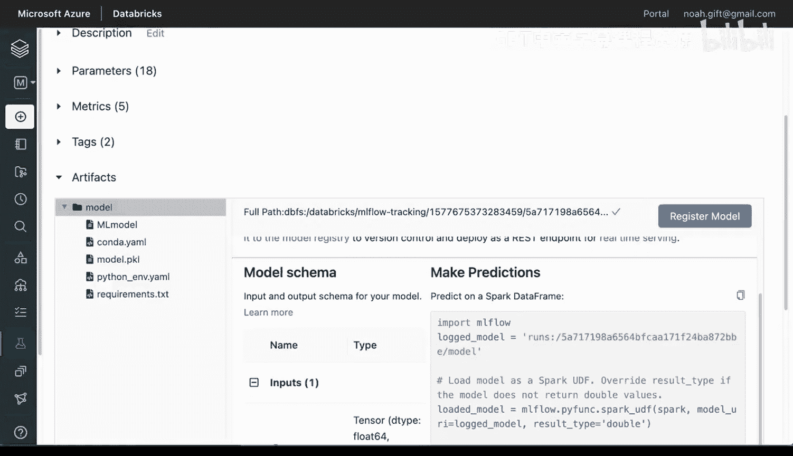
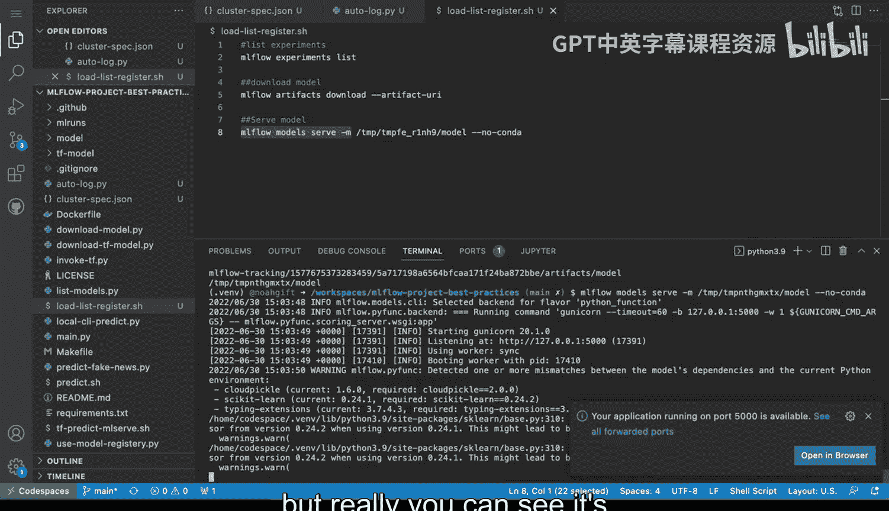

#  027：加载、注册和部署机器学习模型 🚀



在本节课中，我们将学习如何在Databricks平台上，对机器学习模型进行加载、注册和部署。我们将通过具体的API命令和用户界面操作，了解如何从本地或远程获取模型，并最终将其部署为可调用的服务。

---

上一节我们介绍了Databricks平台的基本概念，本节中我们来看看其核心功能之一：机器学习模型的管理与部署流程。

Databricks平台的一个强大特性是机器学习模型的**记录（Logging）**、**加载（Loading）**、**注册（Registering）**和**部署（Deploying）**。让我们通过几个例子来具体了解这个过程。

首先，我们可以使用API命令来操作模型。例如，以下代码展示了如何使用Python从本地加载一个模型：

```python
# 示例：使用Python加载本地模型
import mlflow
model = mlflow.pyfunc.load_model('path/to/local/model')
```

当然，模型也可以从一个Spark DataFrame中加载。除了使用代码，我们还可以通过Databricks的用户界面（UI）来交互式地管理模型。

---

接下来，让我们通过用户界面来查看一个具体的例子。在Databricks的“快速入门指南”中，我们可以找到一个已注册的模型。

进入模型页面后，你会注意到所有相关的**构件（Artifacts）**都已注册完成。页面还提供了进行预测的能力，并显示了一个非常重要的**路径（Path）**。这个路径非常强大，因为它允许我们远程与这个模型进行交互。



---

上一部分我们看到了如何在UI中定位模型，现在我们来具体看看“加载、列出、注册和服务”这个工作流。

首先，我们可能需要查看平台上所有的实验记录。我们可以运行以下命令来列出所有MLflow实验：

```bash
# 列出所有MLflow实验
mlflow experiments list
```

命令执行后，会显示一个实验列表。你可以通过Databricks界面找到关心的那个实验，进而定位到对应的模型UI。由于在本例中我们已经知道了模型UI，我们可以跳过查找步骤。

回到我们的例子，我们可以直接复制模型的存储路径。然后，通过以下命令来下载这个模型：

```bash
# 下载位于指定Databricks路径的模型
mlflow models download -i <model_uri> -d /local/target/path
```

这个命令会将整个模型包下载到本地。

---

模型下载完成后，最后一步就是部署服务。这个过程非常直接。

我们只需要使用`mlflow models serve`命令，并指定刚才下载的模型路径即可：

```bash
# 部署（服务）下载的模型
mlflow models serve -m /local/path/to/downloaded/model --no-conda
```

这个命令会启动一个本地服务，托管我们从Databricks下载的模型。服务启动后，如果你想进行API调用，可以使用`curl`命令，也可以使用Python的`requests`库等工具。

```bash
# 示例：使用curl调用模型API
curl -X POST http://127.0.0.1:5000/invocations -H 'Content-Type: application/json' -d '{"data": [[1,2,3]]}'
```

可以看到，与远程Databricks服务器上的模型进行交互，是一个非常直观和简单的过程。

---



本节课中我们一起学习了在Databricks上管理机器学习模型的完整流程。我们了解了如何通过API和UI来**加载**和**注册**模型，如何**下载**已注册的模型到本地，以及最后如何通过简单的命令将模型**部署**为一个可访问的API服务。这套流程使得团队协作和模型部署变得高效且标准化。