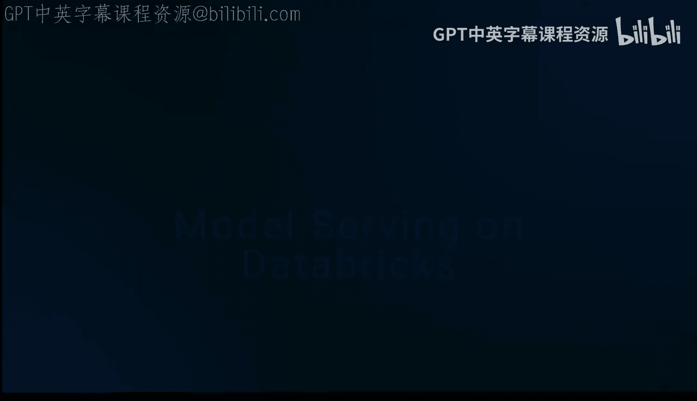
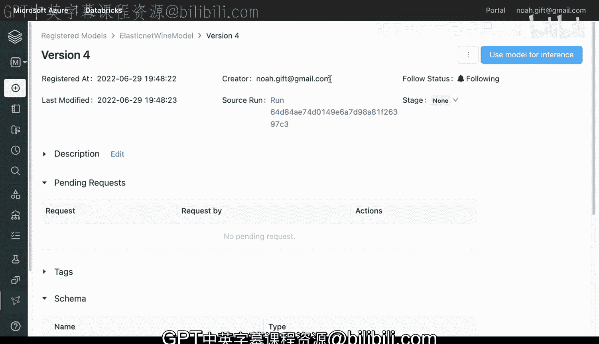

#  029：Databricks上的模型服务



在本节课中，我们将学习如何在Databricks平台上部署和提供机器学习模型服务。我们将涵盖从模型注册表中选择模型，到配置实时API或批量推理的完整流程。

## 模型注册表概览

上一节我们介绍了模型注册表的基本概念。本节中我们来看看如何实际使用注册表中的模型来提供服务。

在Databricks工作区中，你可以在“最近活动”中看到模型，也可以直接导航到专门的“模型”区域。

## 选择与部署模型

以下是部署模型的基本步骤：

1.  在模型列表中选择目标模型，例如“elasticastic wine model”。
2.  点击“使用此模型进行推理”的选项。

此时，你需要决定推理服务的类型。

## 配置推理服务类型

Databricks主要支持两种模型服务方式：批量推理和实时推理。

**批量推理**适用于周期性任务，例如每晚执行一次的信用风险评估。其核心操作是选择一个输入数据表进行一次性评分。
```python
# 概念性示例：批量推理处理
process_batch_inference(input_table='nightly_transactions')
```

**实时推理**则会启动一个REST API端点，能够接收即时请求并返回预测结果。选择此选项后，系统将自动配置和启动一个服务集群。

## 实时服务端点管理

当你启动实时端点后，界面会进入“等待中”状态，随后系统将启动计算资源。

在端点管理界面，你可以：
*   查看正在运行的模型版本。
*   监控相关事件，如端点更新、集群启动。
*   检查并配置后端集群的规格，例如可以选择基于GPU的推理实例以加速特定类型的模型。

此外，该界面的一个关键功能是允许你在不同模型版本之间切换。你可以选择部署历史版本中的任何一个。

## 调用服务端点

部署实时端点后，Databricks会提供详细的调用示例。

例如，你可以使用`curl`命令通过HTTP请求调用API：
```bash
curl -X POST -H "Authorization: Bearer <token>" -H "Content-Type: application/json" -d '{"dataframe_records": [<your_features>]}' https://<workspace>.cloud.databricks.com/model/<model_name>/<version>/invoke
```

同样，也提供了Python代码的调用方式：
```python
import requests
response = requests.post(api_url, headers=headers, json=data)
```

这实现了一个“点击即服务”的在线模型部署流程。

## 批量推理配置

如果回到模型选择界面并选择“批量推理”，操作同样直观。

核心步骤是选择一个输入表，系统将对该表数据执行一次性批量预测操作。这为ETL管道或定期报表任务提供了便利。

## 总结



本节课中我们一起学习了在Databricks上进行模型服务的全过程。我们了解了如何从模型注册表中选择模型，并根据需求配置实时REST API服务或批量推理任务。平台提供了清晰的管理界面和调用示例，使得模型部署变得简单直接。此外，这些服务既可以在Databricks云端运行，也支持在本地环境中执行。