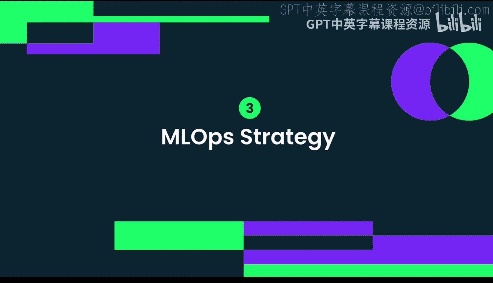
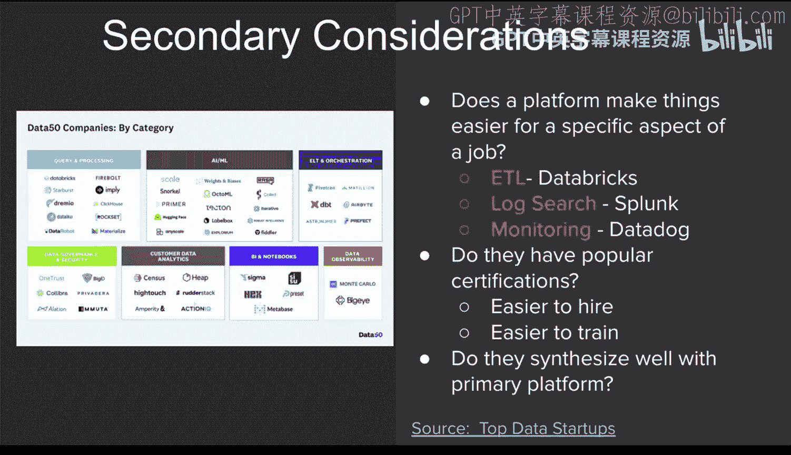
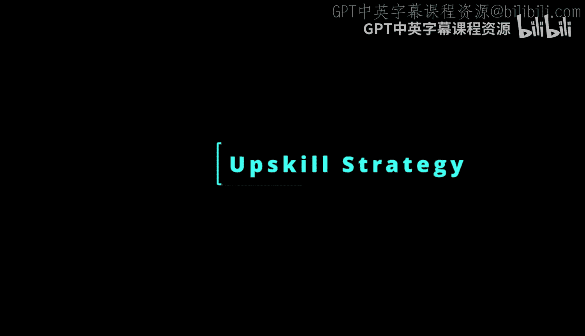
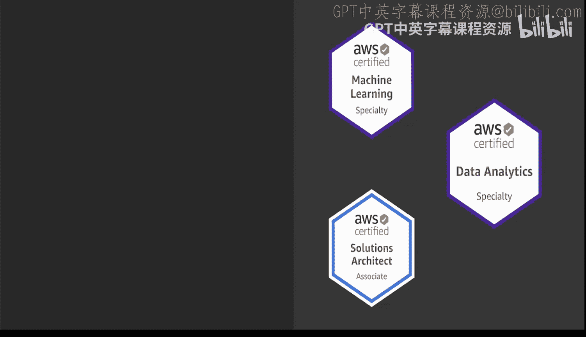
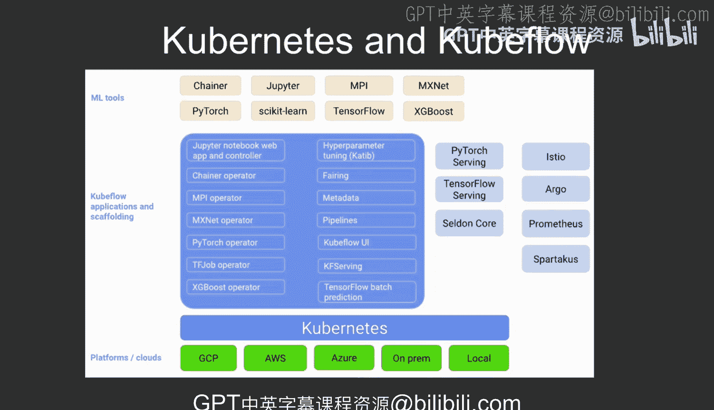

#  030：什么是MLOps 🚀

在本节课中，我们将要学习MLOps（机器学习运维）的核心概念、其必要性、关键组成部分以及实施策略。我们将探讨为什么需要MLOps，它与DevOps和数据Ops的关系，以及如何构建一个有效的MLOps平台。

---

## 动机与必要性

首先，我们需要考虑MLOps的动机。为什么需要MLOps？简而言之，MLOps是一种将模型操作化并投入生产环境以使其发挥价值的方法。

新冠疫情危机揭示了像MLOps这类解决方案的必要性。我们需要快速部署解决方案。此外，许多学术界人士或数据科学领域的新手难以将模型投入生产，这也是MLOps兴起的原因之一。市场上存在主要的MLOps平台，了解哪些平台有助于模型操作化非常重要。

---

## 行业趋势与背景

首先，让我们看看行业趋势。这确实很有启发性：《华尔街日报》在2020年10月16日报道，2020年云计算相关职位达到77.5万个，而2019年为40万个。观察LinkedIn可以发现，数据工程师和机器学习工程师的职位在增加，但云计算领域本身在招聘足够人才方面面临挑战。同时，数据科学职位数量在下降。这并不意味着数据科学不重要，而是意味着其他职位正成为进行数据科学工作的基础设施的一部分。

---

## DevOps与MLOps的关系

现在，我们来看看DevOps和MLOps究竟是什么。如果没有DevOps，就不可能实现MLOps，这是一种需求层次结构。当你观察DevOps生态系统时，它涉及自动化软件工程任务、自动化基础设施部署、构建持续集成和持续交付，这些都是强制性的。一旦拥有这些，你就可以在其上构建数据自动化系统，这些系统能够利用DevOps平台。接下来，你可以进行平台自动化，使用这些平台工具，最终达到能够进行模型操作化的阶段。其核心理念是建立在越来越复杂的自动化形式之上。

---

## 持续交付与MLOps

考虑MLOps中持续交付概念的一种方式是使用多分支部署代码的理念，例如部署到主分支、预演分支和生产分支。每个分支内部都有“基础设施即代码”。本质上，环境就是一段代码，可以自动部署，并利用了“改善”（Kaizen）的概念，即软件系统的自动改进。通过使用改善理念，你能够充分利用围绕统计过程的基础设施来改进事物，这一理念源于二战后的汽车工业，这就是“改善”（日语中意为持续改进）的概念。

---

## 数据操作（DataOps）

数据操作可以类比为房屋的水管连接。如果你的房子没有水，就无法使用洗碗机、洗衣机或水疗浴缸等高级工具。数据也是如此，你需要某种复杂的系统来收集数据，这可能是午夜运行的数据收集作业。你还需要引用诸如特征存储这样的工具，在那里存储数据的精炼方面。此外，你需要使用像无服务器数据工程工具这样的工具，这样你就不必在幕后做大量繁重的工作，这些工作由平台管理。像Spark和Databricks这样的大数据处理工具也是很好的例子。最后是模型版本控制，这是数据的网络方面，你能够将不同的模型存储在数据湖中，以便能够回溯时间并重新评估你所做的工作。这就是数据操作。

---

## 平台自动化

平台自动化是更高一级的层次。这是一个SageMaker项目架构的好例子。在数据科学工作流中，我们有数据摄取、探索性数据分析、建模和得出结论。观察整个架构，这并非你想独自完成的事情，因为它是一个巨大的分布式系统。相反，你想使用一个平台。平台让你能够启动可以自动扩展和缩减的训练系统，让你能够在对象存储系统或数据湖中对模型进行版本控制和训练。最后，当模型准备好部署时，你可以设置这些推理端点，它们可以弹性扩展和缩减，并且可以在不同模型版本之间切换。你真的不想自己处理这些，而是希望使用一个平台来编排这种自动化。

---

## MLOps的反馈循环

MLOps背后的反馈循环是“创建与重新训练”的概念。进行持续交付，审计流水线，并观察数据漂移等现象。这实际上是一个反馈循环，你不断评估训练好的模型，以确保它满足业务需求，并且当新数据进入系统时，其准确性仍然保持。

---

## 一次构建，多处部署

MLOps中另一个非常关键的概念是“一次构建，多处部署”或“一次创建，多处部署”。你为什么要多次构建同一种模型？实际上，你希望有一个系统能够利用完全相同的模型，以便它可以部署到不同的组件，如移动应用、Web应用或命令行工具。

---

## 25%法则

另一个我认为非常有趣的概念，我称之为“25%法则”。其核心理念是没有银弹。我认为学术界有很多关于以数据为中心还是以模型为中心的争论，但我会说这实际上是错误的论点。答案是，你需要所有这些方面。不幸的是，没有完美的解决方案。你需要自动化（即DevOps），需要数据自动化（即DataOps），需要模型自动化（即MLOps的概念），还需要理解业务方面，以便你能正确地定义问题，并且你的模型确实能达到业务需求，甚至能理解如何正确实施一个问题。例如，如果你去找一位放射科医生，并说我们要自动化你的工作，他们可能会告诉你，即使他们想自动化自己的工作，某些方面也有法律要求，需要人工参与。因此，“25%法则”的真正含义是，不要认为存在一个银弹，突然我们发现了一个可以切换的新二进制开关，然后MLOps就变得容易了。实际上，它并不容易。这是一种全面的方法，你需要平等地考虑这四个象限。

---

## MLOps的用例

现在，让我们深入探讨一些MLOps的用例。我认为一个经典的用例是自动驾驶汽车。我们看到这正在形成，一方面有很多进展，但也可能存在业务框架问题，也许一些汽车公司需要专注于一条新道路，而不是试图优化一些可能永远不会完全按照他们预期的方式工作的东西。因此，这也是一个非常有趣的伦理用例。从零开始的机器学习生产是另一个经典用例。你是一名学者，你想将模型投入生产，你该怎么做？应用计算机视觉是MLOps的另一个很好的用例，我们在各处都能看到。车牌识别就是一个好例子。与现实世界的可靠性需求相比，研究部门的概念是不同的。

---

## MLOps策略

既然我们对MLOps有了一些了解，现在让我们深入探讨MLOps策略。

首先，要再次意识到没有银弹。选择正确的技术合作伙伴非常重要，例如使用AWS SageMaker平台、Kubernetes或其他与你现有工作互补的关键解决方案。

---

## 主要与次要投资

另一个需要考虑的概念是主要投资和次要投资。就主要投资而言，这包括低成本、流行度、是否容易招聘人员、是否拥有全面的功能以及能否在其上构建抽象层。次要平台可能非常擅长解决某一特定问题，例如Databricks非常擅长Spark，Splunk非常擅长分析，Snowflake非常擅长大数据。一旦你拥有了这些组件，接下来需要考虑的是投资的概念。你是否专注于研发？你是否正在深入研究深度学习、Kubernetes、边缘计算等技术？你是否使用预训练模型？这些都是非常重要的考虑因素。

就主要考虑因素而言，一种方法是审视数据。如果我们从事数据科学，我们应该自己审视数据。就云计算而言，前两大参与者是AWS和Azure，分别占33%和21%。企业支持也是一个关键的考虑因素，行业标准认证、招聘能力、提升员工技能的能力，这些都是选择主要平台时非常重要的考虑因素。

---

## 次要考虑因素

就次要考虑因素而言，需要考虑的几点是：一个平台是否使工作的特定方面（如ETL，可能是Databricks；日志搜索，可能是Splunk；监控，可能是Datadog）变得更容易？它们是否有容易且流行的认证？因为这会使招聘变得更容易。它们是否与你的主要平台很好地集成？例如，是否有这些系统的第一方集成？

---

## 招聘与技能提升策略

招聘和技能提升策略需要考虑的另一点是：你是否在利用学习平台本身？你是否鼓励组织内的人员进行实践和自我意识？这样你就会知道自己知道什么，不知道什么。一个好的方法是设定年度和季度的学习目标。付费让人们学习，订阅像O‘Reilly或LinkedIn Learning这样的学习平台，这些都是在你组织中构建这种结构的很好的例子。

---

## 关键认证

对于MLOps，我会考虑的一些关键认证包括：AWS机器学习认证是一个很好的例子。AWS数据分析专业认证、解决方案架构师认证等。Snowflake、Databricks和Google Cloud的认证也很有趣。因此，在MLOps领域有一些非常好的行业标准认证。

---

## 未来趋势

现在，MLOps的未来趋势是什么？我认为有几个趋势相当有趣。一个是NFS Ops。你是否进行基于NFS的部署？例如，你使用GitHub，在GitHub内开发，与Cloud9协作，弹性文件系统作为单一事实来源，你可以与构建系统集成并自动部署代码，因为它们都有这个集中的事实来源。我认为我们看到越来越多这种基于文件系统的方法来进行机器学习操作，这是NFS Ops的重要组成部分。

Kubernetes和Kubeflow是另一个需要重点考虑的趋势，例如集成了ML工具的Kubeflow平台。同样，无论你认为什么是关键技术，这些都是MLOps正在出现的一些趋势。

---

## 总结

在本节课中，我们一起学习了MLOps的核心概念。我们探讨了其必要性，了解了它与DevOps和数据Ops的层次关系。我们讨论了持续交付、数据操作、平台自动化以及关键的反馈循环。我们还介绍了“一次构建，多处部署”的理念和“25%法则”。最后，我们审视了MLOps的用例、实施策略、关键认证以及未来趋势。MLOps是一个全面的方法，需要结合技术、数据和业务理解，才能成功地将机器学习模型投入生产并持续创造价值。