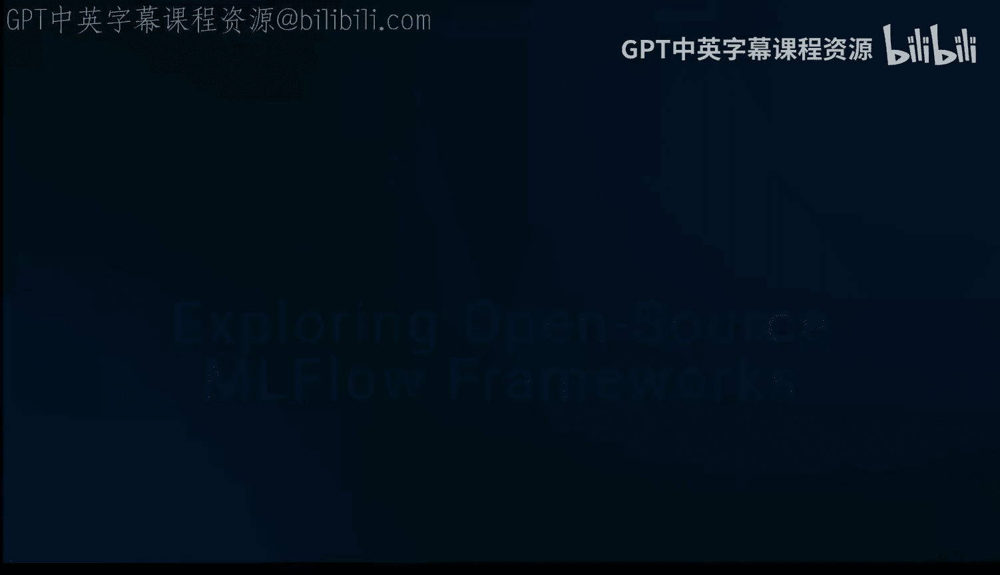
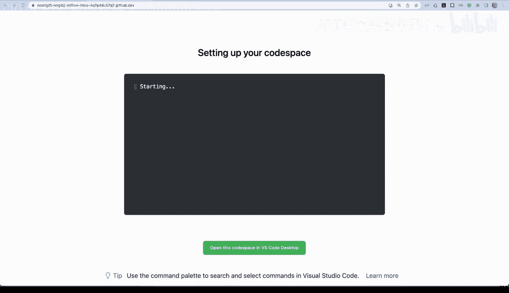
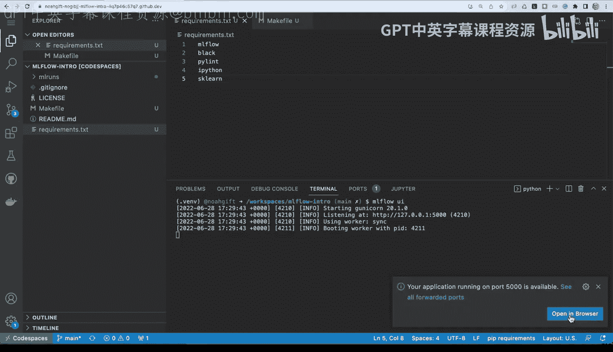
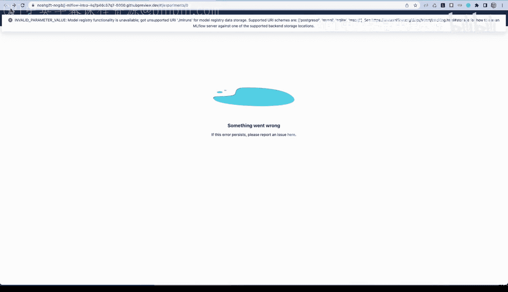
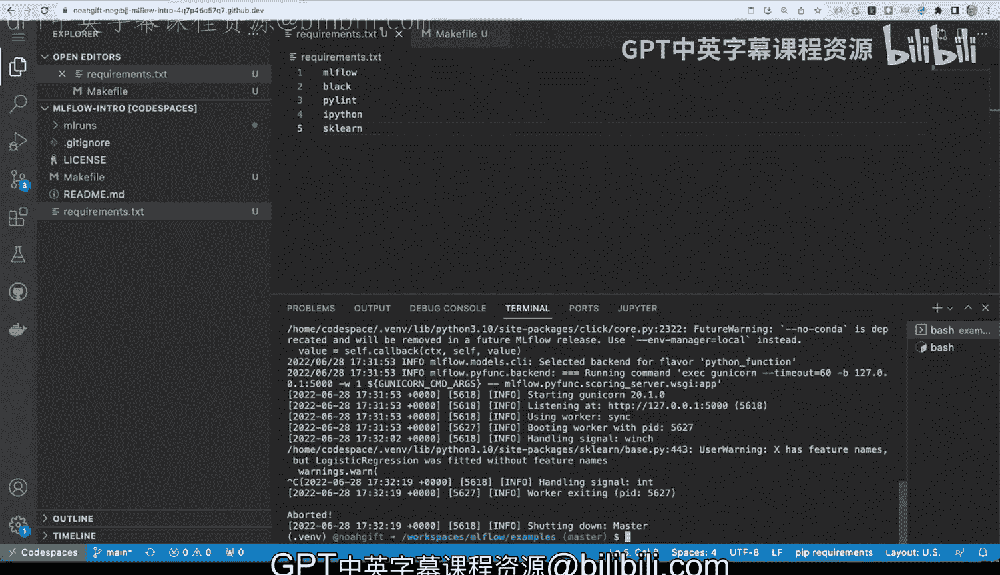

#  031：探索开源MLflow框架 🚀



在本节课中，我们将要学习MLflow，一个开源的模型追踪与版本控制系统。它最初由Databricks开发，但也可以独立使用。MLflow提供了一系列强大的功能，能帮助我们高效地管理机器学习生命周期。

## 概述

MLflow是一个用于管理端到端机器学习生命周期的开源平台。它主要包含四个组件：**追踪**、**项目**、**模型**和**模型注册表**。本节课我们将通过官方快速入门指南，实际操作并探索其核心功能。

## 安装与快速入门

首先，我们需要安装MLflow。这是使用它的第一步。

```bash
pip install mlflow
```

安装完成后，我们可以开始探索其功能。MLflow的官方仓库提供了丰富的示例代码，是学习的好起点。

## 探索追踪API与用户界面

上一节我们介绍了如何安装MLflow，本节中我们来看看它的核心功能之一：实验追踪。

MLflow的追踪API允许我们记录实验的指标、参数和输出文件（即“工件”）。例如，你可以记录模型训练的最后时间、使用的超参数等。

如果你想通过图形界面查看不同的模型运行记录和版本，只需启动MLflow UI。

```bash
mlflow ui
```

在Github Codespaces这类环境中，启动UI后通常可以直接在浏览器中预览界面，方便我们查看和管理实验。

## 运行MLflow项目示例

MLflow项目提供了一种可复现的方式打包和运行代码。以下是运行项目的方法。

你可以直接指向本地的一个子目录来运行项目。

```bash
mlflow run examples/ -P alpha=0.5
```

更酷的是，MLflow还支持直接指向一个Github仓库的URL来运行项目，这极大地增强了协作和复现的便利性。







```bash
mlflow run git@github.com:mlflow/mlflow-example.git -P alpha=0.5 --no-conda
```

请注意，如果你不想使用Conda作为包管理系统，可以在命令后添加 `--no-conda` 参数。

## 训练与部署模型

MLflow同样简化了模型的训练与服务化流程。我们可以训练一个模型，然后将其部署为一个可调用的API端点。

首先，我们使用一个示例脚本训练一个模型。训练完成后，MLflow会生成一个唯一的运行ID。

```bash
python train_model.py
```

接着，我们可以使用这个运行ID来部署（服务化）该模型。

```bash
mlflow models serve -m runs:/<RUN_ID>/model --no-conda -p 1234
```

模型服务启动后，我们可以在另一个终端中使用curl命令来调用这个API端点，以获取模型的预测结果。

```bash
curl -X POST -H "Content-Type:application/json" --data '{"data": [[1,2]]}' http://127.0.0.1:1234/invocations
```

## 总结



本节课中我们一起学习了MLflow框架的基础应用。我们从安装开始，逐步探索了其**追踪API**和**用户界面**，学习了如何运行本地及远程Github仓库中的**MLflow项目**，最后实践了模型的**训练**与**服务化部署**流程。MLflow提供了一套全面的工具，能有效管理机器学习项目的实验、代码和模型，是数据工程师和科学家提升工作效率的得力助手。