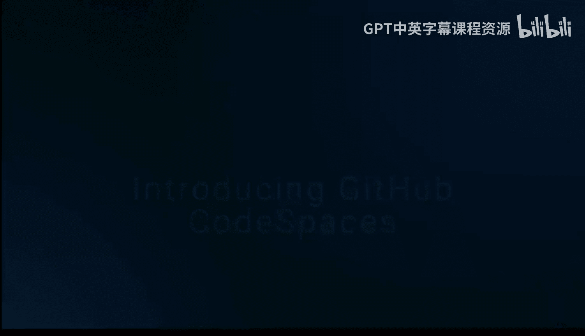
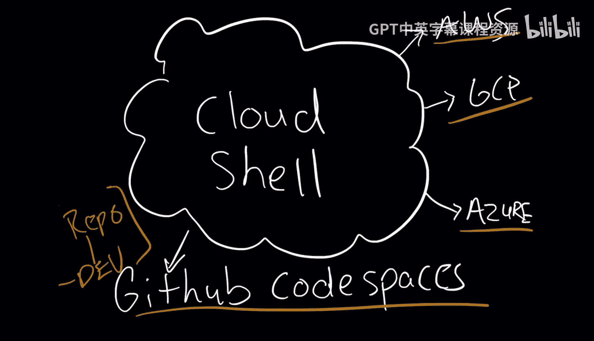
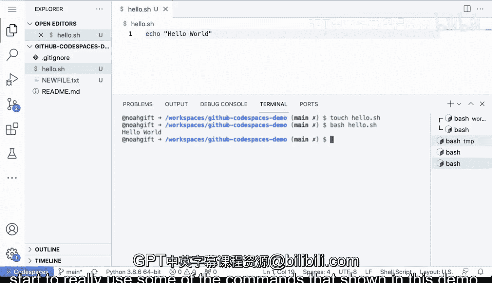

#  036：GitHub Codespaces简介 🚀

在本节课中，我们将学习如何使用GitHub Codespaces这一基于云的开发环境。我们将探索其核心功能，并演示如何利用它来高效地进行软件开发、数据工程和机器学习项目。通过本教程，你将学会如何在这个环境中导航、执行基本命令以及自定义你的工作空间。

---

## 云开发环境的优势

上一节我们介绍了云开发环境的概念，本节中我们来看看GitHub Codespaces的具体优势。

GitHub Codespaces提供了一个集成的云Shell环境。你可以直接与代码仓库交互，同时也能访问完整的开发环境。这是使用基于云环境的一个巨大优势。

*   与AWS类似，你可以访问其服务及开发环境。
*   与GCP类似，你可以访问其服务及开发环境。
*   与Azure类似，你可以访问其服务及开发环境。

这确实是软件开发的一种新范式。我们将直接进入GitHub Codespaces，并了解那些能让你高效工作的功能。

---

## 创建并进入Codespace

现在，我们进入GitHub。我将创建一个新的仓库。

我们将这个仓库命名为 `GitHub-Codespaces-Demo`，并注明这是一个演示项目。然后，我会选择添加一个README文件和一个.gitignore文件。我通常为我的.gitignore文件选择Python模板，这能帮助我们忽略一些不必要的文件。

接着，我们点击“创建仓库”。

完成这些后，使用GitHub环境的一个好处是，我可以在其中直接进行软件开发。这对于数据工程、软件工程和机器学习工程来说，都是一个基础组成部分。

请注意，如果我点击这里的“Code”按钮，我可以选择克隆到本地，或者克隆到云环境。但我们要做的是选择“Codespaces”。

注意这里的提示：“欢迎使用云编辑。你可以在不进行本地克隆和设置的情况下编辑、调试和运行你的仓库。”这确实是软件开发的未来。

如果你要学习Bash，这里可能是最好的学习场所之一。你可以像这样设置一个临时仓库，并真正开始在这个代码空间内构建项目。原因是，它已经为你开始编写代码所需的一切做好了准备。这对于软件工程师来说，是一个理想的场景，可以让你深入其中并开始实践。

---

## 探索终端与Linux命令

让我们逐步了解你可以在终端中做些什么，以及如何使用Linux。

首先，我喜欢输入这个命令：`uname -a`。这个命令能让我查看操作系统的信息。

执行后，我们可以看到类似 `Ubuntu 18.04` 的信息，以及系统创建时间等详细信息。

接下来，我喜欢运行 `ls` 命令。这是一种列出我仓库内内容的方式。请注意，如果我在这里输入 `pwd`，我们可以看到我当前位于 `/workspaces/GitHub-Codespaces-Demo` 目录下。`ls` 命令显示这里有一个README文件。

如果我想创建一个新文件，可以使用 `touch` 命令。例如：`touch new_file.txt`。

注意发生了什么：一个新文件出现在资源管理器中。如果我点击它，我可以编辑内容。例如，我可以输入“这真的很酷”并保存。

那么，如果我想从终端读取这个文件内容呢？有一个叫 `cat` 的命令。如果我输入 `cat` 然后按Tab键，它会自动补全文件名，然后让我查看该文件的内容。

对于初学者来说，这是一个非常常见的工作流程：
*   你想知道你的操作系统是什么，所以使用 `uname`。
*   你想查看周围有什么，所以使用 `ls`，这就像打开房间的灯。
*   你想创建一个新文件，所以使用 `touch` 命令。

请注意，如果我再次运行 `touch new_file.txt` 命令，什么也不会发生。我可以反复运行它，为什么没有变化？因为这个命令是**幂等**的。这意味着无论你运行多少次，它都会产生相同的效果：如果文件不存在，它会创建它；如果文件已存在，它什么都不做。Linux的很多工具都采用这种风格，为你提供这些实用的小功能。

---

## 导航与路径操作

我们还需要知道些什么呢？如果我们输入 `pwd`，它会显示我们所在位置的完整路径。

现在，如果我想输入 `cd` 命令，我可以转到另一个位置。让我们进入临时目录：`cd /tmp`。

然后输入 `pwd`，注意它显示 `/tmp`。如果我想转到硬盘的根目录，我可以输入 `cd /`，再输入 `pwd`，它显示我在硬盘的根目录。

现在，如果我想回到工作空间 `/workspaces`，我们可以在这里看到路径。如果觉得有点难读，在GitHub Codespaces中，我可以点击“View”菜单，进入“Appearance”，然后调整一些显示设置，比如布局。这是很常见的操作。

---

## 自定义开发环境

另一件你可以做的事是配置你的终端，例如设置不同的快捷键绑定，或者为不同的语言进行自定义。

同样，在这个基于云的环境中，你拥有资源管理器，我可以切换它的开关。我也可以搜索文件，这非常方便。我可以调试代码，可以处理我的源代码控制（这里有一个我更改过的新文件）。我还可以与插件交互。

例如，如果我想找一个Bash相关的插件，这里有一个“Bash Beautifier”。我也可以使用其他环境，或者在这里调整设置，添加不同的命令面板。

简而言之，主要收获是：通过使用基于云的开发环境，我确实可以在这里做任何我想做的事情。

需要指出的几点是：我们目前在这个Bash工作空间内。但如果我想分割终端呢？我可以让终端并排显示，这是人们常做的事。

现在，如果我想打开另一个终端，我也可以再打开一个。注意这两个是连接在一起的，但我也可以在这里创建新标签页。

稍后我们会深入一点的是，编辑你的环境可能会很有帮助。注意我们的环境里有很多花哨的配置。如果我想稍微调整和改变一些东西呢？我可以进入我的 `~/.bashrc` 文件，然后编辑提示符。人们就是通过编辑他们的 `~/.bashrc` 文件来做这些设置的。你现在看到的所有这些东西实际上都已经设置好了。

---

## 创建和使用别名

另一件很方便的事情是，注意它已经设置了一些别名。让我们创建一个新的别名。我们将它命名为 `temp_top`，它的作用是切换到 `/tmp` 目录。

我将这样写：`alias temp_top=‘cd /tmp’`。在我做的很多项目中，我都会创建这样的别名，它们就像快捷方式或书签。

为了加载这个别名，我可以要么打开一个新的Shell（让我们先试试这个），然后输入 `alias` 命令，`temp_top` 就会出现。

或者，我可以回到之前的某个Shell，然后执行 `source ~/.bashrc`。这基本上是告诉你的环境重新加载配置。如果我再次输入 `alias`，我们可以看到它现在已经加载到这个环境里了。

现在，如果我想使用它，我只需输入 `temp_top`。看，它在我的环境中生效了。

---

## 编写并运行Bash脚本

因此，我强烈推荐使用基于云的开发环境，比如GitHub Codespaces或AWS Cloud Shell。总的来说，这能让你亲身体验使用Bash工作，并且你可以开始配置环境。这些都是可丢弃的环境，你不必担心弄坏任何东西，一切都为你设置好了。

事实上，与传统开发方式相比，我们还可以在这里创建一个“Hello World”脚本。让我们创建一个名为 `hello.sh` 的文件：`touch hello.sh`。

然后，我可以在里面输入：`echo “Hello World”`。这样，我们的Bash脚本就准备好了。

我该如何运行它呢？我只需输入：`bash hello.sh`。看，“Hello World”打印出来了。

---

## 总结 🎯

本节课中，我们一起学习了GitHub Codespaces这一强大的云开发环境。我们了解了其核心优势，创建并进入了一个Codespace，探索了基本的Linux终端命令（如 `uname`, `ls`, `pwd`, `cd`, `touch`, `cat`），学习了如何导航文件系统、自定义工作环境、创建实用的命令别名，并最终编写和运行了一个简单的Bash脚本。

通过使用这种即用型、可配置且无需担心本地设置的云环境，你可以更快速、更安全地开始你的软件开发、数据工程或机器学习项目。现在，你可以自己尝试使用Codespaces，并开始运用我们在本演示中展示的一些命令了。