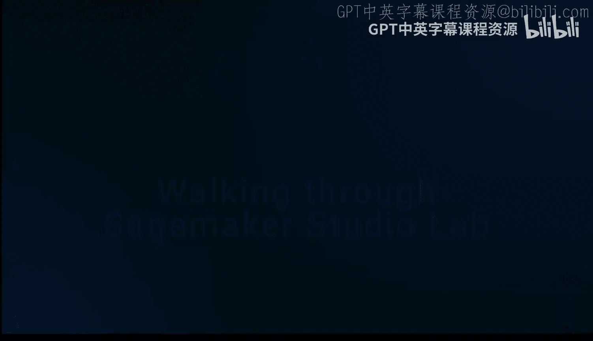
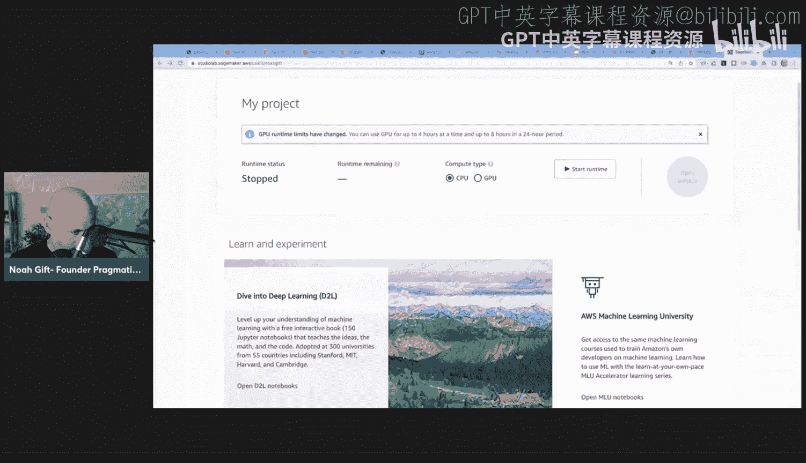
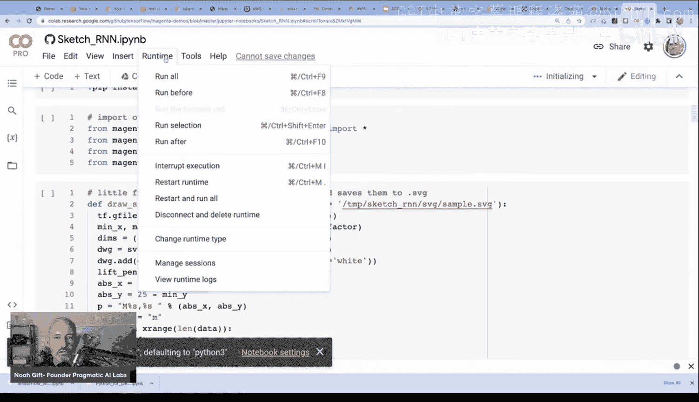
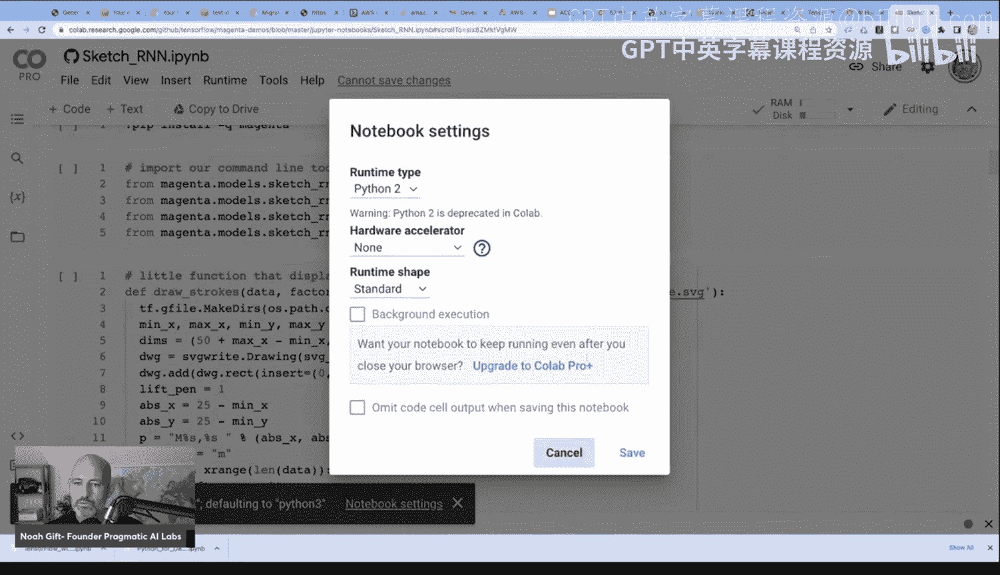
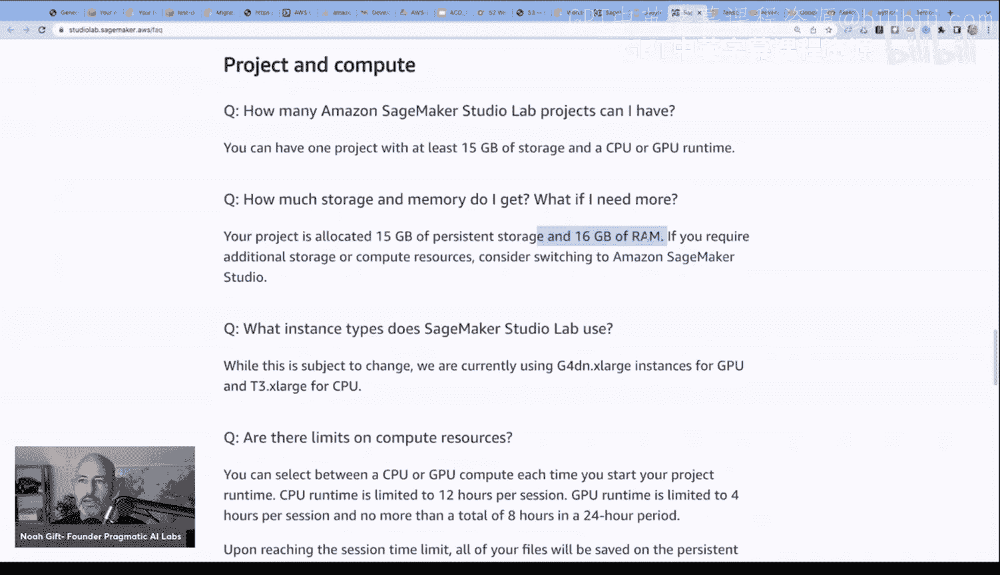
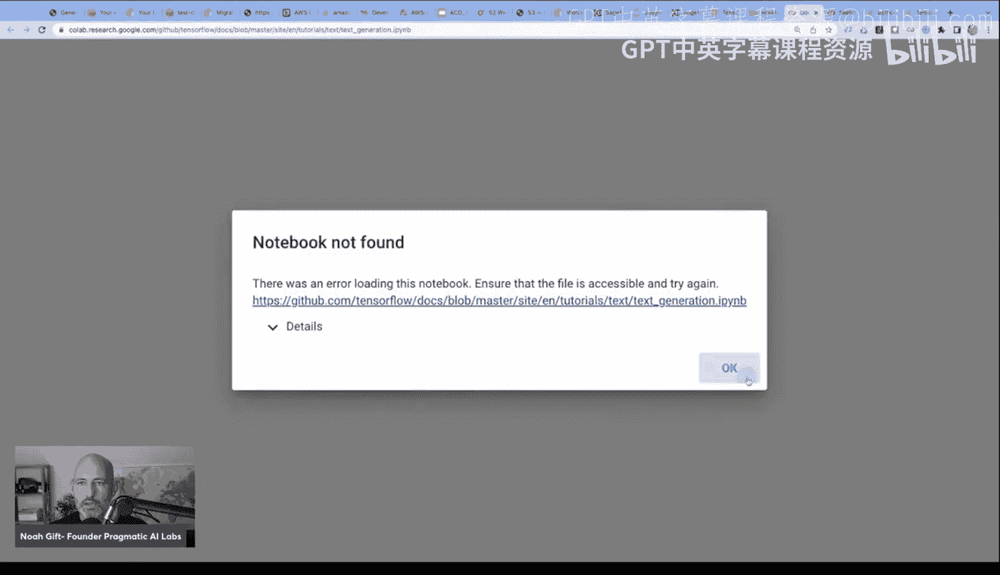
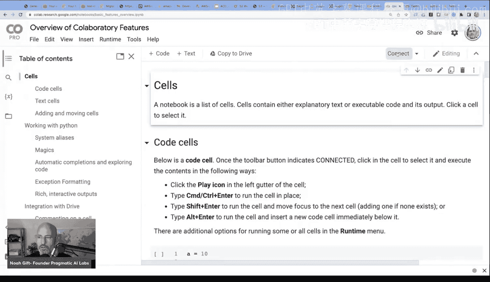
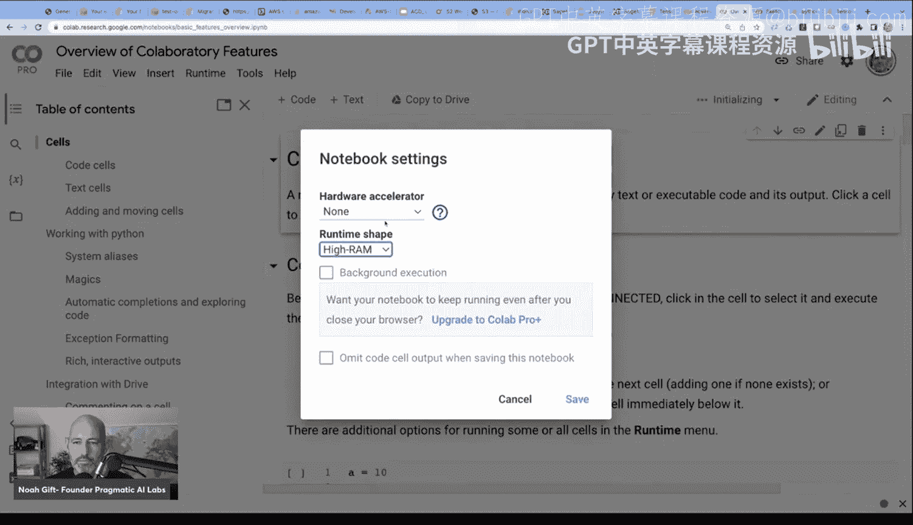
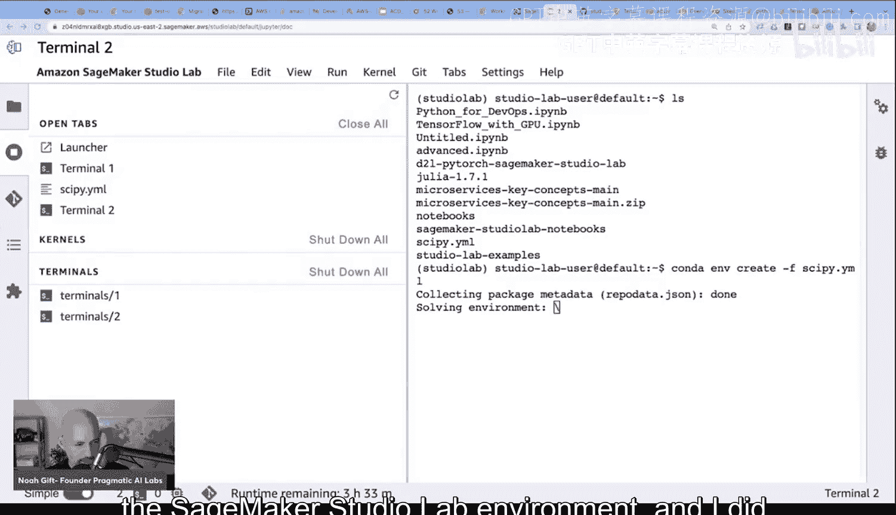

#  038：SageMaker Studio Lab实践指南 🧪

在本节课中，我们将系统地探索AWS SageMaker Studio Lab的功能。这是一个免费的云端机器学习开发环境，我们将了解其界面、核心功能、与Google Colab的异同，以及如何上传项目、使用GPU和自定义环境。

---

## 界面概览与基本操作 🖥️

上一节我们介绍了课程背景，本节中我们来看看SageMaker Studio Lab的默认界面。界面左侧是文件浏览器，右侧是主工作区。顶部菜单栏提供了文件、编辑、运行等选项。

以下是界面中的几个关键区域：
*   **文件浏览器**：用于管理项目文件，支持上传、下载和创建文件夹。
*   **启动器**：用于创建新的笔记本、终端或文本文件。
*   **属性检查器/变量窗口**：用于调试时查看变量、调用堆栈和断点。

## 上传与运行外部笔记本 📤

了解了基本界面后，我们来看看如何导入并运行现有的Jupyter Notebook。这个功能对于复用代码和项目至关重要。

操作步骤如下：
1.  在文件浏览器中点击“上传”按钮。
2.  从本地计算机选择已下载的 `.ipynb` 格式的Notebook文件。
3.  上传完成后，在文件列表中点击该Notebook即可在右侧工作区打开。
4.  可以逐单元格或一次性运行所有代码。

## 测试GPU加速能力 ⚡

上传Notebook后，我们自然想测试环境的计算能力，特别是GPU。SageMaker Studio Lab为免费用户提供了有限的GPU使用时长。

以下是测试GPU性能的一个示例流程：
1.  从Google Colab等平台找到一个利用GPU的示例Notebook（例如，比较TensorFlow在CPU和GPU上训练卷积神经网络的速度）。
2.  将其下载并上传到Studio Lab。
3.  在Notebook中，可能需要先安装必要的库，例如使用 `!pip install tensorflow`。
4.  运行比较代码。典型结果可能显示GPU相比CPU有显著的加速效果（例如21倍）。

**注意**：免费账户的GPU资源有使用时间限制，界面会显示剩余时间。

## 探索更多功能与限制 🔍

测试了核心的笔记本和GPU功能后，我们再来探索Studio Lab的其他功能，并了解其可能存在的限制。

Studio Lab还提供以下功能：
*   **集成终端**：可以打开Linux终端，执行Shell命令，管理环境。
*   **Git集成**：支持克隆代码仓库，方便版本控制。
*   **环境设置**：可以导出Notebook为多种格式（HTML、PDF等），并调整编辑器设置。
*   **自定义内核**：支持通过Conda环境文件（`environment.yml`）创建包含特定依赖包的自定义Python环境。

**潜在限制**：
*   **内存限制**：在处理大型数据集或模型时，可能会遇到内存不足的错误。例如，尝试加载过大的批处理数据可能导致失败。
*   **AWS凭证**：终端默认未配置AWS凭证，如需与S3等服务交互，需自行配置。
*   **资源配额**：每个项目有固定的存储空间（如15GB）和内存上限。

## 与Google Colab Pro的对比 🤔

在探索了各项功能后，我们可以将SageMaker Studio Lab与另一个流行的免费工具Google Colab进行简单对比。

主要对比点如下：
*   **核心优势**：Studio Lab提供**持久的项目存储**，关闭运行时后文件不会丢失，而Colab（免费版）的临时文件需要手动保存到云端硬盘。
*   **GPU资源**：两者都为免费用户提供有限时长的GPU。Studio Lab基于AWS的G4dn实例（搭载NVIDIA T4 GPU）。
*   **内存**：Colab Pro提供更大的RAM（如25GB），而Studio Lab免费版可能较少。
*   **生态集成**：Studio Lab更易于与AWS生态系统（如SageMaker完整服务）未来进行衔接。

从成本角度看，Studio Lab提供的免费GPU实例具有相当高的价值。

## 环境自定义与高级用法 ⚙️

最后，对于希望深度定制开发环境的用户，Studio Lab支持创建自定义的Conda环境。

创建自定义环境的基本步骤是：
1.  准备一个 `environment.yml` 文件，其中定义了所需的Python版本和依赖包。
2.  在Studio Lab的终端中，使用命令 `conda env create -f environment.yml` 来创建环境。
3.  创建完成后，新的内核选项会出现在Notebook的启动器中。

这允许你为不同的项目创建隔离的、可复现的软件环境。

---

本节课中我们一起学习了SageMaker Studio Lab的核心功能。我们实践了如何上传和运行Notebook，测试了其GPU加速能力，探索了终端、Git集成等附加功能，并将其与Google Colab进行了对比。最后，我们还了解了如何通过Conda环境文件来自定义项目环境。对于学生和机器学习初学者而言，这是一个强大且免费的实验平台。