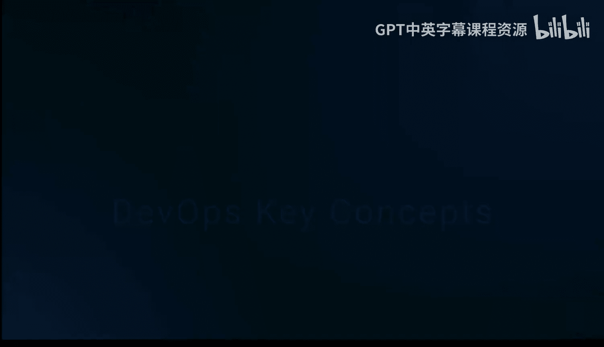
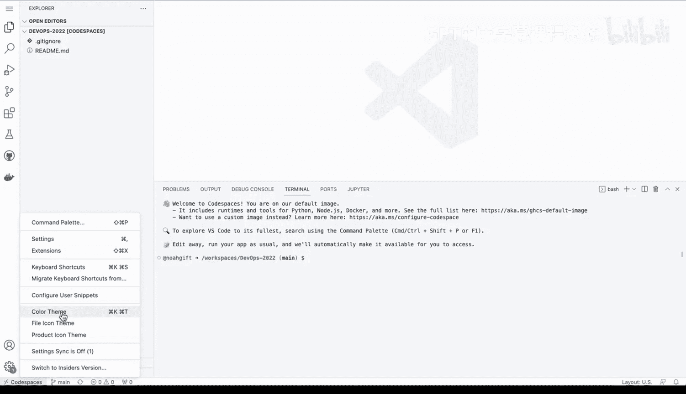
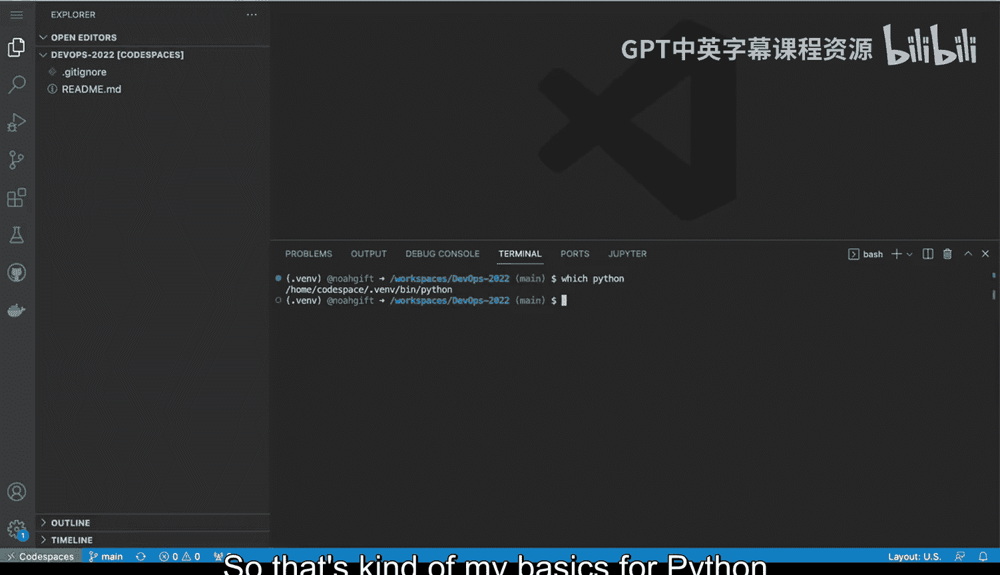
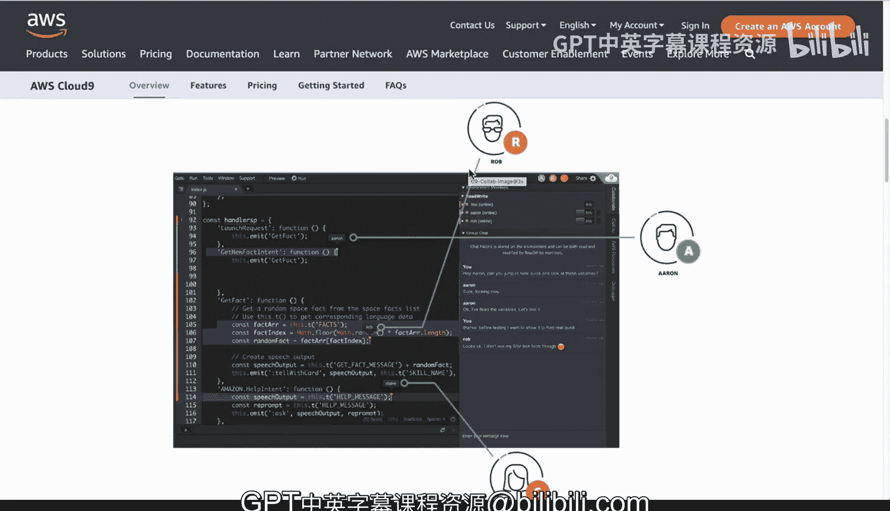

#  041：DevOps关键概念 🚀



在本节课中，我们将深入探讨DevOps的核心概念。我们将了解什么是DevOps、为什么需要它，以及如何将其核心原则应用到实际工作中。课程内容基于行业专家的著作和实践经验，旨在为初学者提供一个清晰、实用的理解框架。

---

## 什么是DevOps？🤔

上一节我们介绍了数据工程的宏观背景，本节中我们来看看DevOps的具体定义。DevOps并非单一工具或职位，而是一种融合了文化、实践和自动化的方法论。

以下是《Python for DevOps》一书中对DevOps的几点核心总结：

*   **双向协作**：DevOps的核心是促进软件开发（Dev）与运维（Ops）团队之间的深度协作与沟通。未来的趋势是这两个角色的融合。
*   **快速交付**：运维任务的周转时间应从“数天至数周”缩短到“数分钟至数小时”。能否在几分钟内完成软件部署，是衡量一个组织是否实践DevOps的关键指标之一。
*   **开发者深度参与**：开发者需要具备运维技能，其责任不应止于编写代码，而应延伸至系统的部署与监控。DevOps是每个人的职责，而非某个特定团队的工作。
*   **运维人员编程能力**：运维人员需要掌握如Bash或Python等脚本语言，以提高团队整体生产力。
*   **自动化一切**：自动化是DevOps的心脏。基础设施、持续集成、持续交付、监控、自动扩缩容等所有环节都必须实现自动化。没有全流程的自动化，就不是真正的DevOps。
*   **开发者自助服务**：通过“基础设施即代码”和持续交付流水线，开发者应能自助完成部署（至少到预发布环境），确保代码始终处于可部署状态。
*   **持续协作**：这是一个贯穿始终的概念。开发、运维、QA、产品经理等所有角色需要持续协作，共同关注部署状态和问题反馈。
*   **流程高于层级**：应避免“河马驱动开发”（Highest Paid Person‘s Opinion），即避免让高层级的个人意见随意打乱既定流程，这会导致混乱。
*   **微服务架构**：业界趋势是采用微服务架构，这与AWS等云厂商倡导的DevOps理念一致。持续交付系统是其灵魂。
*   **拒绝超级英雄**：依赖个别“超级英雄”加班完成神奇工作的文化是有害的。DevOps强调可重复、可持续的团队流程，而非个人英雄主义。

---

## DevOps与MLOps的紧密联系 🔗

在了解了DevOps的基本定义后，我们来看看它在热门领域的具体体现。MLOps（机器学习运维）是目前最受关注的领域之一。

其根本在于，**MLOps的根基是DevOps**。如果无法持续部署软件，就不可能持续部署机器学习模型。许多来自学术界的数据科学家可能缺乏DevOps经验，这使得同时掌握DevOps和数据分析技能的人才极具价值。

---

## DevOps的起源与核心方法 📜

接下来，我们追溯DevOps的思想源头，并学习一个强大的问题分析方法。DevOps的起源可追溯至日本汽车工业的“改善”文化，其核心是 **PDCA循环**：

1.  **计划**：识别问题，制定计划。
2.  **执行**：实施解决方案。
3.  **检查**：评估结果，分析数据。
4.  **处理**：根据检查结果采取行动，标准化成功经验或开始新的循环。

这是所有持续改进系统的核心，也是DevOps的运作精髓。

另一个至关重要的技能是 **“5个为什么”分析法**，它同样是持续改进文化的一部分。该方法通过连续追问“为什么”来探究问题的根本原因。

以下是一个真实案例的简化演示：
1.  **问**：为什么服务器会崩溃？**答**：因为内存不足。
2.  **问**：为什么内存不足？**答**：因为一个Java应用被分配了超过物理机总量的内存。
3.  **问**：为什么分配会超量？**答**：因为配置错误。
4.  **问**：为什么配置错误没被发现？**答**：因为服务器使用临时存储且无交换分区，崩溃日志未保存。
5.  **问**：为什么使用这种高风险配置？**答**：因为一位已离职的专家曾建议“顶级公司都这么做”，且成本更低。

通过五层追问，找到了配置错误和日志缺失这两个根本原因，而非停留在“服务器崩溃”的表面现象。

---

## DevOps最佳实践 🛠️

掌握了核心理念后，我们来看看支撑这些理念的具体技术实践。DevOps的最佳实践围绕几个关键环节构建。

### 持续集成

持续集成是基石。你需要一个构建系统，在代码合并时自动触发构建和测试，确保团队仓库中的代码始终处于健康状态。

```bash
# 示例：一个简单的CI流水线可能包含的步骤
git commit -m "新增功能"
git push origin main  # 推送触发CI
# CI服务器自动运行：代码检查 -> 单元测试 -> 构建打包
```

### 持续交付与基础设施即代码

持续交付将自动化延伸到部署环节。结合“基础设施即代码”，部署变得可重复且幂等。

*   **幂等性**：无论执行多少次，基础设施代码都能使系统达到相同的目标状态。首次运行创建资源，后续运行仅做必要变更或保持不变。
*   **优势**：实现了环境的一致性，并使得创建和销毁临时环境（如用于测试）变得轻而易举。

### 监控与日志

监控和日志记录是必须的，可以将其视为“软件系统的数据科学”。收集指标、日志，并将其可视化，通过统计分析（如识别响应时间异常）来发现问题。

### 安全性与自动化

在现代复杂系统中，只有通过自动化才能实现持续的安全保障。自动化部署可以确保安全策略（如防火墙规则、数据加密、最小权限原则）被一致地应用和维护。

---

## DevOps实战场景与应用 🚀

理论需要结合实际，下面我们看两个典型的DevOps应用场景。

### 场景一：静态网站持续交付

这是一个经典的例子，展示了从代码提交到全球部署的完整自动化流程：
1.  使用Hugo等工具编写静态网站源码。
2.  代码推送到GitHub。
3.  触发CI/CD流水线，自动构建网站。
4.  基础设施代码将构建产物同步至AWS S3存储桶。
5.  自动通过CDN（如CloudFront）分发，并配置DNS（如Route 53）。
6.  最终获得一个具备全球扩展能力的网站。

### 场景二：容器化DevOps

容器化是当前及未来的主流方向。它将应用运行时与代码打包，确保了环境的一致性和部署的简易性。

流程简述：
1.  代码、Dockerfile和基础设施代码一同存放在Git仓库。
2.  推送代码触发构建。
3.  构建系统编译镜像并推送至容器仓库（如Amazon ECR）。
4.  云环境自动拉取新镜像并完成部署。

---

## 提升组织效能的思考 💡

在课程的最后，我们思考如何将这些概念应用于提升团队效率。避免“重新发明轮子”和“超级英雄”模式。定制化、复杂的解决方案可能短期内效果显著，但会带来长期的维护负担和知识孤岛风险。采用标准化、可自动化维护的解决方案通常更具可持续性。


---

## 开发环境演进：云端开发 🌩️

一个重要的趋势是使用云端开发环境（如GitHub Codespaces或AWS Cloud9）。这允许开发者在与生产环境高度一致的环境中编写代码，避免了“在我机器上没问题”的困境，并简化了依赖管理和环境配置，是实践DevOps文化的有力助推器。

例如，在GitHub Codespaces中，你可以快速获得一个预装Python、Docker等工具的环境，并轻松配置虚拟环境：

```bash
# 创建虚拟环境
python -m venv ~/.venv
# 在 ~/.bashrc 中配置自动激活
echo ‘source ~/.venv/bin/activate’ >> ~/.bashrc
source ~/.bashrc
```



---

## 总结 📝





本节课中我们一起学习了DevOps的关键概念。我们了解到DevOps是一种强调**开发与运维协作、全流程自动化、持续交付与改进**的文化与实践体系。其核心在于通过**持续集成/持续交付流水线、基础设施即代码、全面监控**以及**基于云的协作环境**等工具与方法，实现软件交付的快速、可靠与安全。记住，DevOps的成功依赖于团队协作和流程优化，而非个人英雄主义。掌握这些原则，将为你从事现代数据工程和软件开发奠定坚实的基础。