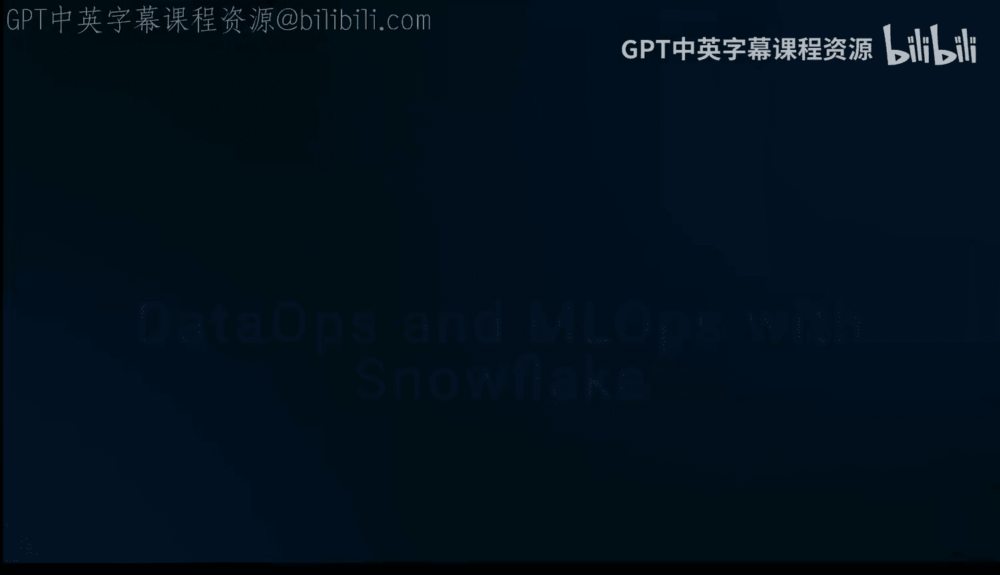
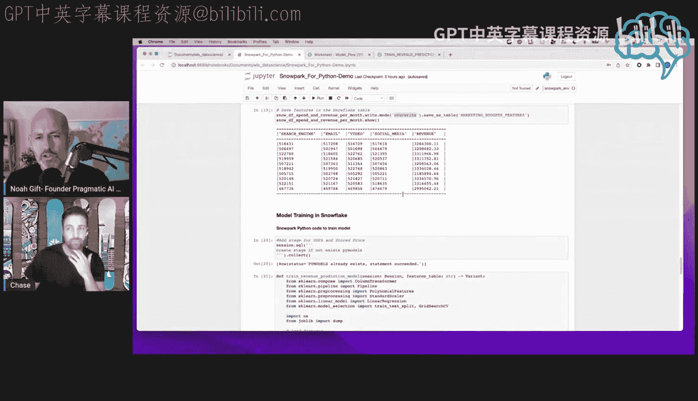

#  048：使用Snowflake实现DataOps与MLOps



在本节课中，我们将跟随Snowflake的解决方案架构师Chase Rao，学习如何利用Snowflake平台实现端到端的机器学习工作流。我们将了解Snowflake的核心概念，并通过一个线性回归案例，演示如何在不将数据移出Snowflake的情况下，完成数据加载、特征工程、模型训练、部署和自动化预测。

## 概述：什么是Snowflake？❄️

Snowflake是一个云原生的数据平台，可以理解为集数据仓库与数据湖功能于一体的“数据湖仓”。它解决了传统架构中数据孤岛、计算资源弹性伸缩和成本控制等问题。Snowflake运行在AWS、Azure和GCP等云服务上，支持多租户和弹性计算，用户只需为实际使用的计算资源（以“积分”计费）付费。

对于初学者和教学场景，Snowflake提供了非常友好的入门途径：
*   **免费试用**：任何人都可获得30天试用账户及400积分。
*   **学生优惠**：凭教育邮箱可申请长达120天的试用。
*   **学习资源**：通过Snowflake University和丰富的在线材料（如GitHub代码库）可以系统学习。

## Snowflake核心概念与优势 🏗️

上一节我们介绍了Snowflake的基本定位，本节中我们来看看它的一些核心特性和优势。

### 弹性数据仓库与积分计费

Snowflake的计算单元称为“虚拟仓库”。其核心优势在于**弹性**：你可以根据工作负载动态调整仓库规模（从X-Small到6X-Large）和集群数量。这种设计带来了两大好处：
1.  **性能与成本优化**：仅在需要时使用大规模计算，任务完成后自动缩容，避免资源浪费。
2.  **按需付费**：计费基于“积分”，你只需为仓库运行的时间付费。例如，一个X-Small仓库运行1小时消耗1积分。

### 多层缓存机制

Snowflake的缓存机制能显著提升查询速度并降低成本：
*   **元数据缓存**：对于完全相同的查询，如果在24小时内再次运行，且底层数据未变，系统会直接返回缓存结果，**不产生计算费用**。
*   **仓库缓存**：在同一仓库未关闭期间，重复查询可能利用缓存，实现亚秒级响应。
这对于需要频繁刷新的仪表板场景尤其有利，可以预先运行查询，使全天的访问都享受缓存带来的极速体验。

### 数据共享与市场

获取高质量数据是数据科学项目的一大挑战。Snowflake的“数据市场”功能完美解决了这个问题：
*   数据提供者可以创建“数据共享”，在几分钟内将数据安全地分享给其他Snowflake用户。
*   用户可以在数据市场中探索并免费获取许多公司的数据集，这些数据会以“共享数据库”的形式出现在你的账户中，查询时才产生费用。
*   你甚至可以向非Snowflake用户提供“读取者账户”来共享数据。

### 认证路径

对于希望专注于Snowflake平台的MLOps专家，有一个清晰的认证路径：
1.  **SnowPro核心认证**：考察Snowflake基础知识。
2.  **高级架构师认证**：深入掌握架构设计。
3.  **专业认证**：如**数据科学家认证**，涵盖机器学习等专项技能。
建议从基础认证开始，逐步深入。

## 实战：在Snowflake中构建端到端ML管道 🚀

了解了Snowflake的基础后，我们进入实战环节。本节将演示一个完整的机器学习项目：预测广告渠道的营收。我们将使用Snowpark for Python，确保所有数据和计算都保持在Snowflake平台内，保障安全性与一致性。

### 环境设置与数据准备

首先，我们需要建立与Snowflake的连接并准备数据。

以下是创建Snowpark环境并连接Snowflake的代码：
```python
# 创建Conda环境（示例）
# conda create -n snowpark python=3.8 -c https://repo.anaconda.com/pkgs/snowflake
# conda activate snowpark
# pip install snowflake-snowpark-python scikit-learn pandas

# 导入库并建立连接
from snowflake.snowpark import Session
import snowflake.snowpark.functions as F

connection_parameters = {
    "account": "your_account",
    "user": "your_username",
    "password": "your_password",
    "warehouse": "COMPUTE_WH",
    "database": "SNOWPARK_DEMO",
    "schema": "SAMPLE_DATA"
}
session = Session.builder.configs(connection_parameters).create()
```
连接成功后，我们可以从Snowflake中加载已存在的表（例如`campaign_spend`）为Snowpark DataFrame。Snowpark采用**惰性求值**，在调用`.show()`等触发计算的动作前，不会实际运行查询或产生费用。
```python
# 将Snowflake中的表加载为Snowpark DataFrame
snow_df_spend = session.table("campaign_spend")
# 此时未执行查询，历史记录中无记录

# 触发计算，显示数据
snow_df_spend.show()
# 此时会执行SQL，可在查询历史中看到记录
```

### 特征工程与数据转换

数据加载后，我们需要进行特征工程。假设我们要按渠道（搜索、邮件、视频、社交媒体）统计月度成本，并与营收数据关联。

以下是进行数据聚合、透视和合并的示例代码：
```python
# 1. 聚合月度各渠道总成本
monthly_spend = snow_df_spend.group_by(F.year("DATE").alias("YEAR"), 
                                        F.month("DATE").alias("MONTH"), 
                                        "CHANNEL") \
                             .agg(F.sum("TOTAL_COST").alias("TOTAL_COST")) \
                             .sort("YEAR", "MONTH")

# 2. 将渠道透视（Pivot）为列
# 手动列出所有渠道进行透视（若渠道很多则不便）
pivot_df = monthly_spend.pivot("CHANNEL", ['search_engine', 'email', 'video', 'social_media']) \
                        .sum("TOTAL_COST")

# 更优方案：动态获取渠道列表并自动处理列名
channel_list = monthly_spend.select("CHANNEL").distinct().collect()
channel_list = [row.CHANNEL for row in channel_list]

pivot_df = monthly_spend.pivot("CHANNEL", channel_list) \
                        .sum("TOTAL_COST")
# 移除Pivot自动添加的单引号（可选）
for col in pivot_df.columns:
    if "'" in col:
        pivot_df = pivot_df.with_column_renamed(col, col.replace("'", ""))

# 3. 加载营收数据并合并
revenue_df = session.table("monthly_revenue")
monthly_revenue = revenue_df.group_by("YEAR", "MONTH") \
                            .agg(F.sum("REVENUE").alias("REVENUE")) \
                            .sort("YEAR", "MONTH")

# 合并成本与营收特征
feature_df = pivot_df.join(monthly_revenue, ["YEAR", "MONTH"])
# 删除无关列，准备建模
feature_df = feature_df.drop("YEAR", "MONTH").dropna()

# 4. 将特征表保存回Snowflake
feature_df.write.mode("overwrite").save_as_table("marketing_budget_features")
```
所有这些操作在调用`.show()`或`.write()`等动作前，都只是构建了执行计划，并未实际消耗计算资源。

### 在Snowflake内训练与注册模型

特征准备完成后，我们可以在Snowflake内部训练模型。通过创建**存储过程**，我们将训练代码部署到Snowflake的虚拟仓库中执行，数据无需离开平台。

以下是创建训练模型存储过程的代码：
```python
# 创建存储过程来训练模型
session.sql("CREATE OR REPLACE STAGE py_models;").collect()

# 定义训练函数
def train_revenue_prediction_model(session: Session, features_table: str) -> dict:
    # 导入所需库（这些库会在存储过程运行时在Snowflake侧加载）
    from sklearn.compose import ColumnTransformer
    from sklearn.preprocessing import PolynomialFeatures, StandardScaler
    from sklearn.pipeline import Pipeline
    from sklearn.linear_model import LinearRegression
    from sklearn.model_selection import train_test_split, GridSearchCV
    import pandas as pd
    import joblib
    
    # 从Snowflake表加载数据到Pandas DataFrame（在仓库内存中处理）
    df = session.table(features_table).to_pandas()
    
    # 定义特征(X)和目标变量(y)
    X = df.drop("REVENUE", axis=1)
    y = df["REVENUE"]
    
    # 划分训练集和测试集
    X_train, X_test, y_train, y_test = train_test_split(X, y, test_size=0.2, random_state=42)
    
    # 创建预处理和建模管道
    numeric_features = X.columns.tolist()
    numeric_transformer = Pipeline(steps=[
        ('poly', PolynomialFeatures(degree=2)),
        ('scaler', StandardScaler())
    ])
    preprocessor = ColumnTransformer(transformers=[
        ('num', numeric_transformer, numeric_features)
    ])
    model = Pipeline(steps=[
        ('preprocessor', preprocessor),
        ('regressor', LinearRegression())
    ])
    
    # 训练模型
    model.fit(X_train, y_train)
    
    # 评估模型
    train_r2 = model.score(X_train, y_train)
    test_r2 = model.score(X_test, y_test)
    
    # 将模型保存到Stage
    model_file = "revenue_model.joblib"
    joblib.dump(model, model_file)
    session.file.put(model_file, "@py_models", overwrite=True)
    
    return {"TRAIN_R2": train_r2, "TEST_R2": test_r2}

# 将Python函数注册为Snowflake存储过程
session.sproc.register(
    func=train_revenue_prediction_model,
    name="train_revenue_prediction_model",
    packages=["snowflake-snowpark-python", "scikit-learn", "joblib"],
    is_permanent=True,
    stage_location="@py_models",
    replace=True
)

# 调用存储过程训练模型
call_result = session.call("train_revenue_prediction_model", "marketing_budget_features")
print(f"训练完成: {call_result}")
```

### 创建预测UDF与自动化推理

模型训练并保存后，我们需要一种方式对新数据进行预测。通过创建**用户定义函数（UDF）**，我们可以将模型加载并应用于流入Snowflake的每一行新数据。

以下是创建预测UDF的代码：
```python
# 注册UDF用于预测
session.udf.register(
    func=lambda *args: predict_revenue(*args),
    name="predict_revenue",
    stage_location="@py_models",
    input_types=[session.sql.types.FloatType()] * 4, # 假设有4个特征
    return_type=session.sql.types.FloatType(),
    packages=["scikit-learn", "joblib"],
    is_permanent=True,
    replace=True
)

# UDF背后的预测函数
def predict_revenue(search_engine, email, video, social_media):
    import sys
    import joblib
    import os
    # 从Stage加载模型
    model_path = os.path.join(sys._xoptions["snowflake_import_directory"], "revenue_model.joblib")
    model = joblib.load(model_path)
    # 进行预测
    features = [[search_engine, email, video, social_media]]
    prediction = model.predict(features)
    return float(prediction[0])

# 在Snowpark中测试UDF
test_data = [(1500.0, 800.0, 300.0, 500.0), (2000.0, 900.0, 400.0, 600.0)]
test_df = session.create_dataframe(test_data, schema=["SEARCH_ENGINE", "EMAIL", "VIDEO", "SOCIAL_MEDIA"])
predictions = test_df.select(
    test_df["*"],
    F.call_udf("predict_revenue", 
               F.array_construct(test_df["SEARCH_ENGINE"], test_df["EMAIL"], 
                                 test_df["VIDEO"], test_df["SOCIAL_MEDIA"])).alias("PREDICTED_REVENUE")
)
predictions.show()
```

### 利用流与任务实现生产化MLOps

最后，我们将整个流程自动化，实现生产级别的MLOps。利用Snowflake的**流（Stream）**和**任务（Task）**，可以监听数据变化并定时触发预测。

以下是设置流和任务实现自动化预测的步骤：
1.  **创建流**：监听源数据表的变化（插入、更新）。
    ```sql
    CREATE OR REPLACE STREAM spend_stream ON TABLE raw_spend_data;
    ```
2.  **创建任务**：当流中有新数据时，自动合并（Merge）预测结果到目标表。
    ```sql
    CREATE OR REPLACE TASK predict_roi_task
        WAREHOUSE = 'COMPUTE_WH'
        SCHEDULE = 'USING CRON 0 6 * * * America/New_York' -- 每天上午6点运行
    WHEN
        SYSTEM$STREAM_HAS_DATA('spend_stream') -- 仅在流中有数据时运行
    AS
        MERGE INTO predicted_roi AS target
        USING (
            SELECT 
                s.*,
                predict_revenue(s.SEARCH_ENGINE, s.EMAIL, s.VIDEO, s.SOCIAL_MEDIA) as PREDICTED_ROI
            FROM spend_stream s
        ) AS source
        ON target.ID = source.ID
        WHEN MATCHED THEN UPDATE SET target.PREDICTED_ROI = source.PREDICTED_ROI
        WHEN NOT MATCHED THEN INSERT (ID, SEARCH_ENGINE, EMAIL, VIDEO, SOCIAL_MEDIA, PREDICTED_ROI) 
        VALUES (source.ID, source.SEARCH_ENGINE, source.EMAIL, source.VIDEO, source.SOCIAL_MEDIA, source.PREDICTED_ROI);
    ```
3.  **启用任务**：
    ```sql
    ALTER TASK predict_roi_task RESUME;
    ```
这样，每当源表有新的广告支出数据流入，系统就会自动计算预测的营收投资回报率（ROI）并更新结果表，整个过程无需人工干预，且高效利用缓存和计算资源。

## 总结与资源 📚

本节课中我们一起学习了如何利用Snowflake实现DataOps与MLOps。我们从Snowflake的核心概念讲起，包括其弹性架构、缓存机制和数据共享能力。随后，我们通过一个完整的线性回归案例，演示了使用Snowpark for Python在Snowflake内部进行数据准备、特征工程、模型训练、注册UDF以及通过流和任务实现自动化预测的全过程。



这种方法的**核心优势**在于：
*   **数据不动代码动**：所有数据和计算都保持在Snowflake平台内，保障了数据安全、一致性和治理。
*   **生产就绪**：原生支持调度、依赖管理和自动化，便于将实验代码转化为生产流水线。
*   **成本与性能优化**：弹性伸缩、多层缓存和按需付费模型，使得处理大规模数据更加经济高效。

对于希望深入学习的同学，可以参考以下资源：
*   **Snowflake University**：官方学习平台，提供丰富课程和实验。
*   **GitHub代码库**：搜索Snowflake官方或社区提供的Snowpark示例项目，包含本课演示的完整代码。
*   **试用账户**：立即注册Snowflake试用账户，亲自动手实践。


Snowflake通过Snowpark等工具，正将数据工程和机器学习工作流深度集成，为构建现代化、高效且安全的数据智能应用提供了强大的平台支撑。