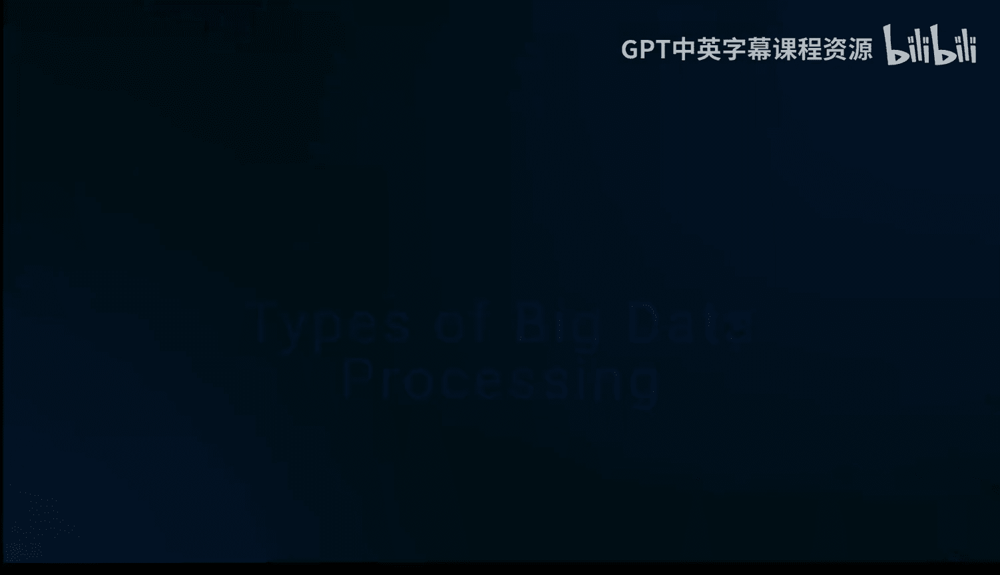
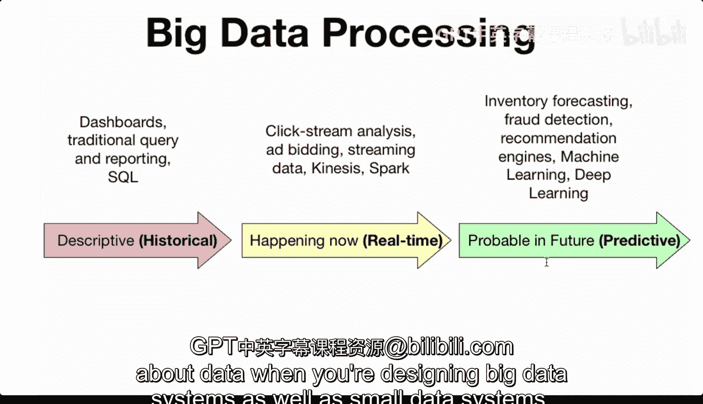

#  053：大数据处理类型

## 🎯 概述
在本节课中，我们将学习大数据处理的三种主要类型。理解这些分类有助于我们在设计数据系统时，无论是大型还是小型系统，都能选择合适的方法和工具。

## 📊 描述性大数据处理
上一节我们了解了大数据处理的整体框架，本节中我们首先来看看描述性大数据处理。

描述性大数据处理是一种面向历史数据的处理方式。它通常表现为仪表盘或传统的报告形式，数据流向数据仓库。我们可以将其理解为对**已发生事件**的总结和呈现。

以下是描述性数据处理的核心特点：
*   处理对象是**历史数据**。
*   输出形式是**描述已发生事件的报告或仪表盘**。
*   典型应用场景是**数据仓库**中的传统商业智能分析。

## ⚡ 实时大数据处理
了解了面向过去的描述性处理，本节我们来看看面向当下的实时大数据处理。

实时数据处理具有独特性，它处理来自实时系统（如Kinesis或Spark）的数据流。例如，这可能是广告数据或来自社交网络的流数据。此时，数据正在动态变化，我们尚不完全清楚其中正在发生什么，事件（如新出现的标签）会持续改变数据状态。因此，处理这类数据需要不同的工具和技术。

以下是实时数据处理的关键点：
*   数据源是**实时数据流**，例如来自Kinesis或Spark Streaming。
*   数据状态**动态变化**，响应即时事件。
*   处理目标是理解并响应**正在发生**的事件。

## 🔮 预测性大数据处理
前面我们讨论了处理过去和当前数据的方法，最后，我们探讨面向未来的预测性大数据处理。

预测性数据处理涉及使用数据来预测未来可能发生的情况。这包括诸如预测库存需求、检测欺诈行为（例如，同一张信用卡在多个州同时使用）等任务。这类问题通常属于机器学习和深度学习的范畴。其核心是计算**未来某个事件发生的概率**。

预测性处理可以概括为以下公式：
`P(未来事件 | 历史及当前数据)`
其中，`P` 代表概率，我们基于已有的历史数据和实时数据来预测未来事件发生的可能性。

## 📝 总结
本节课中，我们一起学习了大数据处理的三种基本类型：**描述性**（历史）、**实时性**（当下）和**预测性**（未来）。这种分类框架是思考数据系统设计时的有效方式，无论系统规模大小。理解数据的时间属性——是过去、现在还是未来——是选择正确处理策略和工具的关键第一步。