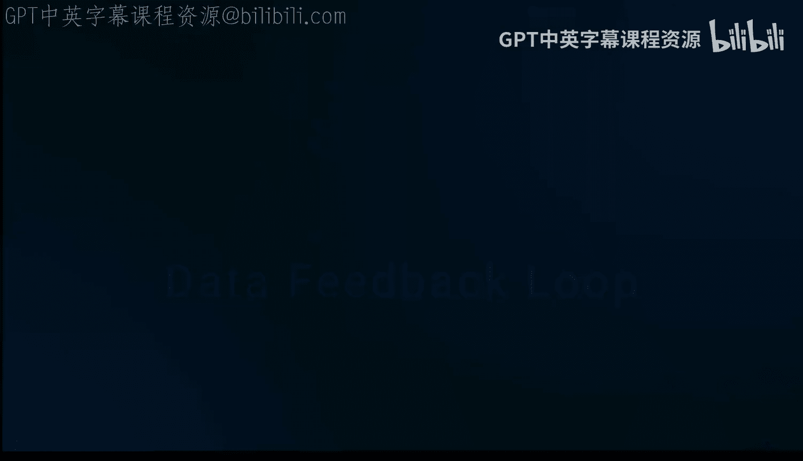
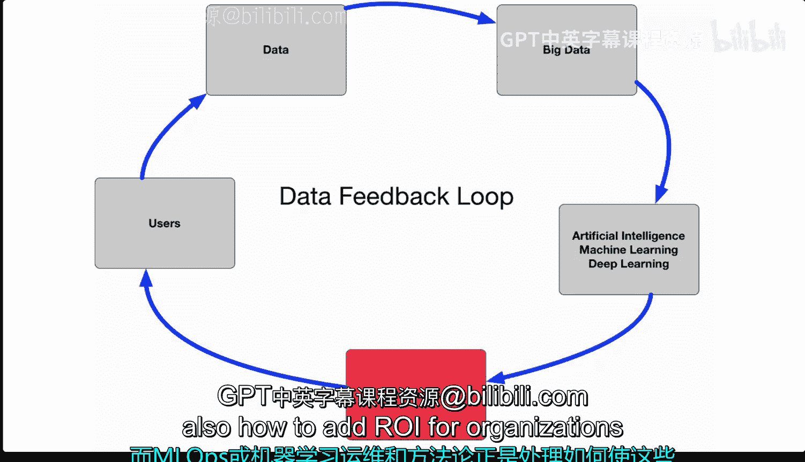

#  055：数据反馈循环 🔄

在本节课中，我们将要学习现代企业中一个核心概念——数据反馈循环。我们将了解数据如何从用户产生，经过一系列处理，最终转化为智能产品或服务，并形成一个持续循环的过程。

---

上一节我们介绍了数据工程的基本范畴，本节中我们来看看数据在企业中是如何流动并创造价值的。数据反馈循环描述了数据从产生到最终应用的完整闭环。

典型的现代公司数据反馈循环始于**用户**，他们是数据的创造者。

这些数据随后被汇集到**更大的数据池**中。

接着，数据被处理并存入**更庞大的数据系统**，例如特征存储。

然后，这些数据被用于**人工智能**、**机器学习**和**深度学习**等领域。

最终，这些技术被转化为**产品**。例如，能够通过AI生成图像的工具，或是能够总结海量数据的自然语言处理工具。

因此，数据反馈循环实质上是一个**持续不断的过程**。

而**MLOps**（机器学习运维）或相关的方法论，正是致力于解决如何让这些数据反馈循环更高效，以及如何为组织增加**投资回报率**。

---

以下是构成数据反馈循环的关键步骤列表：
1.  **数据生成**：用户与系统交互，产生原始数据。
2.  **数据汇集**：原始数据被收集并整合到中央数据池中。
3.  **数据处理**：数据经过清洗、转换，并存储于特征库等专用系统。
4.  **模型开发**：利用处理后的数据训练AI/ML模型。
5.  **产品集成**：将训练好的模型部署到实际应用中，形成产品功能。
6.  **价值创造与反馈**：产品服务用户，同时产生新的数据，循环再次开始。

---

本节课中我们一起学习了数据反馈循环的概念。我们看到了数据如何从用户端出发，经过收集、处理、分析并最终赋能AI产品，而产品的使用又会生成新的数据，从而形成一个自我强化的闭环。理解这一循环是构建高效、有价值的数据管道和AI系统的基石。