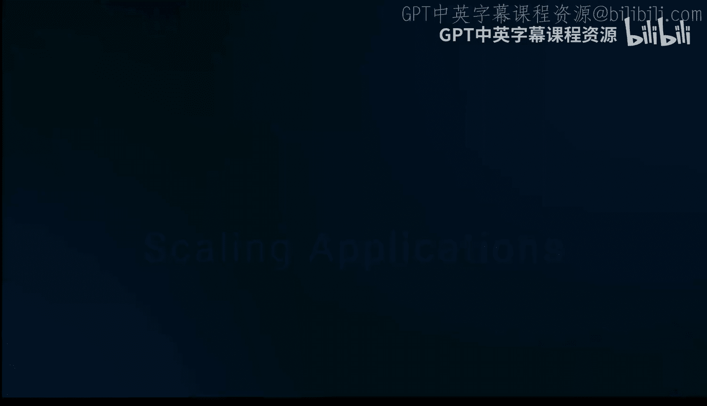
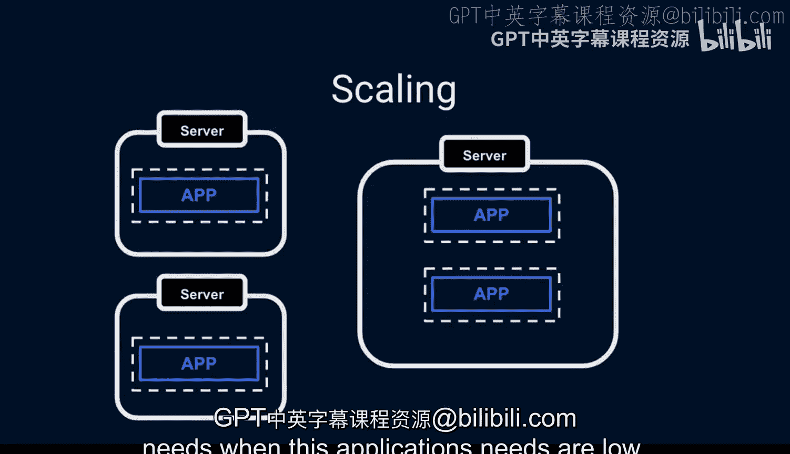

#  057：应用扩展 🚀

在本节课中，我们将学习应用扩展的基本概念，了解从传统物理服务器部署到现代虚拟化部署的演进过程，以及这种演进如何帮助我们更高效地管理计算资源。

## 传统部署的挑战

上一节我们介绍了应用部署的基本背景，本节中我们来看看传统部署方式面临的挑战。

当我们将一个应用程序部署到物理服务器上时，服务器必须配备足以支撑该应用在最大负载下运行所需的全部资源。

如果随着时间的推移，应用程序需要更多资源，那么我们就需要将其重新部署到一台更大型或性能更强的服务器上。这个过程通常会导致应用程序停机，并且需要相当多的工作量。

如果应用程序的使用量随时间波动，例如白天使用量大而夜间使用量小，我们仍然需要根据其峰值负载来配置服务器。这意味着在相当长的一段时间内，该服务器的资源可能未被充分利用。

## 虚拟化带来的解决方案

了解了传统部署的局限性后，本节我们来看看虚拟化技术如何提供解决方案。

当我们使用虚拟化技术时，我们可以在一个服务器上运行应用程序。同时，我们也可以在另一个服务器上，或者在同一个服务器上运行该应用的多个副本。

这意味着我们可以根据负载需求进行**横向扩展**，也可以在负载下降时进行**横向收缩**。当此应用程序需求较低时，我们可以将服务器资源用于其他应用程序的需求。

## 核心概念总结

以下是本节课的核心概念总结：
*   **纵向扩展**：通过升级单个服务器的硬件（如CPU、内存）来应对增长的需求。这通常涉及停机。
*   **横向扩展**：通过增加更多服务器实例（或容器）来分散负载。这可以在不中断服务的情况下进行。
*   **资源利用率**：虚拟化允许更动态地分配资源，从而提高整体基础设施的效率，避免为应对峰值负载而长期过度配置资源。

本节课中，我们一起学习了应用扩展从静态的物理服务器部署到动态的虚拟化部署的演进。我们理解了**纵向扩展**的局限性和**横向扩展**的灵活性，以及虚拟化如何帮助我们根据实际需求弹性地调整资源，最终实现更高的资源利用率和更敏捷的运维能力。