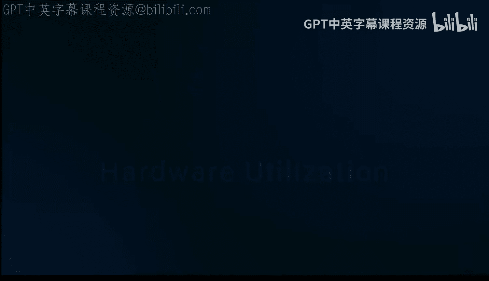
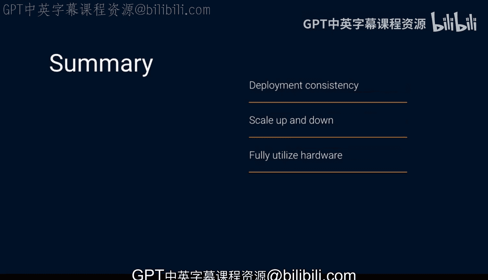

#  058：硬件利用率



在本节课中，我们将探讨虚拟化技术如何帮助我们更高效地利用硬件资源。我们将了解通过在同一台物理服务器上运行多个应用实例，如何实现资源的动态分配与最大化利用。

---

上一节我们介绍了虚拟化带来的部署一致性和弹性伸缩能力。本节中，我们来看看虚拟化如何提升硬件的整体利用率。

虚拟化的核心优势之一是允许我们在单台服务器上运行应用的多个副本。这意味着，当一个应用的需求较低时，其占用的资源可以被释放出来，供其他应用使用。

以下是实现硬件高效利用的几个关键点：

*   **动态资源分配**：当某个应用程序的资源需求较低时，系统可以自动减少分配给它的资源（如CPU、内存）。
*   **多应用共存**：被释放出来的资源可以立即分配给同一台服务器上其他需要资源的应用程序。
*   **按需启停**：通过快速启动（spin up）和关闭（spin down）不同的应用程序，硬件资源得以在不同工作负载间灵活切换。

这个过程可以抽象为以下逻辑：
```python
if application.demand < threshold:
    free_up_resources(application)
    allocate_resources(other_application)
```

通过上述机制，我们能够确保硬件资源很少处于闲置状态，从而实现了对硬件投资的最大化利用。

---



本节课中我们一起学习了虚拟化技术提升硬件利用率的核心原理。总结来说，虚拟化通过实现**部署一致性**、支持**弹性伸缩**，并允许在同一硬件上**动态调度多个应用**，使我们能够充分利用硬件资源，避免浪费。