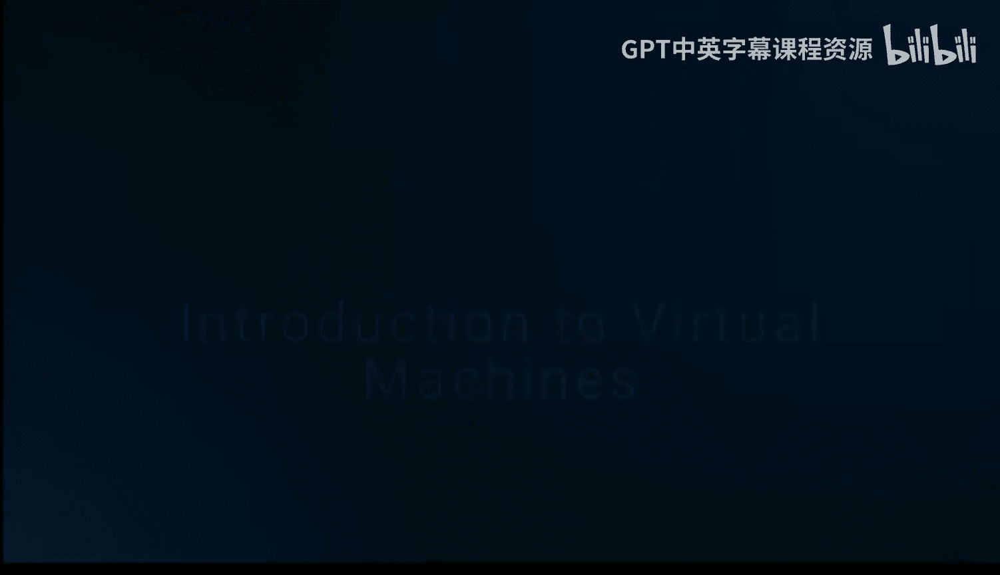
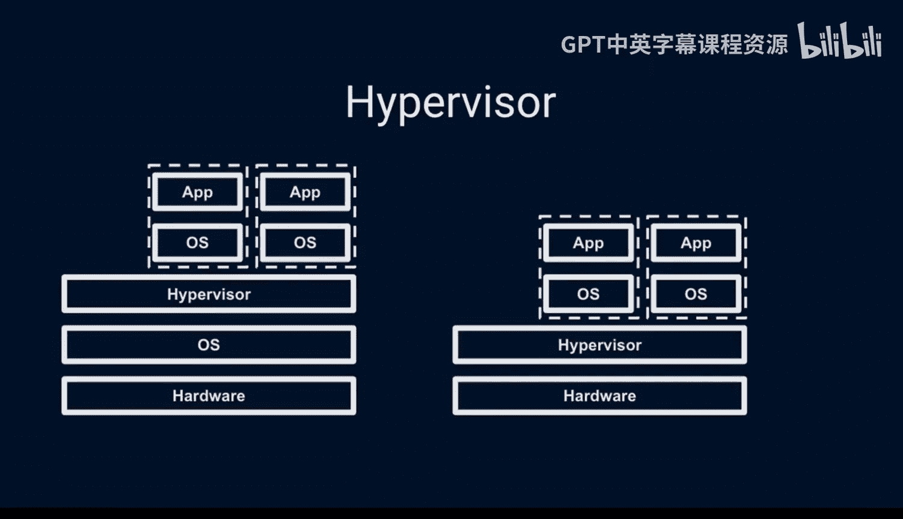

#  059：虚拟机简介 🖥️

在本节课中，我们将要学习虚拟机的核心概念。我们将了解什么是虚拟机、什么是管理程序（Hypervisor）、如何创建虚拟机以及如何在虚拟机上安装操作系统。

---

## 什么是虚拟机？

虚拟机是一种软件模拟的完整计算机系统。它模拟了包括硬件和操作系统在内的完整机器环境。

目前广泛使用的两种机器虚拟化技术是**虚拟机**和**容器**。两者都将应用程序与其依赖项打包在一起，但区别在于它们模拟真实计算机的程度不同。

**虚拟机**模拟了一台完整的机器，包括硬件和操作系统。因为每个虚拟机都有自己的操作系统，所以我们可以在同一台物理主机上运行具有不同操作系统的虚拟机。

一些流行的虚拟机解决方案包括：
*   Microsoft Hyper-V
*   VMware Fusion
*   Oracle VirtualBox
*   Citrix Hypervisor

---

## 什么是管理程序（Hypervisor）？

上一节我们介绍了虚拟机，本节中我们来看看支撑虚拟机的关键组件——管理程序。

**管理程序**是位于物理主机和虚拟机之间的虚拟化层。一个单一的管理程序可以运行多个虚拟机。

管理程序主要分为两种类型：
*   **类型一**：这种类型更常用于服务器环境，它被设计为直接安装在硬件之上，因此无需与主机操作系统共享任何资源。
*   **类型二**：这种类型通常用于个人工作站，它安装在主机操作系统之上运行。

---

## 如何创建与安装系统？

了解了虚拟机和管理程序的基础后，接下来我们看看如何实际操作。

以下是创建虚拟机并安装操作系统的一般步骤：
1.  **选择并安装管理程序**：首先，根据你的需求（如个人使用或服务器部署）选择并安装一款管理程序软件，例如 VirtualBox 或 VMware。
2.  **创建新虚拟机**：在管理程序中，启动“新建虚拟机”向导。你需要为虚拟机分配计算资源，例如 CPU 核心数、内存大小和硬盘空间。
3.  **配置虚拟硬件**：在向导中，配置虚拟机的硬件设置，包括网络适配器、显示设置等。
4.  **安装操作系统**：将操作系统的安装镜像（如 ISO 文件）挂载到虚拟机的虚拟光驱中，然后启动虚拟机。虚拟机会从该镜像引导，并开始操作系统的安装过程，其步骤与在物理机上安装完全相同。

---

## 总结

本节课中我们一起学习了虚拟化的基础知识。我们明确了**虚拟机**是模拟完整硬件的软件计算机，而**管理程序**是实现虚拟化的核心软件层。我们还了解了创建虚拟机并安装操作系统的基本流程。掌握这些概念是后续在虚拟化环境中部署和运行数据工程应用的重要基础。