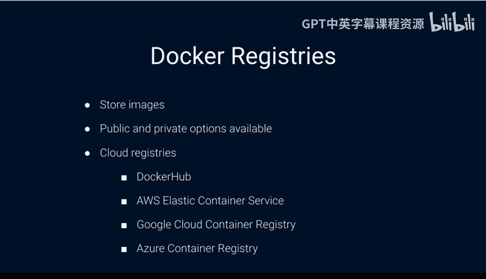
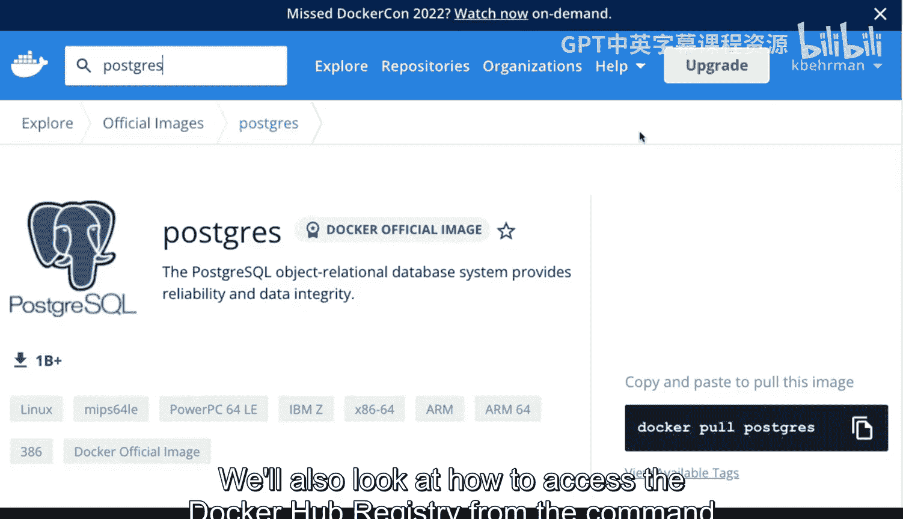

#  062：Docker简介 🐳

在本节课中，我们将要学习Docker容器的基础知识。Docker既是一个容器平台，也是一家推广该平台的公司，同时它还提供与Docker容器相关的工具。虽然存在其他基于Linux的容器技术，但截至目前，Docker是应用最广泛的容器类型。

## Docker概述

Docker使用Go语言编写，并在底层利用Linux命名空间来隔离容器。根据本课程录制时的信息，Docker提供了可运行Linux和Windows的容器。

理解Docker生态系统中的**镜像**和**容器**这两个核心概念至关重要。

*   **镜像**是一个只读的模板，用于创建容器。你可以使用Dockerfile自己创建镜像，也可以使用预先构建好的镜像。
*   **容器**是镜像的可运行实例。

需要明确的是，与虚拟机不同，容器本身**不存储状态**。也就是说，当你关闭一个容器时，它不会保存运行容器的任何状态。当然，你可以将外部存储附加到容器上，从而有效地在那里存储状态，但容器本身不会存储。

## Docker桌面应用

Docker Desktop是一个用于与Docker交互的流行应用程序，可在OSX、Windows和Linux系统上运行。在Docker Desktop应用程序中，捆绑了以下组件：
*   **Docker Daemon**：Docker守护进程。
*   **Docker Client**：Docker客户端。
*   **Docker Compose**：用于定义和运行多容器Docker应用程序的工具。
*   **Kubernetes**：一个用于编排和运行Docker容器的系统。

## Docker镜像仓库

上一节我们介绍了Docker的基本组件，本节中我们来看看Docker镜像的存储位置——镜像仓库。

Docker镜像仓库是存储Docker镜像的地方，它们可以是本地的，也可以位于云端。你可以选择创建公共或私有的仓库。目前有许多流行的云仓库解决方案，包括：
*   Docker Hub
*   AWS的Elastic Container Registry
*   Google Cloud的Container Registry
*   Azure的Container Registry

让我们具体看看Docker Hub这个镜像仓库。如果我们进入“探索”部分，可以看到一些推荐的镜像。在左侧，我们可以进行筛选，例如筛选由已验证发布者发布的官方镜像，这有助于我们了解镜像的创建者。这里也能看到一些更受欢迎、被推荐的镜像。

请注意，每个镜像都有一系列与之关联的**标签**。我们也可以切换到“最近更新”视图，查看哪些镜像最近被更新过。我们还可以按操作系统进行筛选，如前所述，Docker容器可以运行在Linux或Windows上，并支持各种架构。

当我们搜索一个镜像时，会看到在命令行中使用的Docker命令，用于将该镜像拉取到本地的Docker客户端。页面还会提供描述、评论、标签以及一些参考信息。如果你需要特定版本的镜像，标签会非常有用，你可以使用这些标签来拉取特定的版本。此外，页面还提供相关文档。

以上就是Docker Hub仓库的基本运作方式。在后续课程中，我们还将学习如何从命令行访问Docker Hub仓库。

---

本节课中我们一起学习了Docker的核心概念，包括镜像与容器的区别、Docker Desktop的组成以及如何使用Docker Hub镜像仓库来查找和获取镜像。理解这些基础知识是后续进行容器化开发和部署的关键。