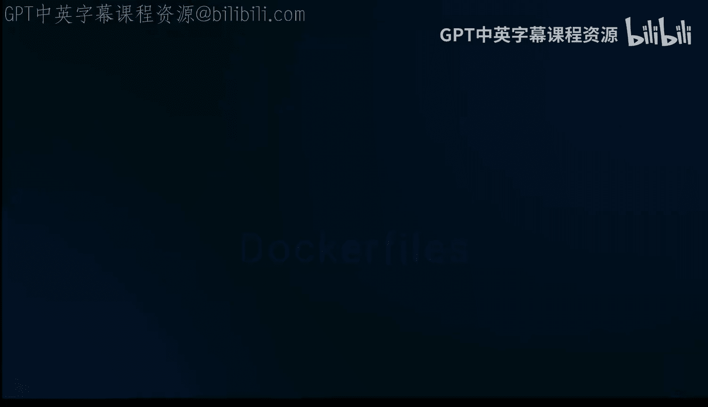
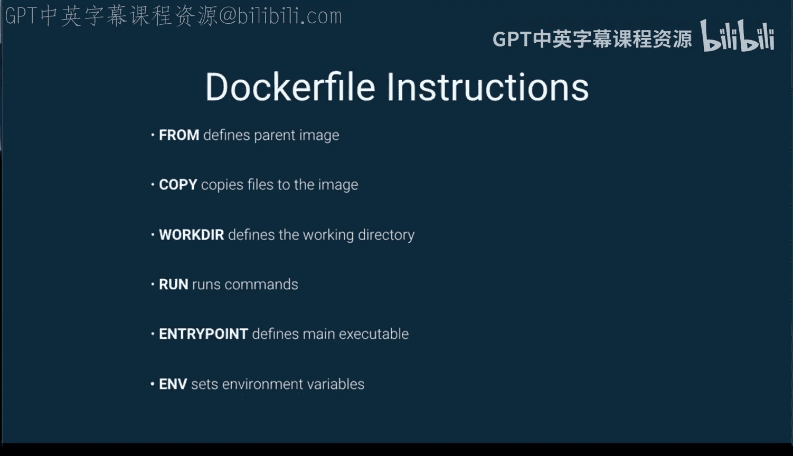

#  068：Dockerfile详解 🐳

在本节课中，我们将深入学习Dockerfile。Dockerfile是构建Docker镜像的核心配置文件，它包含了一系列指令，用于定义如何从基础镜像开始，逐步构建出我们最终需要的应用镜像。理解这些指令是掌握Docker容器化技术的关键一步。

## Dockerfile基础

上一节我们介绍了Docker的基本概念，本节中我们来看看Dockerfile的具体构成和作用。

Dockerfile通常被命名为 `Dockerfile`。通过使用 `docker build` 命令的 `-f` 标志，可以指定不在当前上下文目录中，或者不遵循默认命名规则的Dockerfile文件。

Dockerfile的主要目的是包含一系列由 `docker build` 命令使用的构建指令。

## 常用Dockerfile指令

以下是Dockerfile中最常用的一些核心指令及其功能。

*   **`FROM`**：此指令用于指定构建过程所基于的父镜像。镜像通常是分层构建的，`FROM` 指令定义了起点。它通常是Dockerfile中的第一条指令。
    *   **示例**：`FROM python:3.9-slim`

*   **`COPY`**：此指令用于将文件从构建上下文（通常是Dockerfile所在的目录）复制到正在构建的镜像中。如果你的应用代码、配置文件或其他资源需要包含在镜像内以供正常运行，就需要使用 `COPY` 指令。
    *   **示例**：`COPY ./app /usr/src/app`

*   **`WORKDIR`**：此指令用于为后续的 `RUN`、`CMD`、`ENTRYPOINT`、`COPY` 和 `ADD` 指令设置工作目录。与在 `RUN` 指令中执行 `cd` 命令相比，使用 `WORKDIR` 是更清晰、更推荐的做法。
    *   **示例**：`WORKDIR /usr/src/app`

*   **`RUN`**：此指令用于在构建镜像的过程中执行命令。通常用于安装软件包、编译代码或执行其他构建步骤。
    *   **示例**：`RUN pip install --no-cache-dir -r requirements.txt`

*   **`ENTRYPOINT`**：此指令用于配置容器启动时运行的主命令或可执行文件。由 `ENTRYPOINT` 定义的命令决定了基于此镜像运行的容器的生命周期。
    *   **示例**：`ENTRYPOINT [“python”, “app.py”]`

*   **`ENV`**：此指令用于设置环境变量。这些变量在镜像构建时被设置，并且在基于此镜像运行的容器内部持续可用。
    *   **示例**：`ENV FLASK_APP=app.py`

## 总结

本节课中我们一起学习了Dockerfile的核心指令。我们了解到，`FROM` 定义了基础镜像，`COPY` 用于添加文件，`WORKDIR` 设置工作目录，`RUN` 执行构建命令，`ENTRYPOINT` 指定容器主进程，而 `ENV` 则用于配置环境变量。掌握这些指令是编写高效、可维护的Dockerfile，从而成功容器化应用的基础。