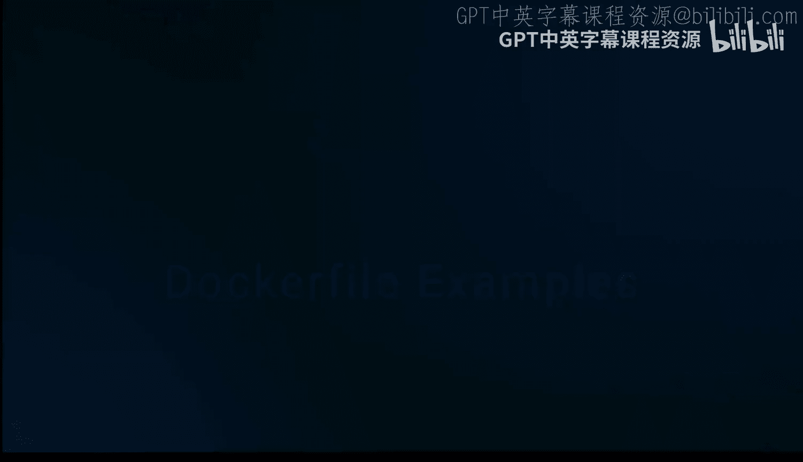
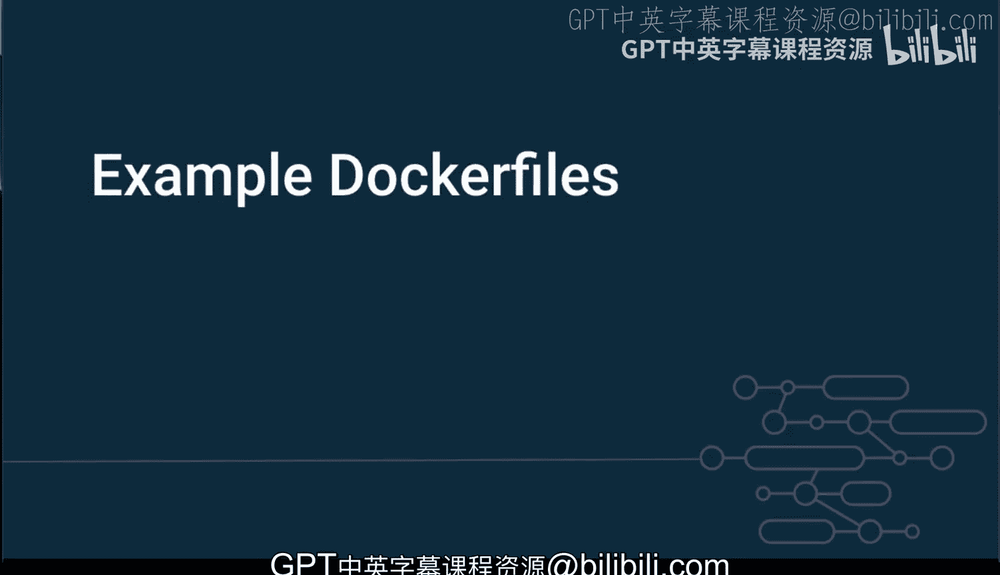
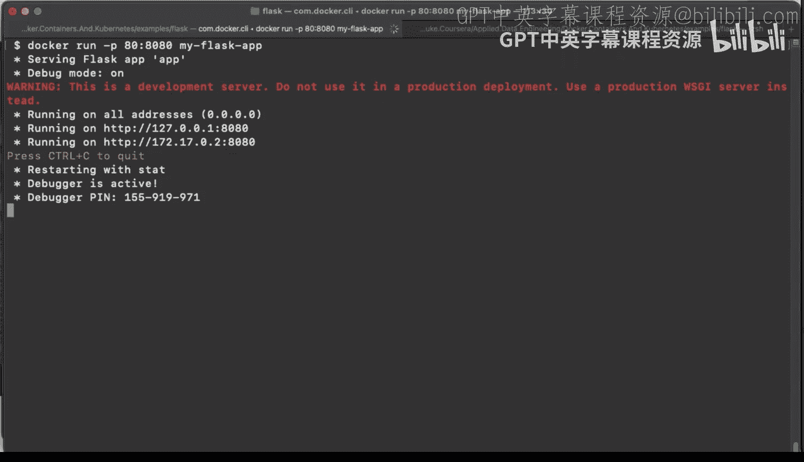
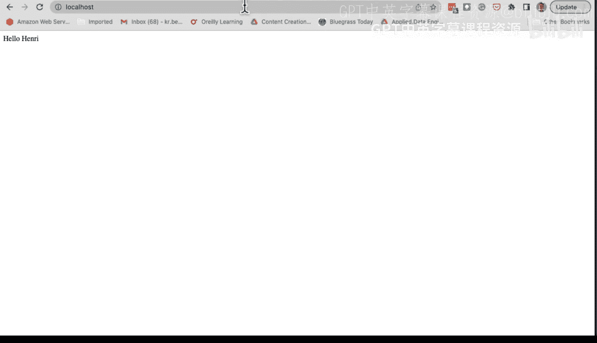
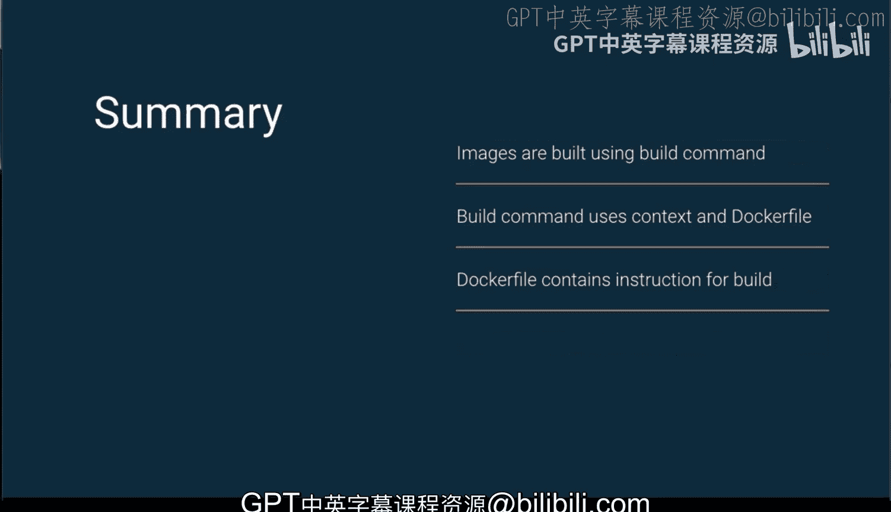

#  069：Dockerfile示例 🐳



在本节课中，我们将通过两个具体的例子来学习如何编写Dockerfile，并了解如何构建和运行Docker镜像。



---

## 一个简单的Dockerfile示例

首先，我们来看一个非常简单的Dockerfile例子。

这个Dockerfile只包含两条指令。
*   **FROM** 指令：指定了基础镜像及其标签。
*   **ENTRYPOINT** 指令：指定了容器启动时运行的主可执行文件，在本例中是命令行命令 `echo`。

以下是该Dockerfile的内容：
```dockerfile
FROM ubuntu:latest
ENTRYPOINT ["echo", "Hello Docker"]
```

现在，我们来构建并运行这个镜像。可以看到，构建后生成了一个名为 `hello` 的镜像。当我们运行这个镜像时，它会执行 `echo` 命令，输出“Hello Docker”。命令执行完毕后，容器就会停止。

---

## 一个更复杂的Dockerfile示例

上一节我们介绍了一个基础示例，本节中我们来看看一个更贴近实际应用的例子。

在这个目录中，我们有一个Dockerfile和一个Python文件。我们先看一下Python文件的内容。

这是一个非常简单的Flask应用。它设置了一个端点，该端点会返回一个字符串“hello”，后面跟着一个从环境变量中获取的名字。应用运行在端口 `8080` 上。

以下是Python文件 `app.py` 的内容：
```python
from flask import Flask
import os

app = Flask(__name__)

@app.route('/')
def hello():
    name = os.environ.get('NAME', 'World')
    return f'Hello {name}!'

if __name__ == '__main__':
    app.run(host='0.0.0.0', port=8080)
```

接下来，我们查看对应的Dockerfile。它同样以 **FROM** 指令开始，指定了基础镜像为 `python:3.12-slim`。

以下是该Dockerfile的完整内容：
```dockerfile
FROM python:3.12-slim
COPY . /app
WORKDIR /app
RUN pip install flask
ENV NAME=Henri
ENTRYPOINT ["python", "app.py"]
```

以下是构建此镜像所涉及的步骤列表：
*   **COPY . /app**：将构建上下文中的所有文件复制到镜像内的 `/app` 目录。
*   **WORKDIR /app**：将镜像内的工作目录设置为 `/app`。
*   **RUN pip install flask**：运行命令，安装此代码所需的依赖（Flask）。
*   **ENV NAME=Henri**：定义一个名为 `NAME` 的环境变量，并将其值设置为 `Henri`。
*   **ENTRYPOINT [“python”, “app.py”]**：指定容器启动时运行 `python app.py` 命令。

现在，我们来构建这个镜像。构建完成后，可以在镜像仓库中看到它。接着，我们运行这个镜像，并将宿主机的端口 `80` 映射到容器内的端口 `8080`。



此时，如果我们打开一个网页浏览器并访问相应地址，就能看到从运行在Docker容器中的Flask应用返回的消息了。



---

## 总结

本节课中，我们一起学习了Docker镜像构建的核心知识。



我们了解到，镜像通常使用 `docker build` 命令构建。该命令会使用一个**构建上下文**和一个 **Dockerfile** 文件。而Dockerfile文件则包含了构建镜像所需的所有**指令**。通过两个由浅入深的例子，我们实践了如何编写Dockerfile、构建镜像以及运行容器。