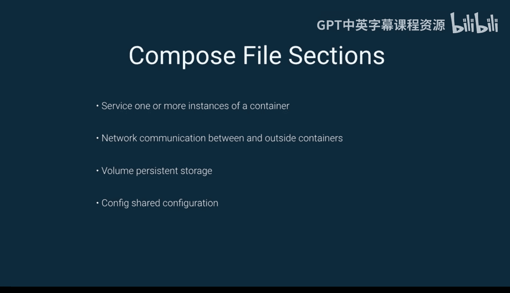
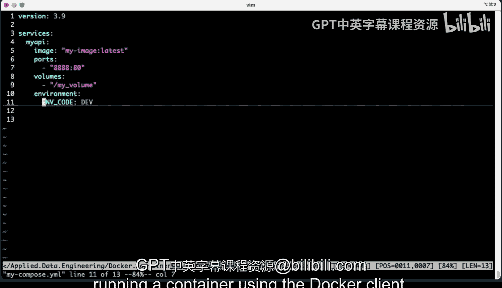

#  070：使用Docker-Compose编排 🐳


在本节课中，我们将要学习如何使用Docker-Compose进行容器编排。我们将了解Compose文件的结构，介绍Airflow平台，并最终使用Docker-Compose在本地运行Airflow。

## 编排与Docker-Compose简介

上一节我们介绍了Docker容器的基础概念。本节中我们来看看如何管理多个相互关联的容器。

在使用Docker容器时，每个容器通常应代表一个单一的功能或服务。在传统的服务器设置中，我们可能将Web应用和数据库部署在同一台服务器上。但在Docker生态系统中，Web应用和数据库应各自拥有独立的容器。每个容器都有定义其执行方式的主要目的。

例如，一个应用可能包含Web前端、后端数据库、API服务以及缓存层。每个部分都需要运行在自己的容器中。这些容器之间需要定义网络通信，并且它们彼此存在依赖关系。如果API容器没有启动并运行，Web前端将无法正常工作；同样，如果数据库容器没有启动，API容器也无法运行。

为了定义这些多容器应用、它们之间的通信和依赖关系，我们使用一种称为编排工具的技术。Docker-Compose就是这样一种编排工具。它是Docker Desktop附带的另一个Docker客户端，作为创建和管理多容器应用的编排工具。它通过一个称为Compose文件的YAML格式文件来定义编排规则。

## Compose文件结构

上一节我们介绍了编排的概念，本节中我们来看看Compose文件的具体结构。

Compose文件包含多个可能的配置部分，其中最主要的是服务（services）部分。每个服务代表一个或多个正在运行的容器实例。文件中还可以定义服务之间或服务与外部之间的网络通信部分，以及可以被Compose文件中其他元素共享的持久化卷存储和配置。

以下是Compose文件中可能包含的主要部分：

*   **服务（Services）**：定义每个容器的配置，如镜像、端口、卷和环境变量。
*   **网络（Networks）**：定义容器之间的网络连接方式。
*   **卷（Volumes）**：定义持久化数据存储。
*   **配置（Configs）**：定义可被多个服务共享的配置文件。

## 一个简单的Compose文件示例

让我们来看一个简单的例子。在这个Compose文件中，我们定义了一个名为`my-api`的单一服务。

```yaml
version: '3.8'
services:
  my-api:
    image: my-api-image:latest
    ports:
      - "8080:80"
    volumes:
      - ./app:/usr/src/app
    environment:
      - MODE=production
```

我们为该服务定义了一个源镜像、一个端口映射、一个要挂载的卷，以及一个名为`MODE`的环境变量。请注意，我们在这里定义的元素，类似于我们使用Docker客户端运行容器时可用的选项。

## 引入Apache Airflow平台

在了解了Compose文件的基础后，我们将引入一个具体的编排案例：Apache Airflow。

Apache Airflow是一个用于编排复杂工作流的平台。它通常由多个组件构成，例如Web服务器、调度器、执行器以及后端数据库（如PostgreSQL）。由于组件众多，手动使用Docker命令逐个启动和管理这些容器非常繁琐且容易出错。这正是Docker-Compose发挥作用的完美场景。



## 使用Docker-Compose本地运行Airflow

最后，我们将实践如何使用Docker-Compose在本地运行完整的Airflow服务。

通过一个预先定义好的`docker-compose.yaml`文件，我们可以使用一条简单的命令`docker-compose up`来启动Airflow的所有必需服务。Compose文件会确保各个服务（如数据库、Web服务器、调度器）以正确的顺序启动，并配置好它们之间的网络连接和依赖关系。这极大地简化了在开发或测试环境中部署Airflow的流程。

---



本节课中我们一起学习了Docker-Compose的核心概念。我们了解了为什么需要容器编排，探索了Compose文件的基本结构，并通过一个简单示例加深了理解。最后，我们介绍了Apache Airflow这一多组件应用，并说明了如何使用Docker-Compose来简化其本地部署过程。掌握Docker-Compose是管理复杂微服务架构和数据处理平台（如Airflow）的重要技能。