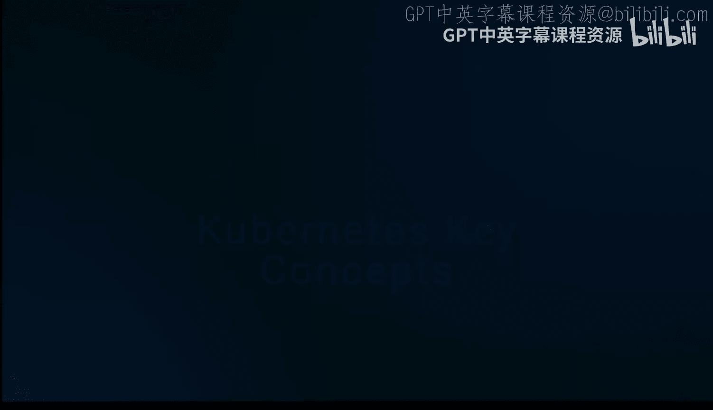
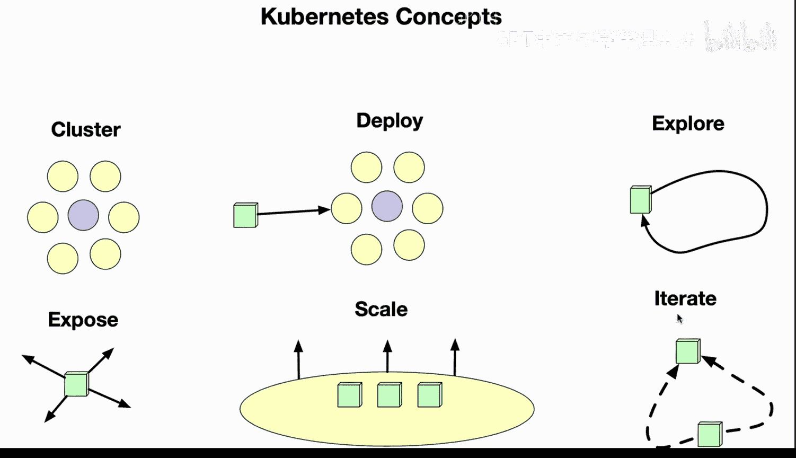
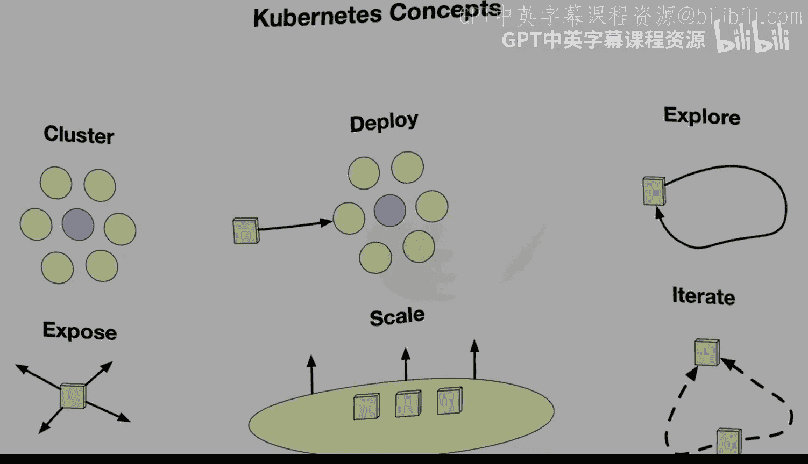

**应用Python数据工程：3：Kubernetes核心概念**

在本节课中，我们将学习Kubernetes的几个核心概念。这些概念是理解和使用Kubernetes进行容器化应用部署与管理的基础。

---

### **集群**

首先，我们来了解**集群**。集群是由一组节点组成的集合，这些节点由一个API统一控制。这个集群可以部署在您的虚拟机上，也可以存在于基于云的环境中，或者您自己的数据中心里。集群具备可扩展性，这是其重要特性之一。

### **部署**

上一节我们介绍了集群，本节中我们来看看如何将应用部署到集群中。在部署方面，您需要将一个容器化的应用程序移入集群，然后启动该部署。这是一种非常常见的做法。

以下是部署的典型步骤：
*   您可以从一个公共的容器注册表（例如DockerHub）开始。
*   然后将该容器镜像移入您的部署系统。

### **探索**

一旦应用部署完成并运行起来，您就可以对应用程序进行**探索**和迭代。这意味着您可以检查应用状态、查看日志，并根据需要进行修改和更新。

### **暴露**

接下来是**暴露**应用。这里的核心思想是将您的应用程序暴露给外部世界，以便其他人能够使用它。通常，应用程序会通过一个公共端口对外提供服务。

### **扩缩容**

应用暴露后，我们还需要考虑其应对负载变化的能力，这就是**扩缩容**。通过扩缩容，您能够响应特定事件（例如CPU使用率过高或内存不足），并为已部署的应用程序提供更多资源。

### **滚动更新**

最后，一个非常常见的用例是发布应用程序的新版本，同时进行**滚动更新**。这意味着您可以在不中断服务的情况下，逐步迭代更新容器化应用程序的多个版本。

---

本节课中我们一起学习了Kubernetes的几个核心概念：**集群**、**部署**、**探索**、**暴露**、**扩缩容**和**滚动更新**。这些是使用Kubernetes时最常见的场景。在接下来的课程中，我们将更深入地探讨其中一些场景。