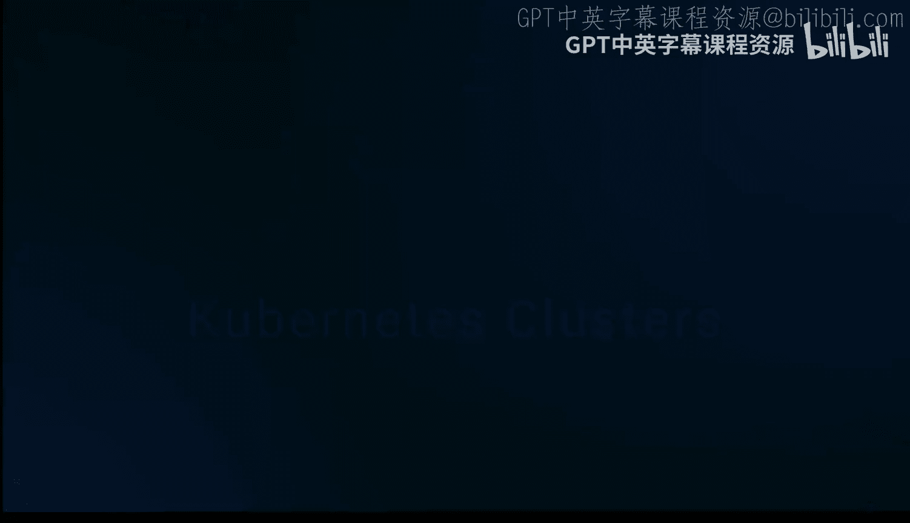
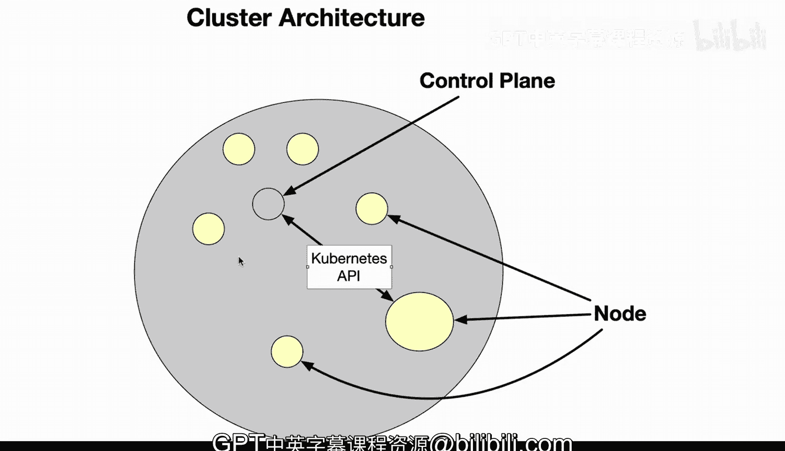

#  074：Kubernetes集群架构 🏗️

在本节课中，我们将要学习Kubernetes集群的基本架构。我们将了解构成集群的核心组件，包括控制平面和工作节点，并解释它们如何协同工作。

## 集群架构概述

Kubernetes集群包含几种不同类型的资源。

首先，存在一个协调整个集群的控制平面。

在上图中，控制平面就是这里的紫色圆点。而节点则是运行在集群内部的工作单元。

因此，集群内部有多个工作节点，它们通过Kubernetes API进行通信。

从集群架构图中可以看到，所有节点基本上都处于这个控制平面的管理之下。根据您所构建的Kubernetes架构类型，这些节点会处理不同类型的工作。

## 节点的物理形态

一个节点也可以运行在一台物理计算机上。

它可以运行在虚拟机上，也可以运行在集群中。

因此，理解这个集群是一个逻辑上的概念集群非常重要。

但物理节点可能位于多种不同类型的位置。

---

本节课中我们一起学习了Kubernetes集群的基本架构。我们了解到集群由控制平面和工作节点组成，控制平面负责协调，节点负责执行具体工作。同时，我们也明白了Kubernetes集群是一个逻辑概念，其背后的物理节点可以分布在不同的计算环境中。