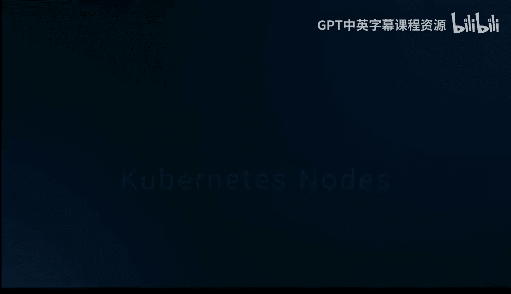
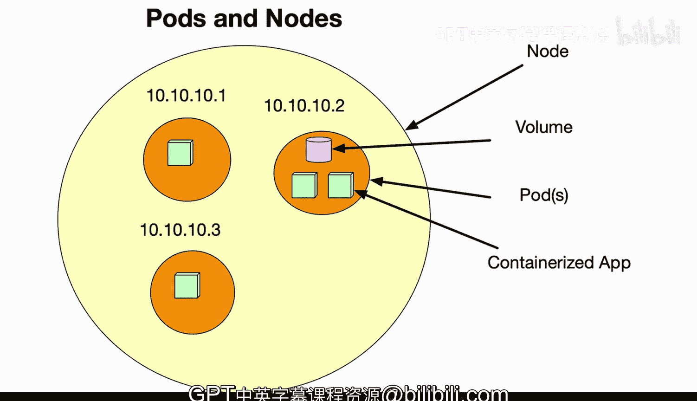

#  075：Kubernetes节点

## 概述
在本节课中，我们将要学习Kubernetes中的两个核心概念：Pod和节点。我们将了解它们是什么，它们之间的关系，以及它们如何共同构成Kubernetes集群的基础。

## Pod与节点的概念

上一节我们介绍了Kubernetes的基本架构，本节中我们来看看Pod和节点这两个具体的组件。

Kubernetes Pod和节点是重要的概念。你可以在此图中看到，一个节点可以包含多个Pod。

我们知道节点可以运行在虚拟机上。它们可以运行在数据中心，也可以运行在云端。但在这个节点内部，你可以拥有许多不同的Pod，而这些Pod又可以包含许多不同的容器化应用、存储卷和IP地址。

在一个节点内运行多个Pod是典型做法。这里需要考虑的几点是：Pod是一个应用规格的逻辑主机，它可以包含紧密耦合的不同应用容器。

例如，一个前端和一个后端可以被包含在这种特定的配置中。另外需要考虑的几点是：Pod总是在一个节点上运行，而这个节点在Kubernetes中是工作机器。

节点可以是物理机，也可以是虚拟机，这取决于你配置了哪种类型的集群。

## 核心要点总结

以下是关于Pod和节点的关键信息列表：

*   Pod是应用的逻辑主机，包含一个或多个紧密耦合的容器。
*   节点是运行Pod的物理机或虚拟机。
*   一个节点可以托管多个Pod。
*   Pod总是在节点上运行。
*   节点的类型（物理机/虚拟机）取决于集群配置。

## 总结
本节课中我们一起学习了Kubernetes的Pod和节点。Pod作为容纳应用容器的逻辑单元，运行在节点之上。节点是集群的工作单元，可以是物理或虚拟资源。理解这种“节点托管多个Pod”的关系，是掌握Kubernetes如何编排和管理容器化应用的基础。