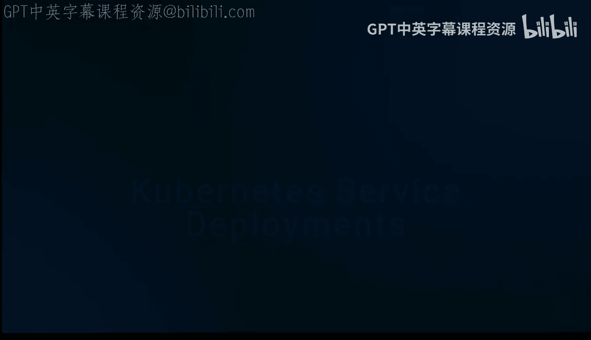
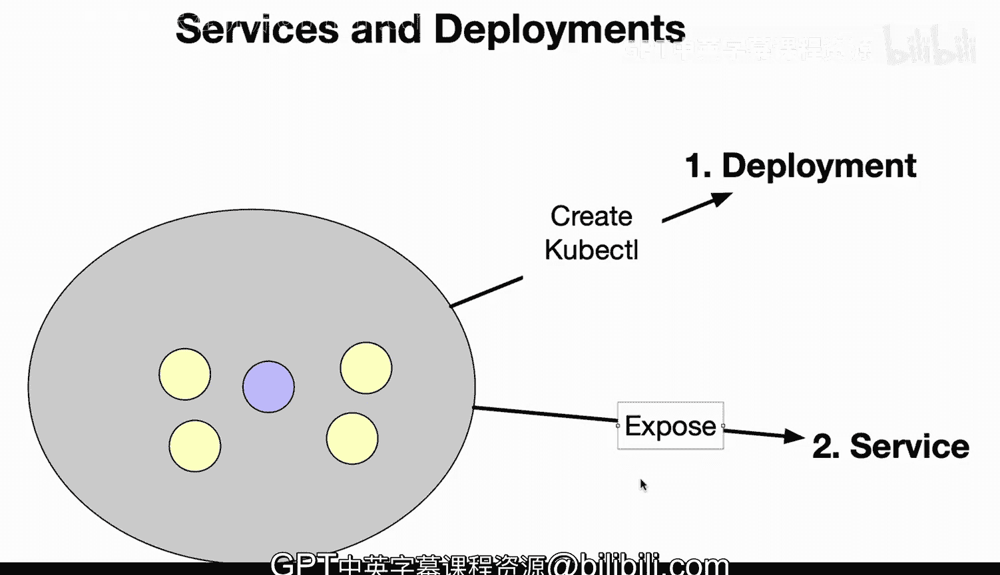

#  076：Kubernetes服务部署



在本节课中，我们将要学习Kubernetes中的两个核心概念：**部署**和**服务**。我们将了解如何通过`kubectl`命令来创建和管理部署，以及如何通过服务将应用程序暴露给外部世界。

## 部署：启动应用的第一步

在Kubernetes中，当你想要部署一个应用时，一个良好的起点是创建一个**部署**。

你可以通过Kubernetes的命令行接口`kubectl`来创建和管理这个部署。`kubectl`的优势在于，它允许我们与Kubernetes控制平面进行交互和控制。

以下是使用`kubectl`创建部署的基本命令格式：
```bash
kubectl create deployment <部署名称> --image=<容器镜像>
```

一旦你成功创建并指定了这个部署，下一步就是关联一个**服务**。

## 服务：暴露应用给外部世界

上一节我们介绍了如何创建部署，本节中我们来看看如何设置服务。

服务的作用是将你的应用程序暴露给外部世界。例如，你可以通过服务打开一个网络端口。

以下是设置服务并暴露端口的典型步骤：

1.  **创建服务**：定义一个服务资源，将其与之前创建的部署关联起来。
2.  **暴露端口**：在服务配置中指定要对外开放的端口。
3.  **访问应用**：一旦端口被暴露，你就可以通过`curl`命令或运行功能测试、端到端测试来访问你的应用。

因此，在Kubernetes中设置应用的完整流程是：第一步创建**部署**，第二步设置**服务**并将应用暴露出去。

## 总结



本节课中我们一起学习了Kubernetes应用部署的核心流程。我们了解到，首先需要通过`kubectl`创建**部署**来定义和运行我们的应用实例。随后，我们需要创建一个**服务**资源，通过它来为部署的应用提供稳定的网络端点并对外开放端口，从而使外部客户端能够访问到我们的应用。这个“先部署，后服务”的两步法是发布Kubernetes应用的基础。