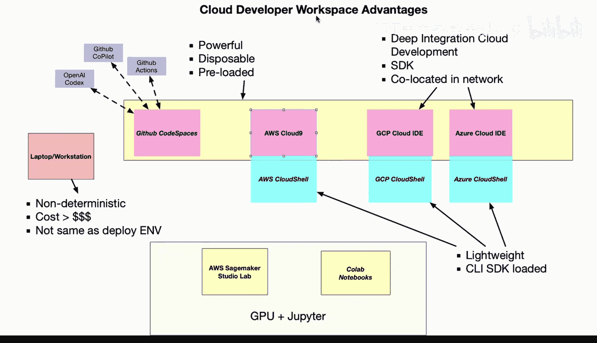

#  077：云开发工作空间优势 🚀

在本节课中，我们将探讨云开发工作空间这一新兴趋势，并分析其相较于传统本地开发环境的优势。我们将了解不同类型的云开发环境及其适用场景。

## 概述

云开发工作空间正成为软件工程、数据工程、数据科学和机器学习等多个领域的重要趋势。如果不使用基于云的开发环境，你可能会错过许多在本地笔记本电脑上无法获得的新功能。

## 传统本地开发环境

首先，让我们看看传统的笔记本电脑或工作站开发环境。这种环境存在几个关键问题。

*   **环境不确定性**：没有保证一致的开发环境。
*   **存在不必要包**：可能安装了你不想要的软件包。
*   **硬件成本高**：获取GPU或大容量固态硬盘的成本可能很高。
*   **与部署环境不一致**：本地环境通常与云端的生产部署环境不同，尽管容器技术可以部分解决此问题。

## 云开发环境概览

现在，让我们转向云端，看看一些基于云的开发环境。这些环境通常具有许多共同点。

以下是几种主流的云开发环境：

*   **GitHub Codespaces**：一个与GitHub深度集成的开发环境。
*   **AWS Cloud9**：亚马逊云科技的云端集成开发环境。
*   **GCP Cloud IDE**：谷歌云的云端集成开发环境。
*   **Azure Cloud IDE**：微软Azure的云端集成开发环境。

## 深入各类云环境

上一节我们介绍了云开发环境的整体情况，本节中我们来看看它们各自的特点。

### GitHub Codespaces

GitHub Codespaces 具有独特的功能。它易于与 **GitHub Actions**（持续集成系统）集成。它也易于与 **GitHub Copilot** 集成，后者利用OpenAI Codex辅助你编写代码。整个集成与GitHub平台紧密耦合，是备受推荐的开发环境。

### 云端笔记本环境

对于偏好使用笔记本的工作流，也存在专门的云端环境。

以下是两种笔记本友好的云端选项：

*   **Colab Notebooks**：允许在云端构建使用GPU的Jupyter兼容系统，甚至可以使用专业版本。
*   **AWS SageMaker Studio Lab**：允许用户免费使用AWS平台提供的GPU来运行Jupyter笔记本。

### AWS Cloud9 与其他云服务

AWS Cloud9 提供定制化功能，包括基于角色的权限管理，因此你无需在代码中硬编码API密钥。它还与 **AWS Lambda**、**AWS S3**、**API Gateway** 等服务深度集成，便于构建无服务器应用。

AWS还提供了一个更轻量级的版本，称为 **AWS Cloud Shell**，它甚至适合进行非常小型的软件工程任务，并且可以在Bash、Zsh或PowerShell之间切换。

其他云服务商也提供类似产品。GCP有自己的云编辑器和Cloud Shell。Azure也有自己的云编辑器和Cloud Shell。

## 核心优势与未来展望

我们介绍了多种具体的云开发环境，现在来总结其核心优势。

云开发工作空间的核心优势在于，它们提供了**功能强大、可随时创建和销毁、且预装了所需工具的环境**。这些环境深度集成云端服务，SDK已预装，并且**与你的数据位于同一地理位置**。

例如，当你在咖啡馆需要处理TB级数据时，如果数据在云端，而你启动了一个云开发环境，那么你就直接与数据同地协作，无需来回传输数据。

## 总结

本节课中我们一起学习了云开发工作空间的优势。未来属于云开发工作空间，它提供了环境一致性、强大的计算资源、与云服务的深度集成以及与数据的同地协作能力。强烈建议开发者深入探索并利用这些环境。