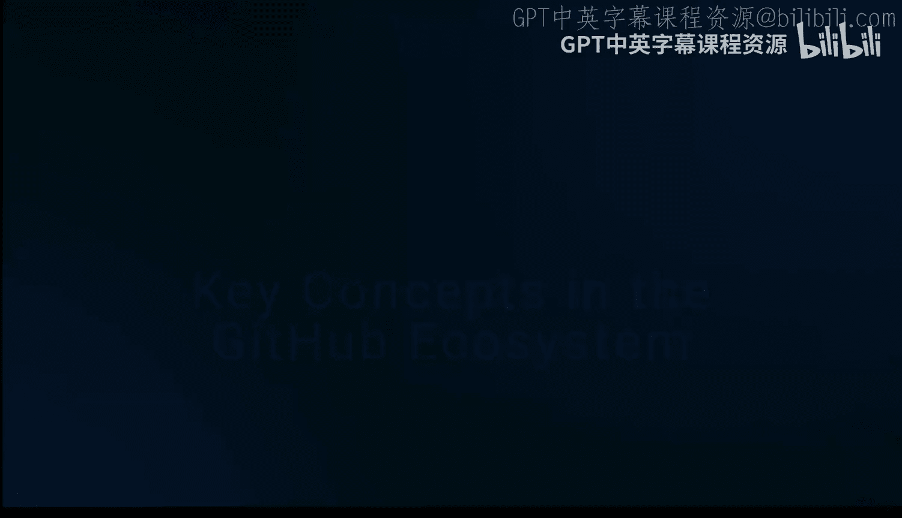
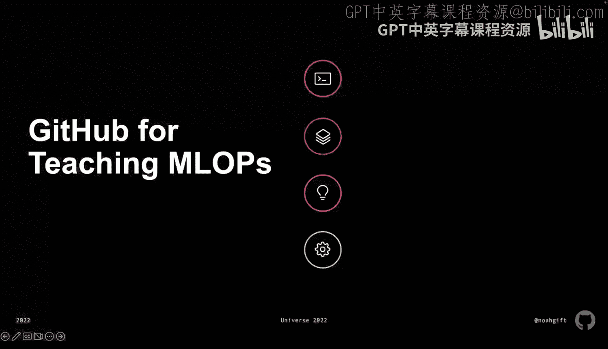
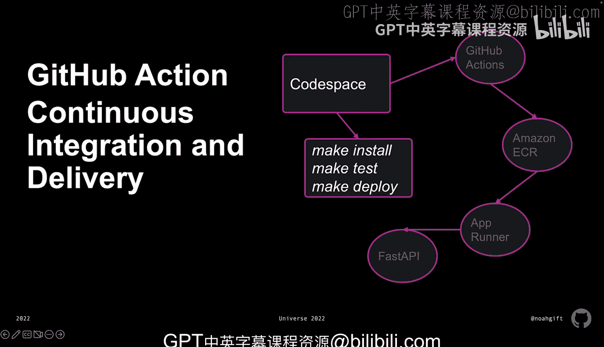

#  078：GitHub生态系统核心概念 🚀



在本节课中，我们将学习GitHub生态系统的核心概念，了解它如何为机器学习和数据工程项目提供支持。我们将重点探讨四个关键方面：可复现性、GPU访问、AI编码助手以及持续集成与部署。



---

## 可复现性与Codespaces

上一节我们介绍了GitHub生态系统的概览，本节中我们来看看如何利用Codespaces实现环境的可复现性。可复现性对于团队协作和教学至关重要，它确保每个人都能在完全相同的环境中工作。

Codespaces是一个基于云的开发环境和工作空间，其核心是一个内置的容器镜像。这个镜像可以是Ubuntu、微软创建的镜像，或任何与Docker兼容的镜像。你可以通过 `.devcontainer` 配置文件来自定义它，以满足你的特定需求。

以下是Codespaces的三个核心优势：

*   **基于容器的环境**：它提供了一个预配置的、可移植的开发环境。
*   **可定制的计算与存储**：你可以配置Codespaces使用GPU、多核CPU或高内存机器。
*   **类生产环境**：这使你能够在与生产环境相似的系统上进行测试和构建，减少部署时的意外问题。

---

## GPU访问与深度学习

理解了环境可复现性后，我们来看看如何利用GitHub Codespaces访问GPU资源。这对于运行计算密集型的机器学习任务，如使用预训练模型或微调模型，非常有价值。

通过配置Codespaces使用GPU，你可以直接利用强大的计算资源，而无需购买昂贵的硬件。这为学习和实验降低了门槛。

借助GPU，你可以进行以下操作：

*   **使用预训练模型**：例如，从Hugging Face下载模型并进行微调。Hugging Face经常与PyTorch配合使用。
*   **构建深度学习模型**：你可以使用PyTorch或TensorFlow从头开始构建自己的模型。
*   **进行底层开发**：甚至可以深入NVIDIA CUDA SDK，编写直接应用于GPU的函数。

---

## AI编码助手：Copilot

在拥有了强大的计算环境和GPU资源后，如何更高效地编写代码呢？本节我们将介绍GitHub Copilot，这是一个AI驱动的编码助手，能显著提升开发效率。

Copilot能够根据你的项目上下文提供代码建议，甚至为你生成样板代码。通过与Copilot对话，你可以获得关于代码编写、工具构建等方面的实时建议。

Copilot能帮助你建立一个持续改进的良性循环：

1.  **获取建议**：Copilot为你的代码提供补全和建议。
2.  **集成分析**：你可以要求Copilot运行代码分析（如使用Pylint）、执行测试（如使用pytest）或在IPython中运行代码。
3.  **快速迭代**：这个过程可以带来开发速度数倍的提升。

---

## 持续集成与部署：GitHub Actions

最后，当我们完成了代码开发与测试，如何将其自动化地部署到生产环境呢？这就是GitHub Actions的用武之地。它实现了持续集成（CI）和持续部署（CD）的自动化流程。

你可以在Codespaces环境中，通过Makefile执行标准的构建步骤，例如 `make install`（安装依赖）、`make test`（运行测试）和 `make deploy`（部署）。然后，利用GitHub Actions自动化这些步骤。

一个典型的自动化部署流程如下：

```yaml
# 这是一个GitHub Actions工作流的简化概念描述
1. 代码推送到GitHub仓库。
2. GitHub Actions被触发，运行 `make install` 和 `make test`。
3. 测试通过后，执行 `make deploy`，将容器镜像推送到Amazon ECR（容器注册表）。
4. 镜像推送成功触发AWS App Runner（平台即服务），自动部署应用程序。
```

这个过程确保了你用于开发的环境（Codespaces）与最终部署的环境高度一致，使得从开发到生产的过渡非常平滑，符合CI/CD的最佳实践。

---

## 总结



本节课中，我们一起学习了GitHub生态系统中四个核心概念：**Codespaces** 提供了可复现的云开发环境；**GPU访问** 赋能了高效的深度学习工作流；**Copilot** AI助手大幅提升了编码效率；而 **GitHub Actions** 则实现了从代码到部署的自动化流水线。掌握这些工具，能为你的数据工程和机器学习项目提供一个强大、集成且高效的开发与运维基础。