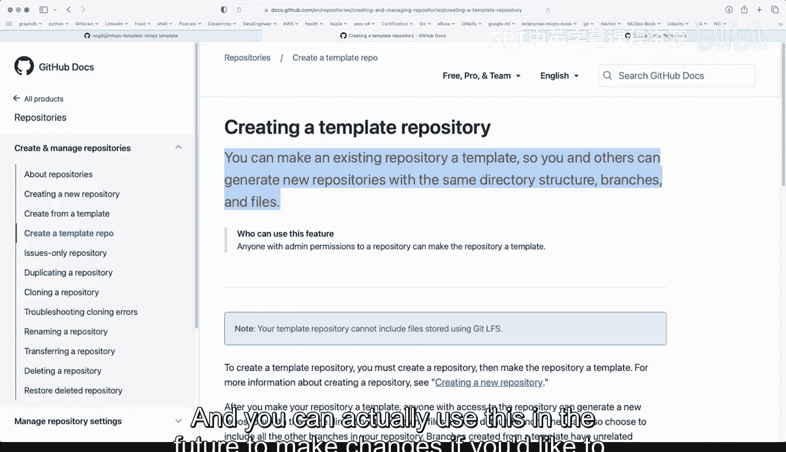

#  079：使用GitHub模板

## 概述

在本节课中，我们将学习如何基于GitHub模板创建一个新的代码仓库。我们将了解模板的优势，并演示如何从现有模板创建仓库、进行自定义修改，以及如何将自己创建的仓库设置为模板供他人使用。

## 创建基于模板的新仓库

上一节我们介绍了GitHub模板的概念，本节中我们来看看如何实际操作。

让我们基于一个模板在GitHub上创建一个新的仓库。这里，我将查看“Microsoft Codespaces Teaching Template Pi”。可以看到这是一个公共模板。这个模板的好处在于，我可以基于它来自定义自己的工作流程。

要开始使用，我只需点击“Use this template”按钮，然后选择我的仓库，它就会将所有文件复制到这个新仓库中。

让我们开始操作。我将这个仓库命名为“Amlos Template”，因为我打算用它来创建我自己的模板。我们可以将其描述为“Emmalos Template”。然后我选择将其设为公开仓库。如果需要，我们也可以包含任何分支，但在这个例子中，只包含主分支就足够了。

## 自定义项目脚手架

现在，我们已经有了一个基于模板的仓库，接下来可以对其进行自定义。

当我为项目创建自己的脚手架时，我喜欢使用Makefile。因此，我可能会修改这个模板，添加一些不同的文件。我们可以快速完成这个操作，甚至可以直接通过这个界面创建文件。

例如，如果我在这里选择“Create new file”，并命名为“Makefile”，这就可以成为我添加到项目中的内容之一。同样，如果我想自定义开发容器（dev container），增强它或进行一些更改，我也可以这样做。

## 将仓库设置为模板

自定义完成后，我就可以将这个仓库设置为模板供他人使用。

接下来，我将进入仓库的设置页面。在仓库的设置中，我可以勾选“Template repository”选项。这样做的好处是，我可以将这个模板提供给学生或工作场所的其他人，他们将来也能使用它。

如果我们返回仓库主页，可以看到它现在显示为“Public Template”。将来，如果我想基于这个模板创建一个新项目，我只需选择“Use this template”即可。

GitHub还提供了一些额外的文档，名为“Creating a template repository”。如果你在创建自己的仓库时想要进行修改，将来可以参考这些文档。

## 总结

本节课中，我们一起学习了如何使用GitHub模板。我们了解了从现有模板创建新仓库的步骤，探讨了如何通过添加文件（如Makefile）来自定义项目脚手架，并最终学会了如何将自己的仓库设置为一个可复用的模板。掌握这些技能可以帮助你快速启动新项目，并促进团队内的代码复用和协作。