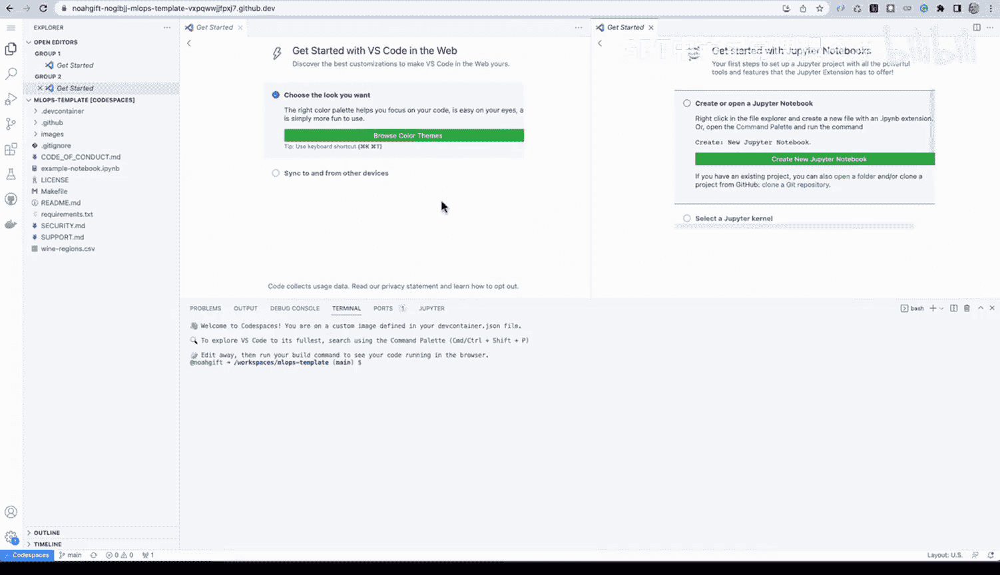
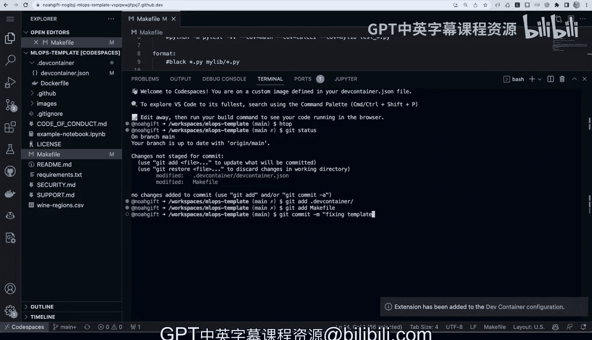

#  080：使用GitHub Codespaces定制开发环境


在本节课中，我们将学习如何利用GitHub Codespaces来定制一个开发环境模板。我们将从创建一个代码空间开始，逐步配置开发容器、安装扩展、设置个性化选项，并最终保存为一个可复用的模板。

## 概述

GitHub Codespaces提供了一个基于云的完整开发环境。本节将演示如何从一个公共模板仓库开始，通过选择机器配置、启用预构建容器、安装必要的扩展以及自定义开发容器配置文件，来创建一个满足特定需求的个性化开发环境。最终，这个环境可以被保存并分享给他人使用。

## 选择与启动代码空间

首先，我们有一个包含开发容器配置文件和GitHub Actions工作流的公共模板仓库。为了满足个人需求并修改此模板，我们将使用GitHub Codespaces。

进入仓库的“Codespaces”选项卡，默认会进入云端编辑模式。在这里，我们可以选择代码空间的配置。根据任务需求，可以从多种机器类型中进行选择。例如，进行多核概念教学时，可以选择16核的机器；而进行GPU相关的任务（如微调Hugging Face模型）时，则应选择配备GPU的机器。

我们选择GPU机型，然后点击“创建代码空间”。启动过程需要一些时间。

## 加速启动：预构建容器

为了加速未来代码空间的启动速度，我们可以启用“预构建容器”功能。这是一个非常实用的特性。

代码空间启动后，进入其“设置”。在“Codespaces”选项下，可以找到“预构建配置”的设置。我们启用此功能，并选择主分支（main branch）。这样设置后，每次向该分支推送代码时，系统都会自动重建此代码空间环境，从而显著提升后续的启动效率。

系统正在启动，我们可以看到它正在为开发环境配置各种选项。一旦环境设置完成，我们就可以开始定制模板了。

## 定制开发环境

关于这个特定环境，需要注意的一点是，我们可以通过修改开发容器（dev container）的配置文件来自定义它，这正是我们将要做的。

首先，我喜欢配置代码空间的外观。进入“设置”（Settings），找到“颜色主题”（Color Theme），将其更改为“Colorblind Beta”。这个主题提供了高对比度，具有良好的可访问性。我们也可以适当调整字体大小。

接下来，安装一些扩展来增强功能。进入“扩展”（Extensions）视图。
以下是需要安装的扩展：
*   **Codium**： 我选择安装其夜间构建版，以获取最新功能。
*   **GitHub Copilot Labs**： 这个扩展能提供代码翻译等辅助功能。



安装后，分别在这两个扩展上右键点击，选择“添加到开发容器”（Add to Dev Container）。这样做的好处是，将来其他人使用这个模板时，也能自动获得这些扩展功能。

## 配置Makefile与环境

现在，回到环境文件。我喜欢在项目中配置一个`Makefile`，并为其安装一个语法支持扩展。

首先，为`Makefile`安装一个扩展（例如“Makefile support”），并同样将其“添加到开发容器”。

然后，打开或创建项目根目录下的`Makefile`文件。我们可以在这里粘贴一些预定义的命令模板。
以下是一个`Makefile`的示例内容：
```makefile
# 部署项目
deploy:
    @echo "运行部署脚本..."

# 安装软件依赖
install:
    pip install -r requirements.txt

# 运行测试
test:
    pytest

# 格式化代码
format:
    black .

# 代码检查
lint:
    flake8
```
通过这个`Makefile`，我们可以为使用者提供清晰的指导，告诉他们如何安装依赖、运行测试、格式化代码以及进行代码检查。这一切都封装在一个模板化的环境中。

此外，我们可以在终端验证环境资源。输入`htop`命令，可以看到这个环境拥有高内存配置。如果输入`nvidia-smi`命令，还可以检查GPU是否正常运行。

## 保存与提交更改

所有配置完成后，最后一步是将更改保存并提交到仓库，从而更新这个模板。

在终端中，运行以下命令：
```bash
git add .devcontainer
git add Makefile
git commit -m "更新开发容器配置和Makefile模板"
git push
```
现在，其他人就可以使用这个更新后的、功能更丰富的模板了。

## 总结



本节课中，我们一起学习了如何使用GitHub Codespaces定制开发环境。我们从选择机器配置和启用预构建容器开始，以提高效率；然后逐步安装了如Codium和Copilot Labs等扩展，并配置了`Makefile`来标准化项目操作。最后，通过提交更改，我们将这些个性化设置保存到了模板仓库中。这个过程使得创建和分享一个功能齐全、预配置好的开发环境变得非常简单。