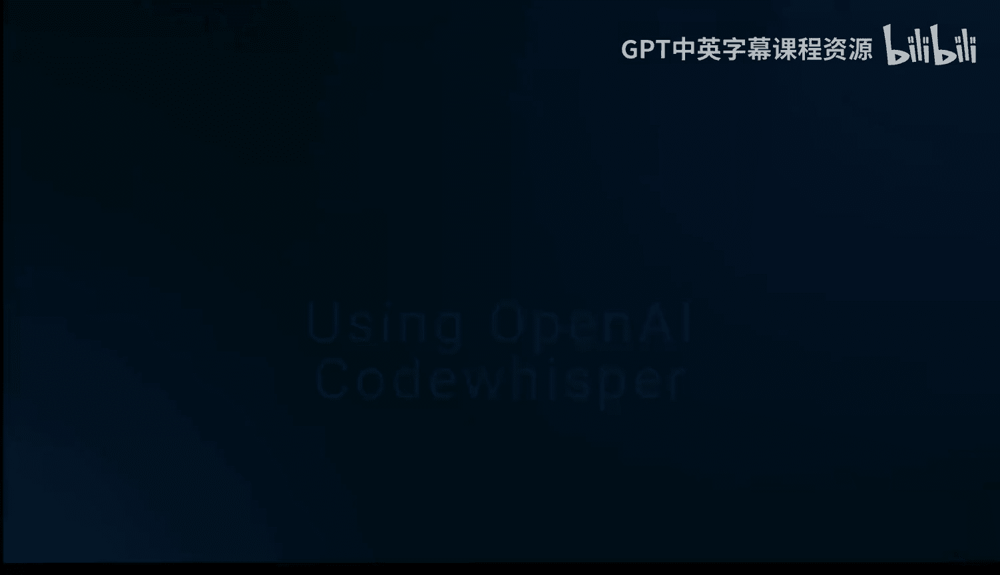
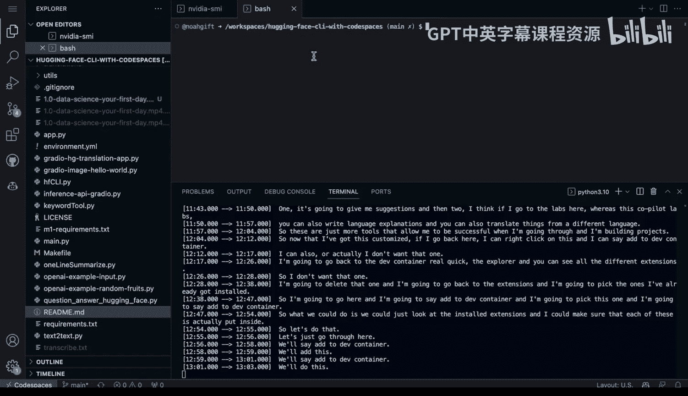

#  081：使用OpenAI Whisper与GPU加速

## 概述
在本节课中，我们将学习如何在配备GPU的Codespace环境中，使用OpenAI的Whisper模型进行大规模音频文件的转录工作，并监控GPU资源的使用情况。

---

上一节我们介绍了如何在云端环境中部署工具，本节中我们来看看如何利用强大的GPU资源来运行AI模型。

这里有一个NVIDIA监控工具，可以让我查看此处NVIDIA GPU的完全利用率。

你可以看到这里的CUDA驱动版本是11.7，GPU使用率为43%。在另一个终端中，我正在运行Whisper，它能够利用Codespace上的GPU。我也能够转录非常大的文件，这得益于Codespace提供的存储空间。

对于使用基于GPU实例的数据科学和机器学习学生来说，这确实是一个进行GPU相关工作的绝佳环境。

---

我们也可以切换到这里查看每个进程。事实上，我不仅能够充分利用GPU，还能够使用这台六核机器，并利用这些重型GPU机器上可用的大内存空间。

你可以看到有110 GB内存可用。这意味着我实际上可以再运行几个转录任务，使用OpenAI的Whisper，同时监控我的资源。之后，如果我想对转录数据进行文本摘要或运行其他Hugging Face预训练模型，一切都可以顺利进行。

---

以下是利用该环境进行工作的关键优势列表：
*   **GPU加速**：Whisper等模型可以利用GPU（`CUDA 11.7`）显著提升处理速度。
*   **大存储空间**：能够处理非常庞大的音频文件。
*   **强大计算资源**：使用多核CPU（如六核）和大内存（110 GB）支持复杂任务。
*   **资源监控**：通过工具（如`nvidia-smi`）实时监控GPU使用率，确保高效利用。
*   **集成工作流**：为后续的文本处理任务（如摘要、其他模型微调）提供了准备好的数据基础。

---

## 总结
本节课中我们一起学习了在云端的Codespace环境中，如何配置并利用GPU资源来运行OpenAI Whisper进行音频转录。我们看到了监控GPU使用率的方法，并了解了该环境如何为数据科学和机器学习项目提供强大的计算能力和存储空间，支持从转录到后续高级文本处理的全流程工作。