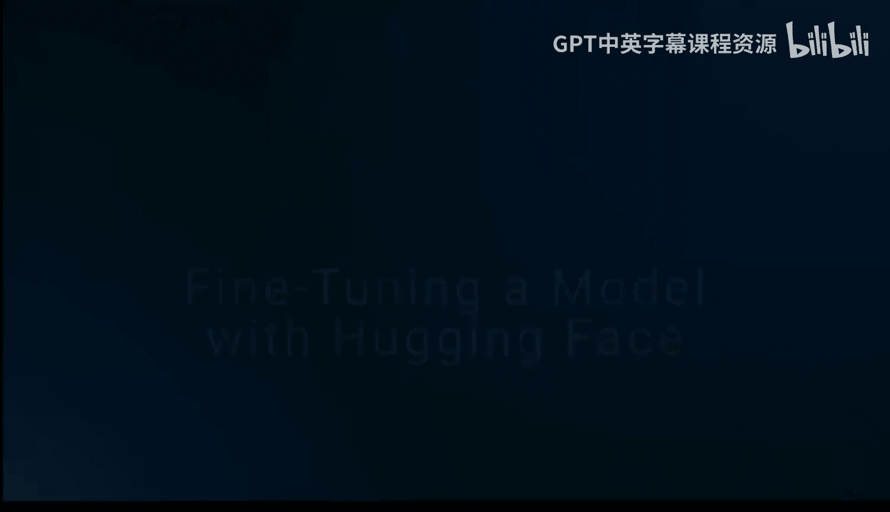
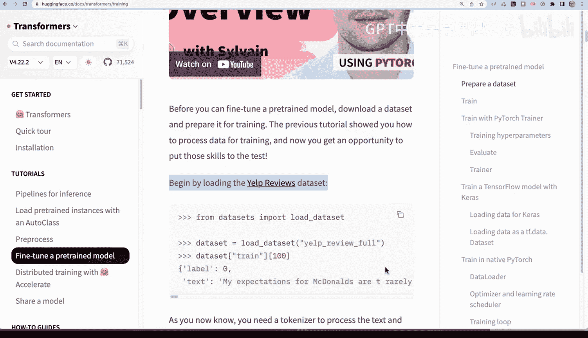
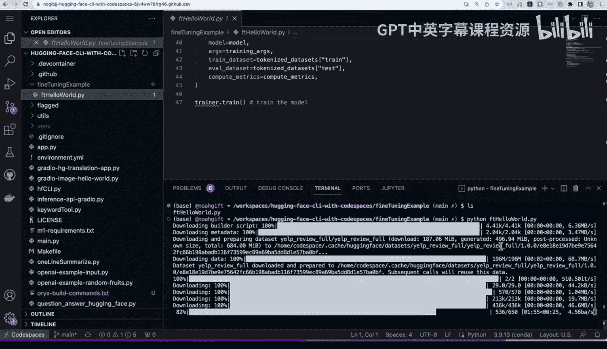
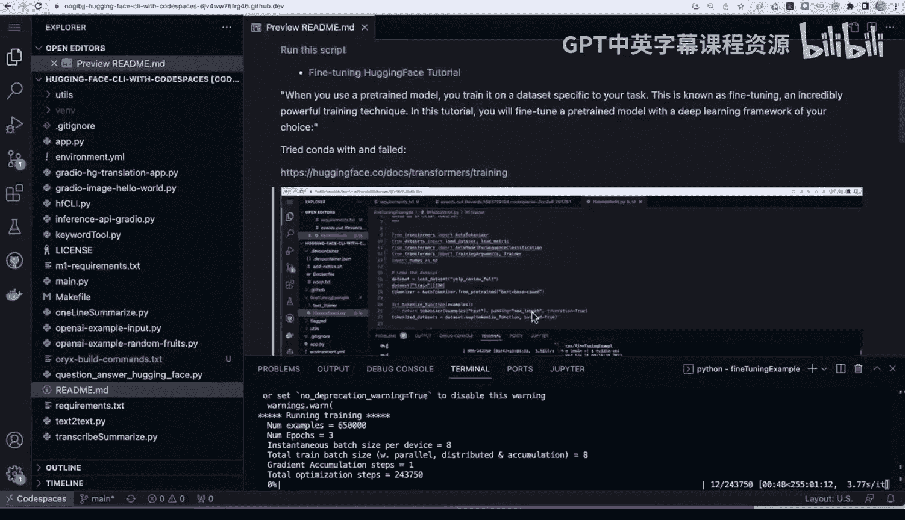

#  082：使用Hugging Face微调模型



在本节课中，我们将学习如何使用Hugging Face这一流行的模型托管服务来微调预训练模型。我们将了解其核心功能，并逐步演示如何下载模型与数据集，并在GPU环境中进行微调。

## 概述Hugging Face平台

Hugging Face平台主要提供三个核心功能：**模型**、**数据集**和**Spaces**。

*   **模型**：这里托管了大量预训练模型。目前平台上有超过75,000个模型，并且数量还在快速增长。
*   **数据集**：平台也提供了丰富的数据集，可用于模型训练和评估。
*   **Spaces**：这是一个用于展示和分享模型演示应用的功能。

这些模型关联着不同的任务，例如文本摘要、分类、问答等。我们可以通过浏览特定模型页面来试用这些功能。

## 探索与使用预训练模型

上一节我们介绍了Hugging Face的核心功能，本节中我们来看看如何具体使用一个模型。例如，如果我们进入“文本摘要”任务区，并找到Google的Pegasus模型，就可以直接在网页上运行示例并查看效果。

输入一段关于埃菲尔铁塔的文本，模型能够生成相应的摘要。这项服务被广泛用于生产环境和实验研究。

## 微调预训练模型的概念

了解了如何直接使用模型后，我们来看看如何根据特定需求定制模型。核心概念是：**下载一个预训练模型，然后根据你的特定需求对其进行微调**。

Hugging Face提供了详细的教程，指导我们如何完成这个过程。通常，你需要从平台下载一个数据集，然后在启用了GPU的Github Codespace环境中进行模型微调。

## 微调实战：代码流程解析

现在，让我们深入一个具体的代码示例，看看微调是如何一步步实现的。

以下是微调过程的关键步骤代码概览：

```python
# 1. 导入必要的库
from transformers import AutoTokenizer, AutoModelForSequenceClassification
from datasets import load_dataset, load_metric



# 2. 加载数据集
dataset = load_dataset("glue", "mrpc")



# 3. 加载分词器并处理数据
tokenizer = AutoTokenizer.from_pretrained("bert-base-cased")
def tokenize_function(examples):
    return tokenizer(examples["sentence1"], examples["sentence2"], truncation=True)
tokenized_datasets = dataset.map(tokenize_function, batched=True)

# 4. 加载预训练模型
model = AutoModelForSequenceClassification.from_pretrained("bert-base-cased", num_labels=2)

# 5. 定义评估函数（例如准确率）
metric = load_metric("glue", "mrpc")
def compute_metrics(eval_pred):
    predictions, labels = eval_pred
    predictions = predictions.argmax(axis=-1)
    return metric.compute(predictions=predictions, references=labels)

# 6. 设置训练参数并开始微调
from transformers import Trainer, TrainingArguments
training_args = TrainingArguments(output_dir="./results", evaluation_strategy="epoch")
trainer = Trainer(
    model=model,
    args=training_args,
    train_dataset=tokenized_datasets["train"],
    eval_dataset=tokenized_datasets["validation"],
    compute_metrics=compute_metrics,
)
trainer.train() # 开始训练
```

这段代码展示了完整的流程：从加载数据和分词器，到加载预训练模型，最后使用`Trainer`进行微调。执行`trainer.train()`即可启动训练过程。

## 训练环境与监控

训练速度很大程度上取决于运行环境。使用CPU和启用GPU会有显著差异。

为了监控GPU在训练过程中的使用情况，可以使用`nvidia-smi`命令。下图展示了一个长时间微调任务的监控截图，可以看到GPU利用率达到了94%，这表明计算资源得到了充分利用。



## 总结


本节课中我们一起学习了Hugging Face平台的核心用途。我们了解了如何利用其托管的预训练模型和数据集，并重点掌握了**微调**的基本流程：即下载通用模型后，使用特定数据对其进行额外训练，使其适应新任务。整个过程可以通过Github Codespaces结合GPU加速来完成，是一种高效且直接的方法。