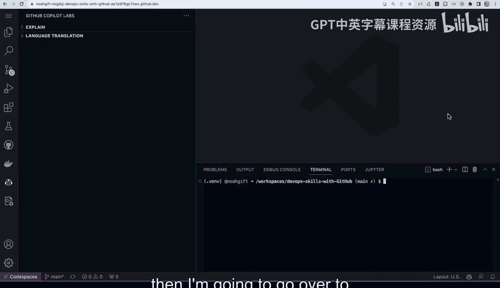
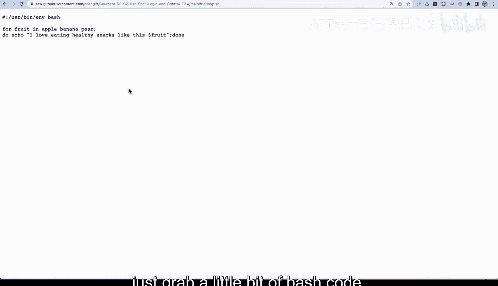
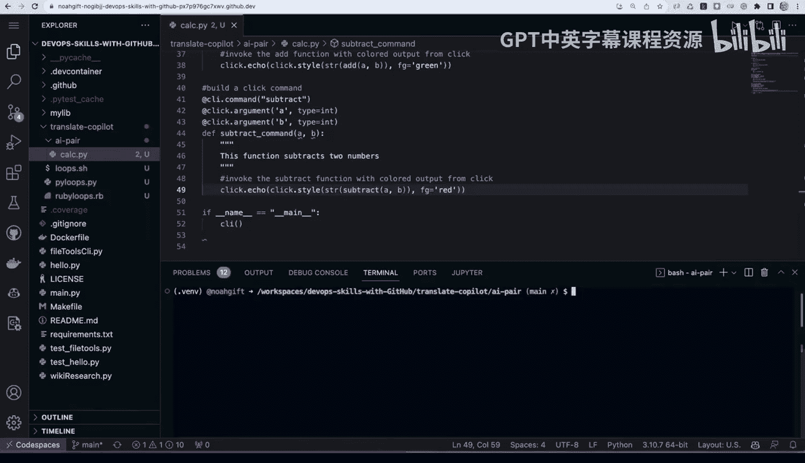

#  083：使用GitHub Copilot


## 概述
在本节课中，我们将学习如何使用GitHub Copilot来辅助编程。我们将探索两个主要功能：代码翻译和结对编程。通过实际操作，你将了解如何利用Copilot快速学习新语言、生成代码片段以及构建完整的命令行工具。

---

## 代码翻译功能

上一节我们介绍了GitHub Copilot的基本概念，本节中我们来看看它的代码翻译功能。





我已在一个启用了Copilot的代码仓库中。我们转到扩展区域，这里有一个“GitHub Copilot Labs”选项。它提供了一些实验性功能，其中包括代码翻译能力。同时，我也启用了GitHub Copilot扩展。有两个版本：Copilot和Copilot Nightly。我使用的是最新版本。我们将尝试这两个扩展。

为了开始使用，我们先查看一下GitHub Copilot Labs。它的作用是允许我们翻译代码。如果我点击这个选项并切换开关，它就会进行翻译。

以下是开始使用的步骤：

1.  我可以从一个现有的仓库复制一些代码。我将创建一个名为`loops`的文件。
2.  接着，我去另一个仓库复制一小段Bash代码。
3.  我将这段代码粘贴到`loops`文件中。
4.  现在我有了一段Bash代码。实际上，我们可以运行它。只需输入`bash loops`即可。

运行后，我们得到了预期的输出。现在，如果我想翻译这段代码，并了解它在Python中会是什么样子，我可以转到Copilot的“语言翻译”功能。看，它已经识别了这段代码。它能够高亮显示这里的文本。

Python是一个很好的尝试对象。一个好的做法是创建一个专门的翻译目录。

我们可以输入：
```bash
mkdir translate_copilot
```
然后，将`loops`文件移动到`translate_copilot`目录中，这样所有内容都在同一个目录下。接着，我进入这个`translate_copilot`目录。

从这里，如果我向Copilot请求建议，它会给我一个很好的例子。现在我可以创建一个Python版本的循环文件，我们称之为`p_loops.py`。

我们做同样的事情。转到`translate_copilot`目录，找到我们的`p_loops.py`文件。让我们试一下。如果我运行`python p_loops.py`，我们得到了相同的结果。

这确实是一个非常棒的学习新语言的方式，特别是当你已经掌握一门语言时。它能让你非常快速地迁移代码。

实际上，我们可以超越Python和Bash。我们可以快速回到Copilot这里，抓取这段代码，然后说：现在我想把它翻译成Ruby。

让我们开始做吧。我们选择Ruby，看，我们也可以轻松得到一个Ruby脚本。我们将创建`ruby_loops.rb`文件。

这是一个在不同语言之间进行翻译的非常直接的过程，体验确实很棒。

---

## 结对编程与工作流构建

上一节我们体验了代码翻译，本节中我们来看看如何通过与Copilot结对编程来构建更复杂的工作流。

这里的核心思想是，Copilot就像另一位开发者。我们将创建一个名为`ai_pair`的目录，并进入该目录。

在这个`ai_pair`目录中，我将创建一个名为`calc`的文件。这个文件将用于向Copilot寻求帮助。

为了让提示更有效，我可以在文件顶部说明我们想要它做什么。例如，添加注释说明这个模块用于创建计算函数，比如加法和减法。随着我不断调整，提示会变得越来越好。

我们还可以在这里添加shebang行，这会告诉它我们最终会将其变成一个脚本。然后，我们可以快速将其设置为可执行文件。这样，我们应该就能直接运行它了。

开始后，看，它很聪明，已经知道我想做什么。这类似于我对另一个人类开发者说的话。一旦第一个函数完成，减法函数也随之而来，依此类推。既然我们已经有了几个函数，这就足够了。

现在我想做的是开始调整代码的方向，并告诉它我想构建一个命令行工具。例如，添加注释说明这个模块也将作为一个命令行脚本被调用，使用`click`库。

我们再次在这里提供一些引导。只需写上`import click`。

要使用它，我需要做的就是告诉它我想创建一个组。我会说“构建一个click组”。然后它会为我构建出所有的样板代码。这样我就不用自己写这些样板代码了。它甚至会帮我写建议。

我们可以继续，并说明这是一个计算器应用。现在我已经构建好了这个，我还可以构建命令。它足够聪明，知道我的意图。我只需要灵活地填写它不知道如何完美填充的部分。

接下来，我将构建第二个命令。在这种情况下，它足够聪明，知道我前进的方向。我们可以继续构建其余部分。看，减法命令将使用这个函数。

现在，为了构建这个，我需要做的就是从命令行调用它。让我们快速试一下。我们可以查看帮助信息。我们有加法函数。我们可以计算2加2。我们也可以计算2加6。我们还可以使用减法函数。

如果我们想让它更花哨一点，一个简单的方法是让输出带有颜色。我可以直接告诉Copilot，它记住了很多样板代码，说“使用click的彩色输出调用add函数”。看，它稍微调整了一下。完美。然后这个函数可能也足够聪明，知道我想要彩色输出。确实如此。

现在，如果我返回，我们得到了每个工具的彩色输出。所以，使用Copilot的一个非常直接的方式就是温和地提示它，让它为你构建东西。从这个计算器工具，你可以看到它能多快地帮你构建出样板代码。

---



## 总结
本节课中，我们一起学习了GitHub Copilot的两个核心应用。首先，我们利用其代码翻译功能，快速将Bash脚本转换为Python和Ruby脚本，这为学习新语言提供了极大便利。其次，我们体验了与Copilot结对编程，通过逐步提示，引导它协助我们构建了一个功能完整的、带有彩色输出的命令行计算器工具。整个过程展示了Copilot如何理解开发者意图、生成样板代码并加速开发流程。