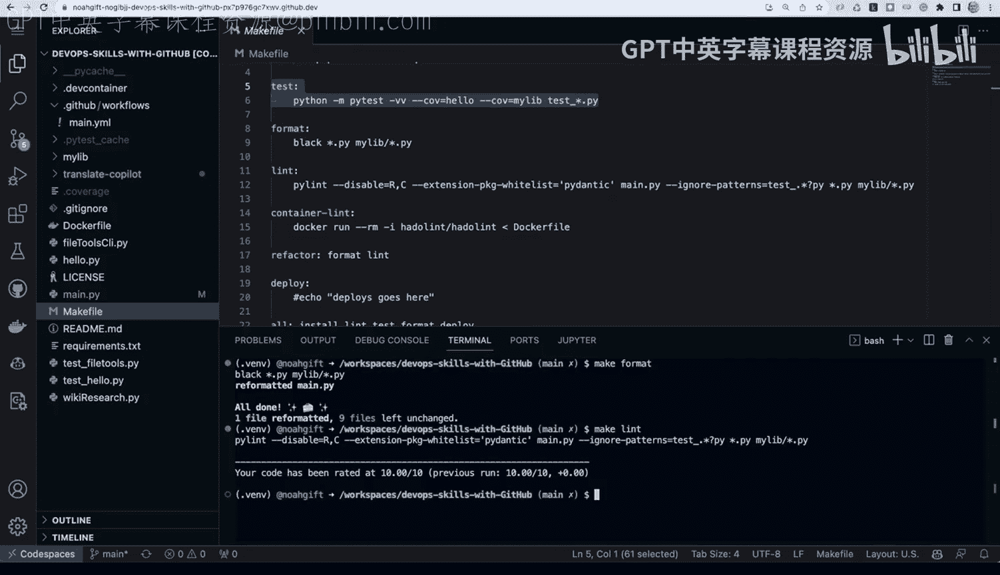
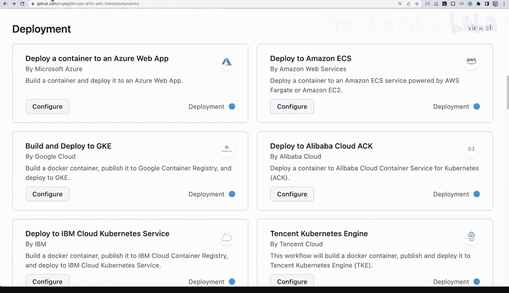
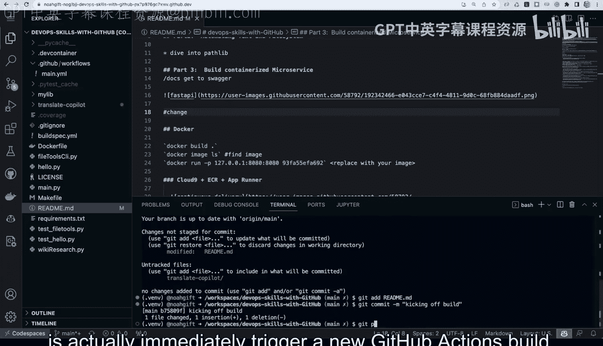
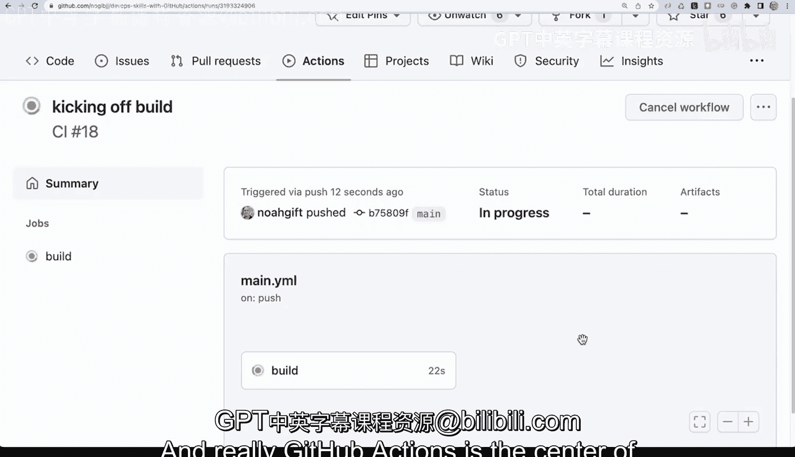

#  084：GitHub Actions入门教程 🚀


在本节课中，我们将学习如何为项目启用和使用GitHub Actions，以实现自动化构建、测试和部署流程。我们将通过一个具体的项目示例，了解其核心配置和工作原理。

## 概述

GitHub Actions是一个强大的持续集成和持续部署平台，允许开发者在代码仓库中直接自动化工作流程。通过编写YAML配置文件，可以定义在特定事件（如代码推送）发生时自动执行的一系列任务。

## 启用GitHub Actions的项目结构

让我们先观察一个已启用GitHub Actions的项目。任何配置了Actions的项目都会在 `.github/workflows/` 目录下包含一个或多个YAML配置文件。

```yaml
# .github/workflows/main.yml 示例结构
name: CI

on: [push]

jobs:
  build:
    runs-on: ubuntu-latest
    steps:
      - name: Install Dependencies
        run: make install
      - name: Lint Code
        run: make lint
      - name: Run Tests
        run: make test
      - name: Format Code
        run: make format
```

在上述配置中，我们定义了一个在 `ubuntu-latest` 环境中运行的作业。它也可以运行在GitHub Actions支持的任何其他容器、自定义容器甚至自定义开发空间中。每个步骤都通过 `- name` 来标识，并执行相应的 `make` 命令。

## 与Makefile的关联

上一节我们介绍了工作流配置文件，本节中我们来看看它如何与项目中的 `Makefile` 关联。

`Makefile` 中定义了构建过程的各个具体步骤。将GitHub Actions的YAML文件直接链接到 `Makefile` 的好处在于，你无需在Actions中重新思考要运行什么命令，只需运行与本地开发时相同的命令即可。



例如，如果我想在本地格式化代码，只需运行 `make format`。同样，当这个命令在GitHub Actions环境中运行时，也会执行完全相同的操作。这种一致性简化了开发到部署的流程。

以下是一个 `Makefile` 的示例内容：

```makefile
# Makefile 示例
install:
    pip install -r requirements.txt

lint:
    flake8 .

test:
    pytest

format:
    black .
```

## 创建新的工作流

了解了基本结构后，我们来看看如何在GitHub上创建一个新的工作流。

在GitHub仓库页面，点击“Actions”选项卡。系统会提供几种不同的选项来帮助你开始：
*   你可以选择“自行设置工作流”，这将提供一个基础模板。
*   你也可以浏览GitHub提供的众多“建议的工作流”示例，例如用于发布Python包的模板。

虽然直接使用模板是一个不错的起点，但结合使用 `Makefile` 能更好地保持本地开发与云端自动化的一致性。这些示例也提供了遵循最佳实践的宝贵指南。

GitHub Actions的强大之处在于它能用于多种场景，包括自动化测试和部署，这正是它成为现代DevOps工作流核心的原因。



## 实战：观察工作流运行

现在，让我们通过一个实际操作来观察GitHub Actions是如何工作的。

首先，假设我们想测试项目中的某些更改。我们可以使用 `git stash` 命令暂存当前的修改。

```bash
git stash
```

接着，我们对项目中的某个脚本进行一个小修改。修改完成后，我们检查状态并提交这次更改。

```bash
git status
git add .
git commit -m “kicking off build”
```

当我们推送这次提交时，它会立即触发一个新的GitHub Actions构建任务。我们可以在Actions页面中逐步查看YAML文件中定义的每个步骤的执行情况。

对于部署流程，一个典型的推荐步骤顺序是：`make install`（安装依赖）、`make lint`（代码检查）、`make test`（运行测试），最后是 `make deploy`（执行部署）。GitHub Actions能够将代码推送到生产环境，是构建专业DevOps工作流的中心组件。

## 总结





本节课中，我们一起学习了GitHub Actions的核心概念和基本使用方法。我们了解了工作流YAML文件的结构、它与 `Makefile` 的关联、如何创建新工作流，并通过一个实战示例观察了其自动化执行过程。掌握GitHub Actions能显著提升代码集成与部署的效率和可靠性。