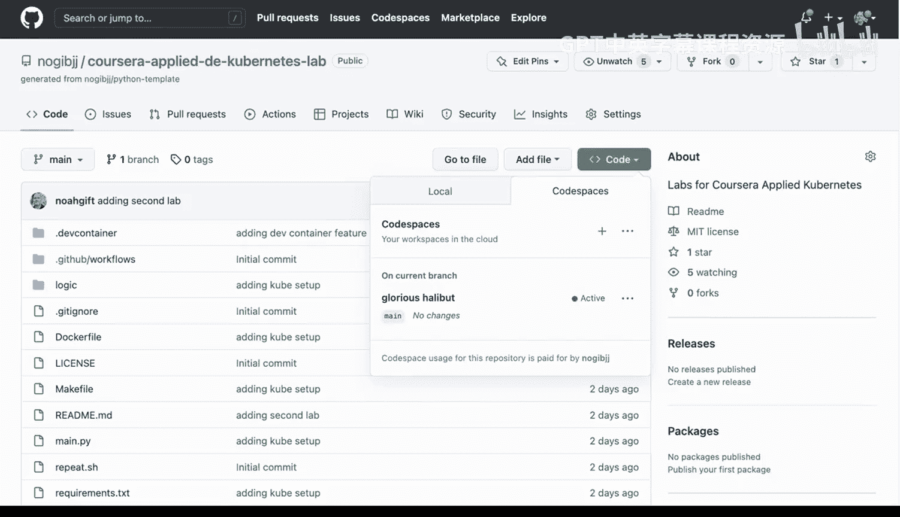
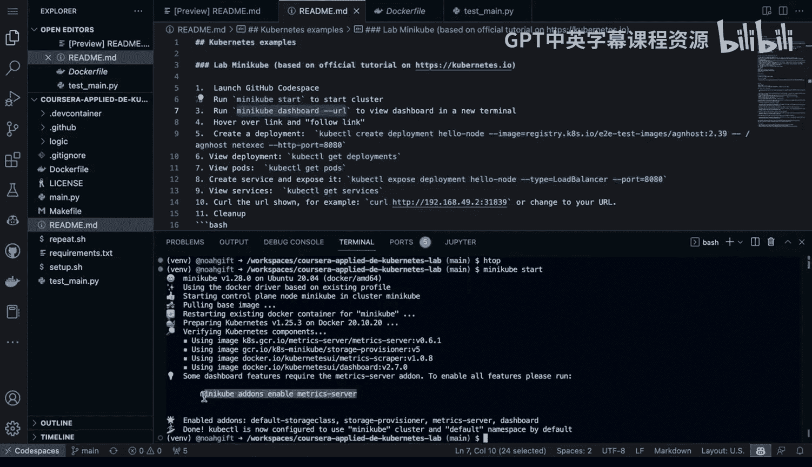
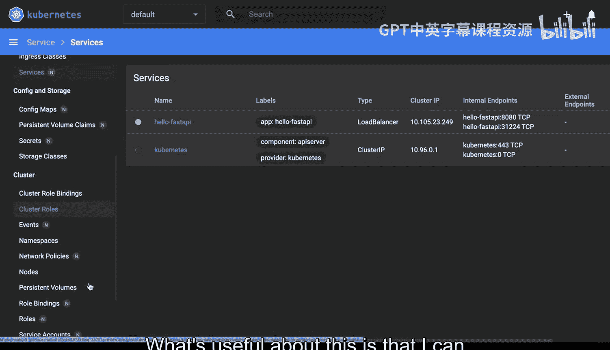
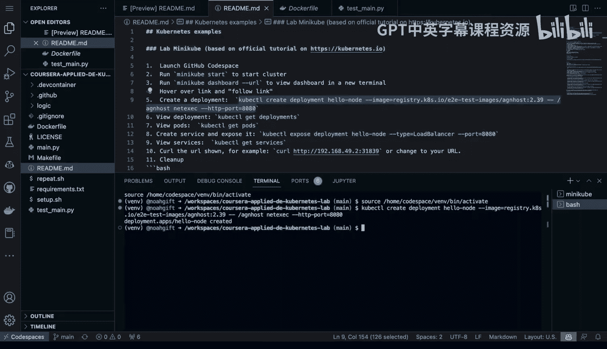
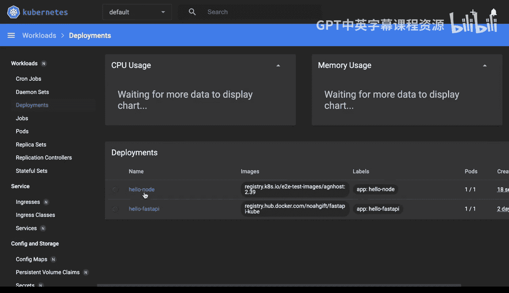
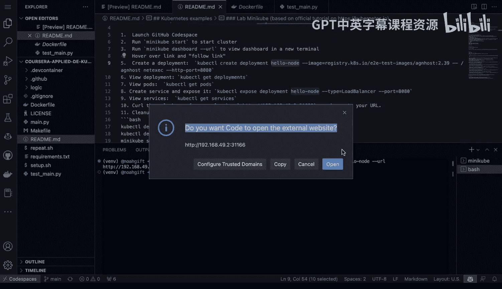
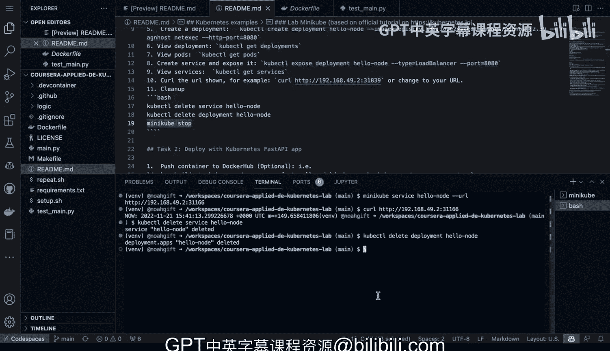

#  085：在GitHub Codespaces中运行Minikube 🚀


在本节课中，我们将学习如何在GitHub Codespaces环境中设置和运行Minikube，这是一个用于本地学习和开发Kubernetes的工具。我们将通过一系列步骤，从启动Minikube到部署一个示例服务，并最终清理环境。

---

## 概述

Kubernetes官方文档中有一个名为“Hello Minikube”的教程，指导用户如何在环境中进行设置。探索Kubernetes和容器的一个理想环境是GitHub Codespaces。本节教程将引导你使用一个预配置的代码仓库，在Codespaces中启动Minikube集群、部署应用并通过仪表板进行监控。

---

## 启动Minikube集群

首先，我们需要在GitHub Codespaces环境中启动Minikube。GitHub Codespaces的优势在于它提供了一个基于云的托管环境，与你的代码仓库直接映射，无需担心本地机器上产生失控进程。



以下是启动Minikube的步骤：

1.  在终端中运行启动命令：
    ```bash
    minikube start
    ```
    此命令将在当前Codespaces环境中本地启动Minikube系统。

2.  启动后，可以打开一个新的终端窗口，运行 `htop` 命令来监控系统资源使用情况，观察Kubernetes相关进程的运行状态。

---

## 启用指标服务器与仪表板

上一节我们启动了Minikube集群，本节中我们来看看如何启用附加功能以便更好地监控和管理集群。



1.  启用指标服务器，它为集群提供资源使用指标：
    ```bash
    minikube addons enable metrics-server
    ```

2.  创建Kubernetes仪表板的访问URL：
    ```bash
    minikube dashboard
    ```
    执行此命令后，会生成一个URL。在GitHub Codespaces中，你可以直接点击该链接，它将在浏览器中打开一个全面的Kubernetes仪表板。

在仪表板中，你可以查看工作负载状态、部署、Pod和副本集等信息，并与之交互。

---

## 部署示例服务

现在集群和仪表板已就绪，接下来我们部署一个示例服务到集群中。



以下是创建和查看部署的步骤：

1.  使用 `kubectl` 命令创建一个新的部署。本例使用一个预构建的容器镜像：
    ```bash
    kubectl create deployment hello-node --image=registry.k8s.io/echoserver:1.4
    ```

2.  验证部署是否成功。有两种方法：
    *   **通过仪表板**：在仪表板的“部署”部分查找名为 `hello-node` 的部署。
    *   **通过终端**：运行以下命令查看部署和Pod状态：
        ```bash
        kubectl get deployments
        kubectl get pods
        ```



---



## 暴露与访问服务

部署完成后，我们需要将服务暴露出来，以便能够从外部访问它。

以下是暴露和访问服务的步骤：

1.  将部署的服务暴露为一个NodePort类型的Kubernetes服务：
    ```bash
    kubectl expose deployment hello-node --type=NodePort --port=8080
    ```

2.  获取服务的访问信息：
    *   使用 `kubectl` 命令查看服务详情，获取IP地址和端口。
    *   一个更便捷的方法是使用Minikube命令直接获取服务的可访问URL：
        ```bash
        minikube service hello-node --url
        ```
        复制输出的URL，在浏览器中打开或使用 `curl` 命令测试，服务应返回一个包含时间戳的响应。

---

## 清理环境

实验结束后，清理资源是一个好习惯，可以释放系统资源。

以下是清理环境的步骤：



1.  删除创建的服务：
    ```bash
    kubectl delete service hello-node
    ```
2.  删除部署：
    ```bash
    kubectl delete deployment hello-node
    ```
3.  （可选）停止Minikube集群：
    ```bash
    minikube stop
    ```

---

## 总结



本节课中我们一起学习了在GitHub Codespaces环境中运行Minikube的完整流程。我们从启动Minikube集群开始，然后启用了指标服务器并访问了仪表板。接着，我们部署了一个名为 `hello-node` 的示例应用，将其服务暴露给外部网络，并通过浏览器和命令行两种方式进行了访问验证。最后，我们演示了如何删除服务和部署以清理环境。这个过程展示了在隔离的云开发环境中安全、便捷地学习和操作Kubernetes的基本方法。