#  089：将FastAPI-PyTorch容器化应用部署到AWS App Runner 🚀

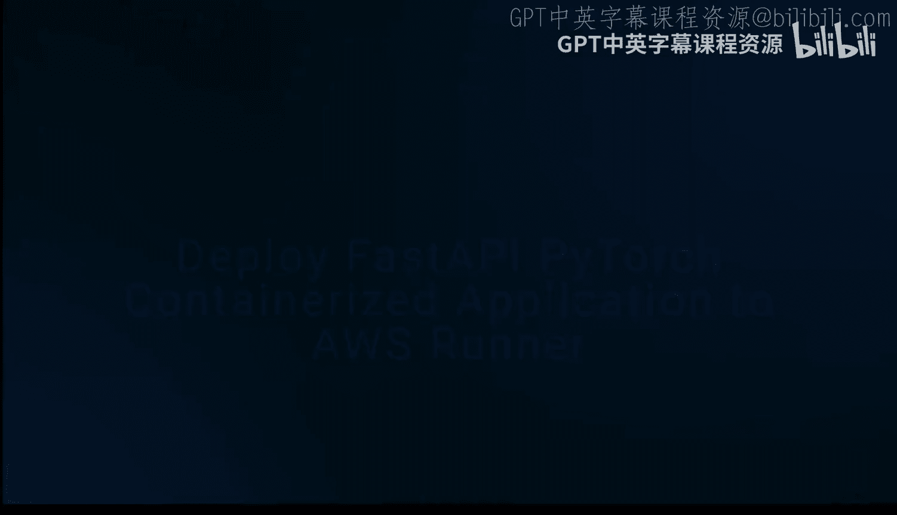

在本节课中，我们将学习如何将一个结合了FastAPI和PyTorch的机器学习应用容器化，并部署到AWS的App Runner服务上。整个过程涵盖了从本地开发、Docker容器构建、推送到AWS容器仓库，到最终在云端运行服务的完整流程。

---

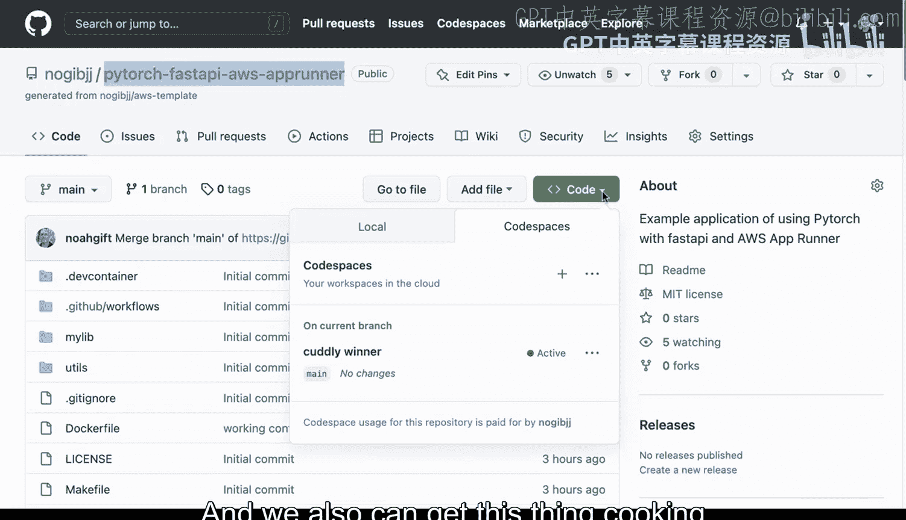

## 环境准备与代码概览

首先，我们进入一个包含PyTorch和FastAPI应用的新代码仓库。这个应用已经配置好，可以部署到AWS App Runner这个平台即服务产品。

我们可以在Github Codespaces环境中直接运行此项目。当前环境已经启动。让我们查看一下项目的`requirements.txt`文件，其中列出了所需的依赖包。

```txt
fastapi
uvicorn
pillow
torch
torchvision
```

这些依赖包已经准备就绪。此外，我们还需要确保PyTorch已正确安装，当前环境已满足此条件。

---

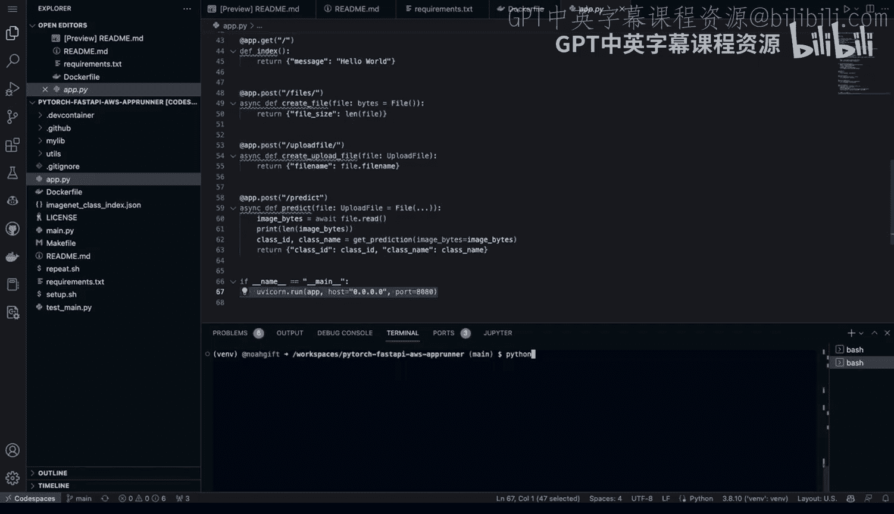

## 项目结构与核心代码


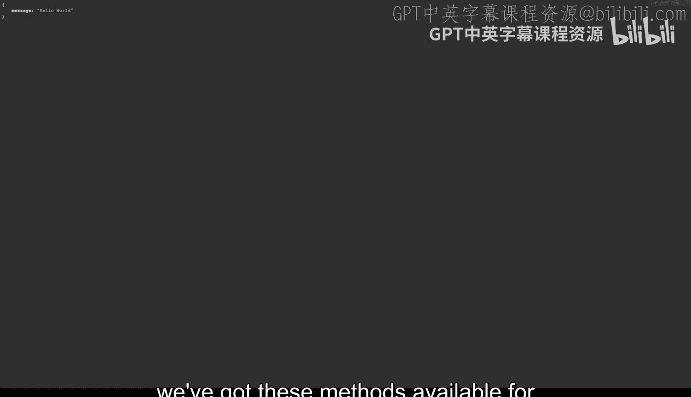

上一节我们检查了运行环境，本节中我们来看看项目的核心文件。

项目包含一个`Dockerfile`，用于构建Docker镜像。这个过程非常简单。

以下是应用的主要代码文件`app.py`的核心逻辑：

1.  **导入必要的库**：包括FastAPI、PyTorch及其工具库。
2.  **初始化模型**：加载一个预训练的PyTorch模型。
3.  **设置FastAPI应用**：创建FastAPI应用实例。
4.  **定义辅助函数**：
    *   `transform_image`: 处理上传的图片，将其转换为模型可接受的张量格式。
    *   `get_prediction`: 使用加载的模型对处理后的图片进行预测。
5.  **定义API端点**：
    *   `/`: 一个简单的“Hello World”端点，用于调试。
    *   `/predict`: 主要的预测端点，接收图片文件，调用辅助函数进行处理和预测，并返回结果（例如，判断图片是否为猫）。

代码的最后部分启动了FastAPI应用。

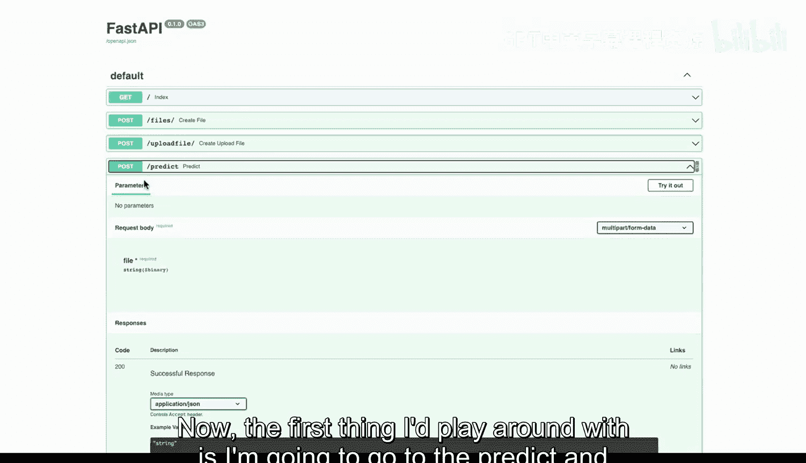

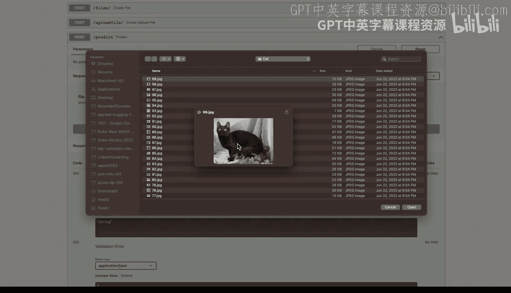

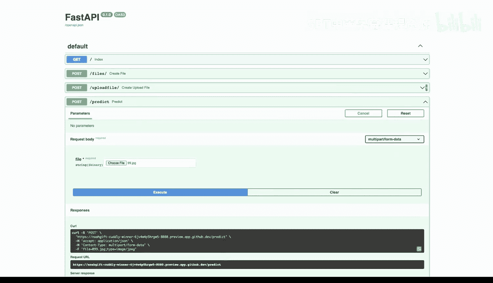

---

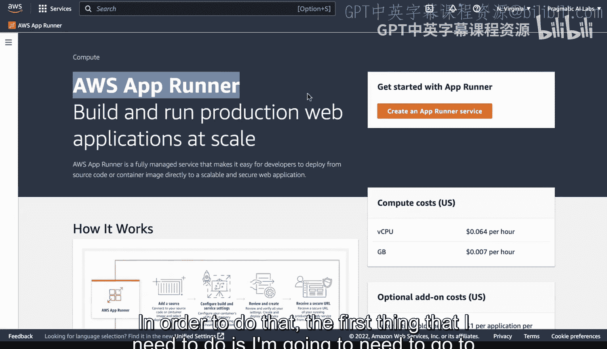

## 本地运行与测试

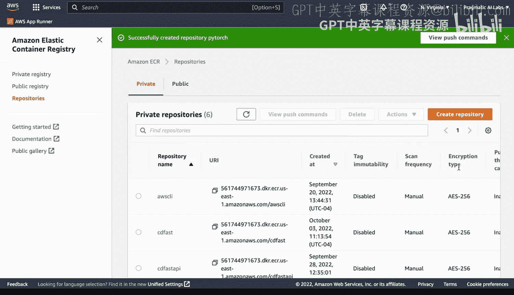

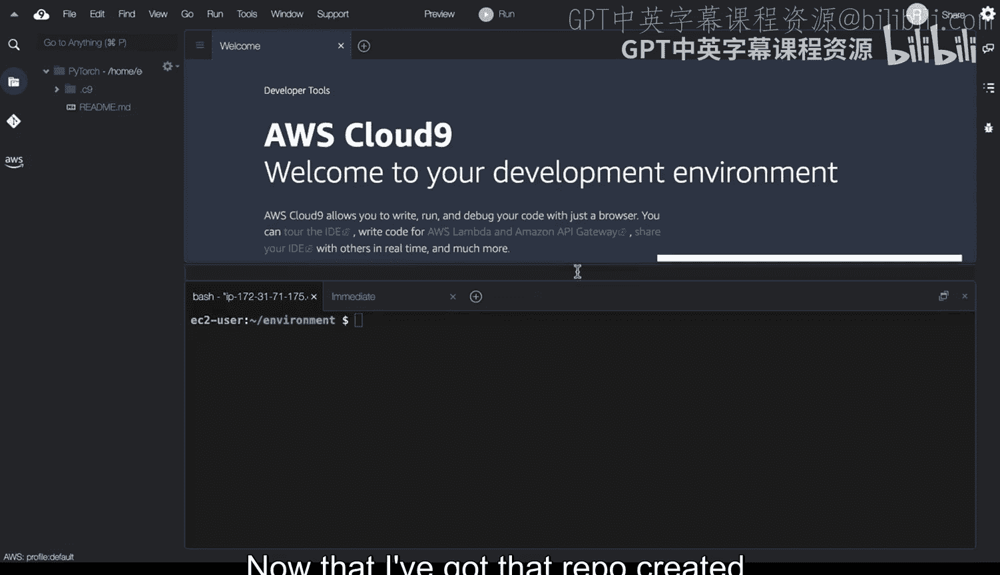

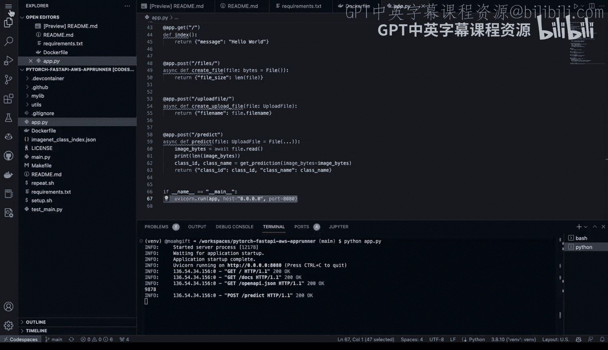

现在，让我们在本地运行这个应用，以确保一切正常。

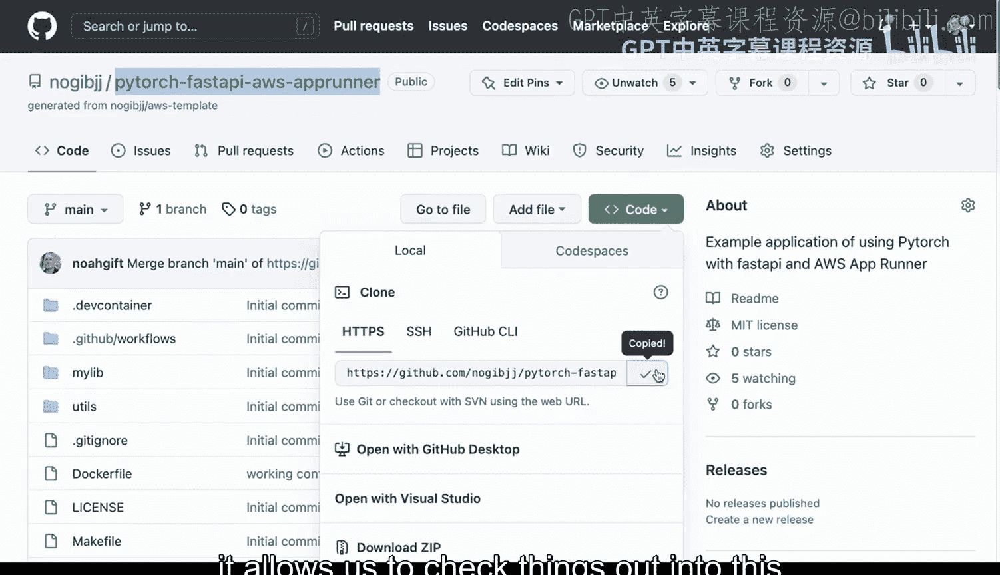

在终端中执行命令：
```bash
python app.py
```
应用启动后，我们可以在浏览器中访问其提供的交互式API文档。访问`/docs`路径，即可看到Swagger UI界面。

在Swagger界面中，我们可以测试`/predict`端点。选择一张本地图片（例如一张埃及猫的图片）进行上传并执行。服务成功返回了预测结果，确认了图片内容为猫。

至此，我们拥有了一个功能完整的、可用于MLOps场景的FastAPI + PyTorch服务。

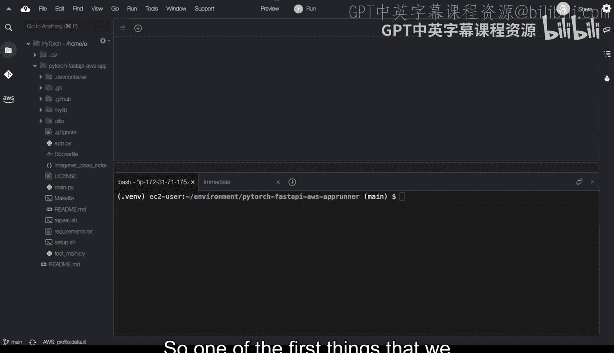

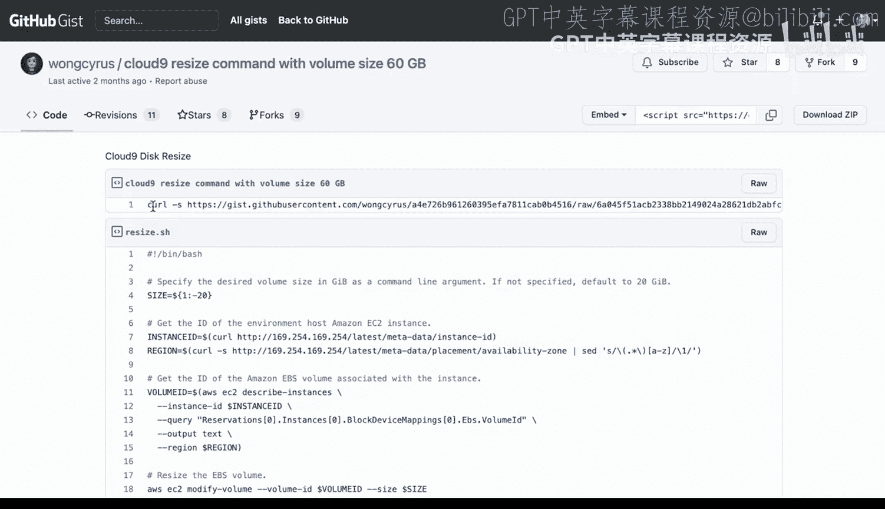

---

## 构建与推送Docker镜像到AWS ECR

为了将应用部署到AWS App Runner，我们需要先将应用容器化，并将镜像推送到AWS的Elastic Container Registry。

以下是具体步骤：

1.  **在AWS控制台创建ECR仓库**：我们创建一个名为`pytorch-fastapi`的私有仓库。
2.  **准备AWS Cloud9构建环境**：Cloud9是AWS提供的云端IDE，类似于Github Codespaces，方便我们进行构建。在Cloud9中克隆项目代码仓库。
3.  **设置Python虚拟环境并安装依赖**：
    ```bash
    python3 -m venv venv
    source venv/bin/activate
    pip install -r requirements.txt
    ```
4.  **可选：调整Cloud9环境磁盘大小**：为了顺利构建容器，有时需要扩大Cloud9实例的存储空间。
5.  **构建Docker镜像**：使用项目中的`Dockerfile`构建镜像。
    ```bash
    docker build -t pytorch-fastapi .
    ```
6.  **本地测试Docker容器**：运行刚构建的镜像，并在Cloud9的预览功能中访问应用，重复之前的预测测试，确保容器化后的应用工作正常。
    ```bash
    docker run -p 8080:8080 <image_id>
    ```
7.  **标记并推送镜像到ECR**：首先登录ECR，然后为本地镜像打上ECR仓库的标签，最后推送。
    ```bash
    aws ecr get-login-password --region <region> | docker login --username AWS --password-stdin <account_id>.dkr.ecr.<region>.amazonaws.com
    docker tag pytorch-fastapi:latest <account_id>.dkr.ecr.<region>.amazonaws.com/pytorch-fastapi:latest
    docker push <account_id>.dkr.ecr.<region>.amazonaws.com/pytorch-fastapi:latest
    ```

---

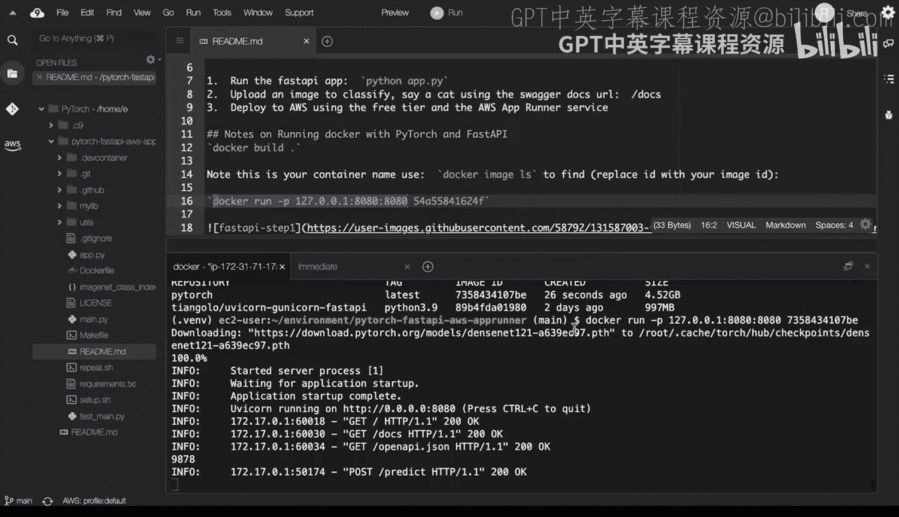

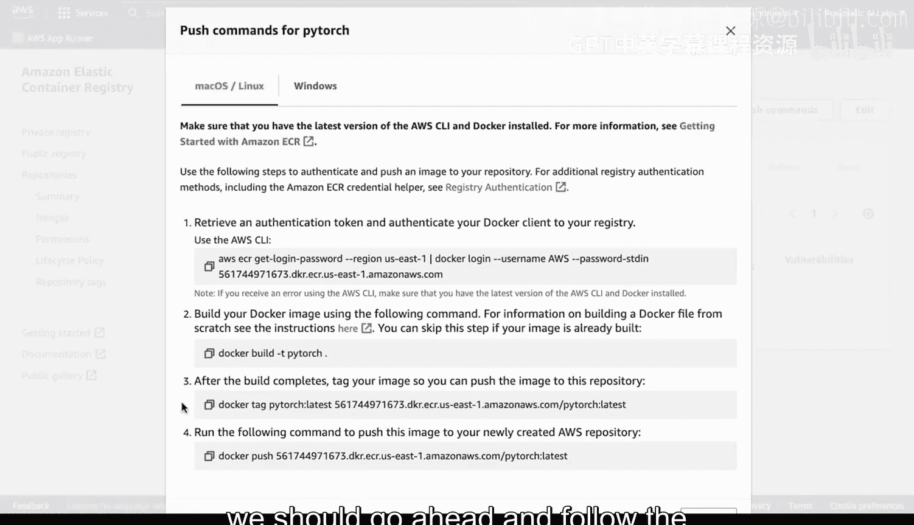

## 在AWS App Runner上部署服务

镜像推送成功后，我们就可以在AWS App Runner上创建服务了。

以下是部署流程：

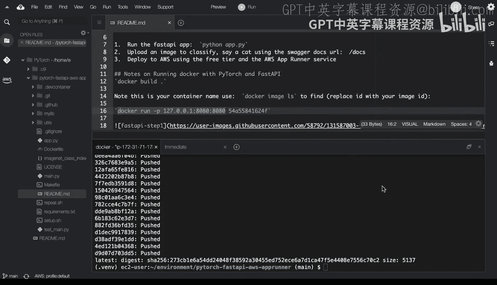

1.  在AWS控制台进入App Runner服务，点击“创建服务”。
2.  选择“容器注册表”作为源代码，并找到我们刚刚推送到ECR的镜像（`pytorch-fastapi:latest`）。
3.  配置服务：
    *   **服务名称**：例如 `pytorch-container-service`。
    *   **部署设置**：选择“自动部署”，这样每次推送新镜像到ECR时，服务会自动更新。
    *   **计算配置**：根据需求选择适当的CPU和内存规格（例如，为机器学习推理选择较高的配置）。
4.  创建服务后，App Runner会自动从ECR拉取镜像并启动容器。我们可以在控制台查看部署日志，监控健康检查状态。
5.  服务启动完成后，App Runner会分配一个HTTPS端点（域名）。这个域名是加密的，提供了安全的访问方式。

---

## 验证云端部署

现在，我们的机器学习微服务已经运行在云端。我们可以通过App Runner提供的域名来访问它。

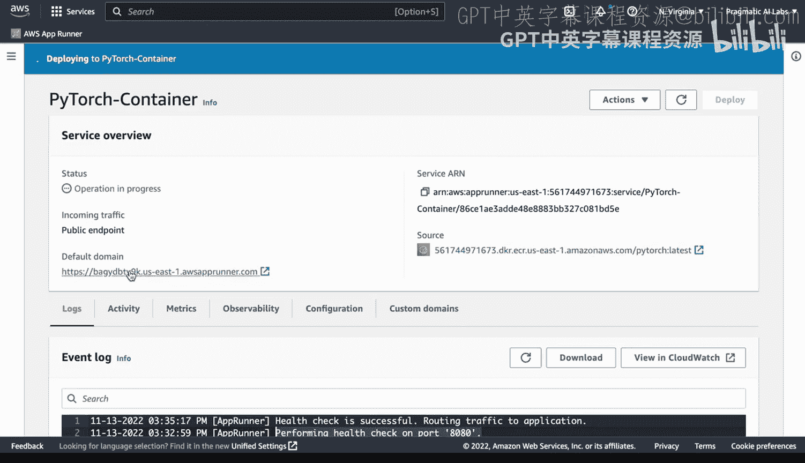

1.  在浏览器中打开服务域名后的`/docs`路径（例如，`https://your-service-id.region.awsapprunner.com/docs`）。
2.  再次打开Swagger UI界面，测试`/predict`端点。
3.  上传同一张猫的图片并执行预测。服务成功返回了预测结果。

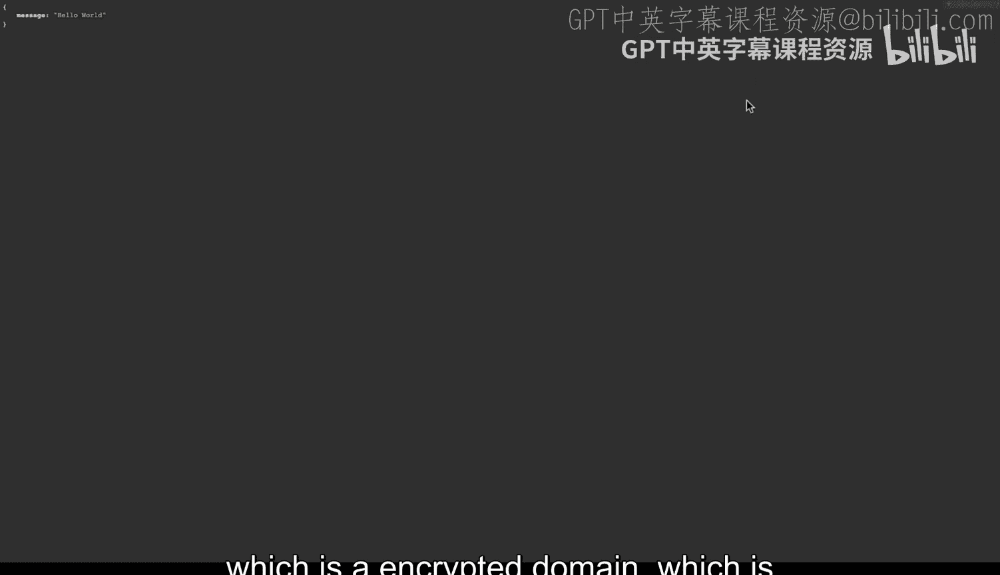

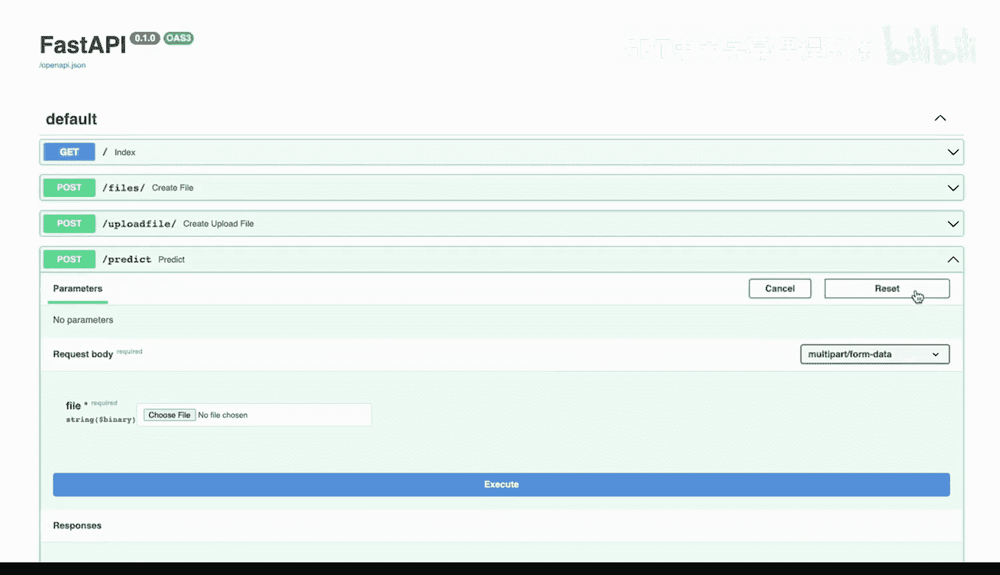

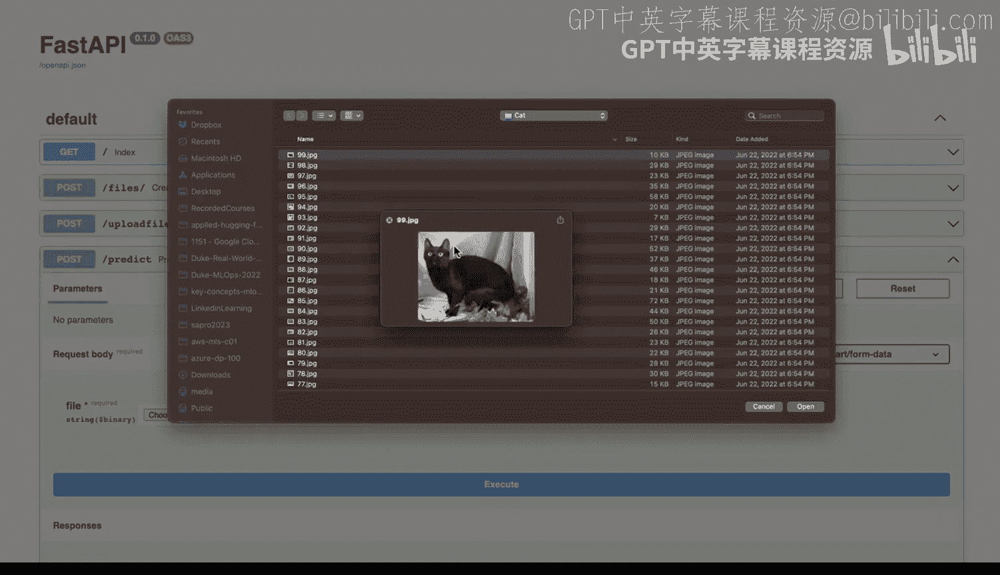

这表明我们已成功将一个生产级的机器学习微服务，通过简单的几步操作，部署到了AWS云平台，并且可供其他用户或系统访问。

---

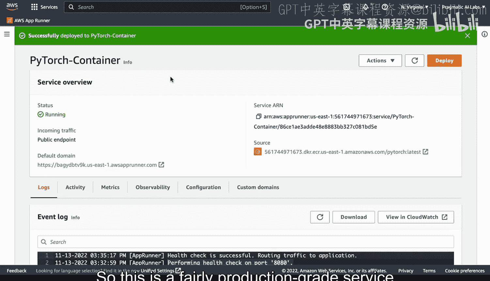

本节课中我们一起学习了将FastAPI与PyTorch结合的机器学习应用进行容器化，并利用AWS Cloud9构建环境、ECR容器仓库和App Runner无服务器容器服务，实现从本地开发到云端部署的完整流程。这套方法能高效地构建和部署可扩展的MLOps应用。