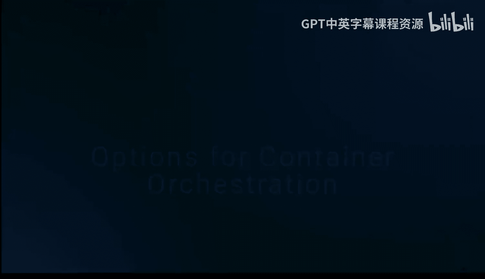
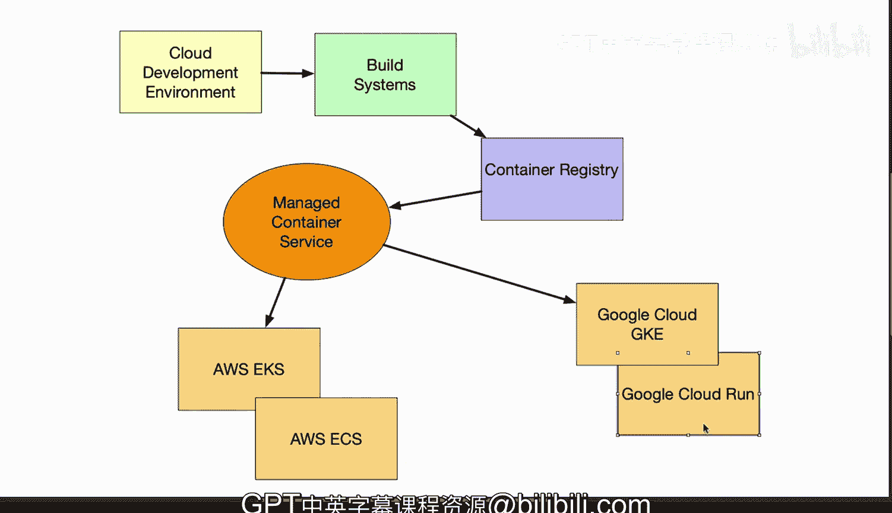

#  090：容器编排方案

在本节课中，我们将学习基于容器的部署服务管理方案。我们将探讨从本地开发到云上生产环境的完整流程，并比较不同云服务商提供的托管容器服务选项。

## 概述

在云原生应用开发中，容器化部署是标准实践。开发者通常在本地或云端开发环境中构建和测试容器，然后通过构建系统将其推送到生产环境。整个过程涉及容器注册表、托管容器服务等多个环节。理解这些组件如何协同工作，对于高效、经济地部署应用至关重要。

## 容器化部署流程

上一节我们介绍了容器化的基本概念，本节中我们来看看一个典型的、基于云的容器化部署工作流是如何运作的。

整个流程可以概括为以下几个核心阶段：

1.  **开发与本地测试**：在云端开发环境（如 AWS Cloud9、Google Cloud Workstations 或 GitHub Codespaces）或本地环境中进行开发，并构建和测试容器。
2.  **构建与推送**：通过构建系统（如 GitHub Actions、AWS CodeBuild）将容器镜像推送到容器注册表。
3.  **部署与运行**：从容器注册表拉取镜像，并在托管的容器服务中运行。

以下是该流程中涉及的关键组件及其作用：

*   **开发环境**：用于编写代码和构建初始容器镜像的地方。
*   **构建系统**：自动化流程，负责构建最终的容器镜像并将其推送到注册表。
*   **容器注册表**：存储和管理容器镜像的仓库，例如 Docker Hub 或云服务商提供的注册表（如 AWS ECR、Google Container Registry）。
*   **托管容器服务**：在云上运行和管理容器化应用的服务。

## 托管容器服务选项

理解了基本流程后，我们来看看流程的终点——托管容器服务。云服务商提供了多种不同抽象级别的服务。

核心原则是：**尽可能使用最高级别的托管服务**。这通常更高效且成本更低，因为云服务商负责了底层基础设施的繁重管理工作。

以下是不同云平台的主要托管容器服务示例：

*   **亚马逊云科技 (AWS)**：
    *   **Amazon EKS (Elastic Kubernetes Service)**：托管的 Kubernetes 服务。你无需管理 Kubernetes 控制平面。
    *   **Amazon ECS (Elastic Container Service)**：AWS 自研的容器编排服务，与 AWS 其他服务深度集成。
*   **谷歌云 (Google Cloud)**：
    *   **Google Kubernetes Engine (GKE)**：托管的 Kubernetes 服务。
    *   **Google Cloud Run**：一个更高级别的无服务器容器平台。你只需提供容器镜像，它就能自动运行和扩缩容，部署命令极其简单。
*   **其他云平台**：如微软 Azure 的 AKS (Azure Kubernetes Service)，其模式也类似。

## 总结与最佳实践

本节课中我们一起学习了基于容器的云上部署架构。

总的来说，在处理云基系统时，你应该预期会用到上述的架构覆盖。一个关键的最佳实践是：**通常你不应该通过自建的、自我管理的 Kubernetes 集群来部署应用**。相反，你应该利用云服务商提供的托管服务，让领域的专家为你完成繁重的基础设施管理工作，从而使你能够更专注于应用本身的开发与业务逻辑。

选择哪种具体服务，取决于你对控制粒度、易用性以及与特定云生态集成的需求。对于大多数应用场景，从高级别服务（如 Cloud Run）开始尝试，是快速上手的有效途径。