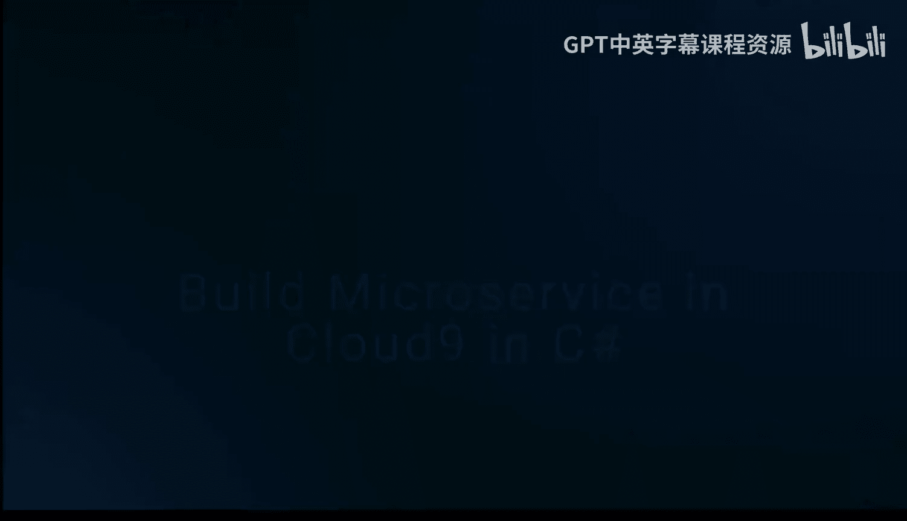
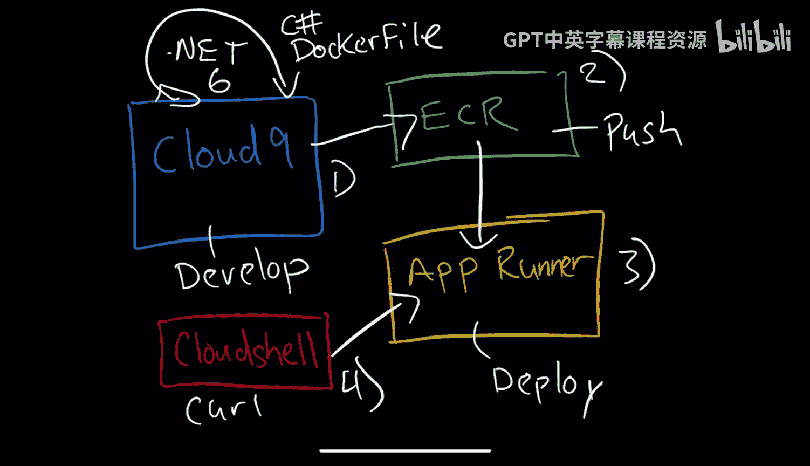
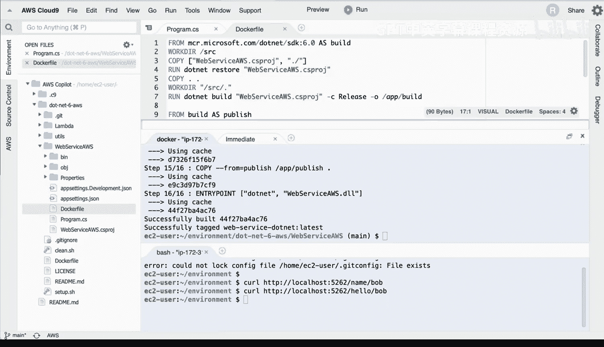
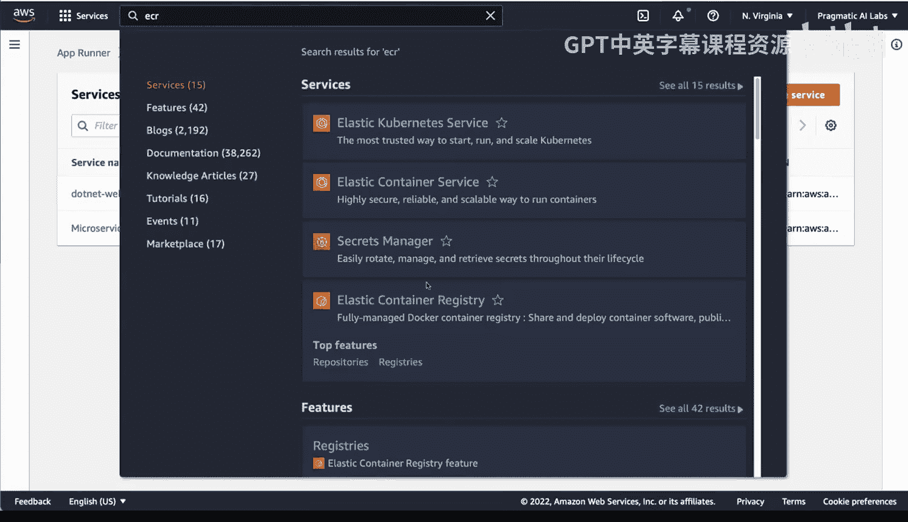
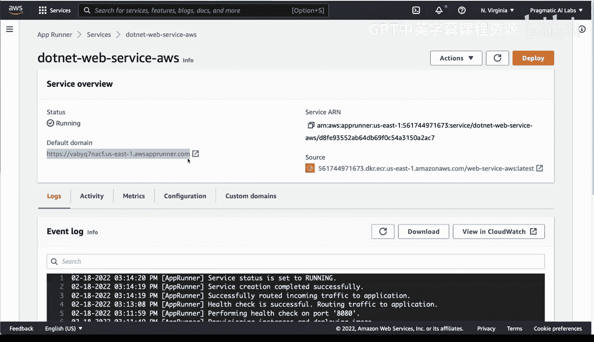
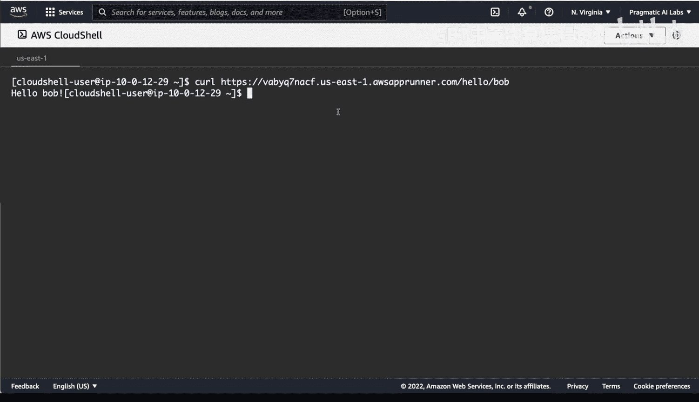

#  092：在Cloud9中用C#语言构建微服务



## 概述
在本节课中，我们将学习如何利用AWS云服务构建一个完整的、容器化的.NET微服务开发与部署工作流。我们将使用Cloud9作为云端开发环境，将应用容器化后推送到Elastic Container Registry (ECR)，并通过App Runner进行自动化部署，最后使用Cloud Shell进行测试。

## AWS容器化工作流介绍
让我们先了解一下AWS的容器化工作流。下图展示了我们将要使用的四个核心服务：


这四个服务是：**AWS Cloud 9**、**Amazon Elastic Container Registry (ECR)**、**AWS App Runner** 和 **Cloud Shell**。它们共同构成了一个纯云端的开发环境。这意味着开发者无需接触任何本地硬件，即使是在性能较弱的设备（如Chromebook的网页浏览器）上，也能借助Cloud9的强大能力进行开发。

这种环境的优势在于，开发者可以在一个与最终部署环境高度相似的本地化环境中进行开发，并且与ECR环境之间拥有高速的网络连接。一旦将.NET应用容器化并推送到ECR，就为生产部署做好了准备。App Runner允许我们监听ECR，并自动部署推送到其中的新镜像。部署完成后，服务将通过HTTPS完全加密。此时，我们可以前往Cloud Shell，启动一个命令行，使用curl命令调用服务并进行测试。这代表了.NET和C#开发的下一代工作流，是除了Visual Studio之外，一个值得加入你工具箱的强大工具。

## 项目准备与环境设置
上一节我们介绍了整体工作流，本节中我们来看看具体的项目和环境设置。




我们将使用一个名为 `NoahGift/dotnet-6-aws` 的代码仓库。这是在Cloud9中运行本教程所需的一切。启动Cloud9环境后，你需要安装一些.NET 6的包，之后就可以开始部署了。

首先，我已经设置好了一个Cloud9环境。建议你设置一个性能较强的实例。需要指出的是，安装好.NET后，我可以运行 `dotnet` 命令。这里有一个非常简单的程序，它接受一个URL参数 `/hello`，并替换其中的字符串。我可以直接运行它。

如果想将其作为容器化应用运行，过程也非常直接，因为环境已经设置好了。当然，我也可以将其作为常规的.NET应用运行。让我们先运行常规版本：

```bash
dotnet run
```

运行后，你会看到弹出的URL。我们可以使用curl命令来测试它：

```bash
curl “http://localhost:5000/hello?name=Bob”
```

预期输出应为：`Hello Bob`。这表明应用正在正常工作。

## 容器化构建与本地运行
现在，我们来看看如何构建和运行容器化版本。这同样相当简单，关键在于Dockerfile。

以下是构建和运行容器化应用的核心步骤：

1.  **检查Dockerfile**：该Dockerfile基于.NET 6 SDK构建。它会查看`.csproj`文件进行构建，并生成一个设置了端口8080的发布版本。`WebService.dll`将在容器化应用中暴露。
2.  **本地构建镜像**：在包含Dockerfile的项目目录中，运行以下命令构建Docker镜像：
    ```bash
    docker build -t web-service:latest .
    ```
3.  **本地运行容器**：镜像构建成功后，使用以下命令运行容器：
    ```bash
    docker run -p 8080:8080 web-service:latest
    ```

运行后，我们可以通过访问 `http://localhost:8080/hello?name=Bob` 来测试，应该会得到与之前相同的 `Hello Bob` 响应。

## 推送镜像到ECR
本地测试成功后，下一步是将镜像推送到Amazon Elastic Container Registry (ECR)。




前往AWS控制台，进入ECR服务。创建一个新的存储库（例如命名为`test`），过程非常简单。创建完成后，选择该存储库，点击“查看推送命令”，AWS会提供完整的推送步骤。

通常，推送命令序列如下：



```bash
# 1. 登录ECR
aws ecr get-login-password --region <region> | docker login --username AWS --password-stdin <account-id>.dkr.ecr.<region>.amazonaws.com
# 2. 为本地镜像打上ECR标签
docker tag web-service:latest <account-id>.dkr.ecr.<region>.amazonaws.com/test:latest
# 3. 推送镜像
docker push <account-id>.dkr.ecr.<region>.amazonaws.com/test:latest
```

由于Cloud9与ECR处于同一高速网络，推送速度会非常快。镜像推送成功后，就可以与团队共享，或用于ECS、App Runner等服务。

## 使用App Runner自动化部署
接下来，我们使用AWS App Runner来部署我们的服务。这是容器化魔力的体现。


在App Runner控制台，点击“创建服务”。配置源时，选择“容器注册表”下的“Amazon ECR”，然后浏览并选择我们刚刚推送的镜像。继续配置，你可以设置服务名称（如`dotnet-app`），并启用自动部署。这意味着如果构建系统推送了新版本的容器镜像，App Runner会自动部署新版本。

配置完成后，点击“创建并部署”。部署过程是自动化的，并且集成了软件开发的最佳实践，如日志、活动指标和配置管理。部署完成后，App Runner会提供一个可访问的URL。

## 使用Cloud Shell进行最终测试
服务部署完成后，我们需要进行最终测试。这里我们使用另一个云服务——Cloud Shell。



在Cloud Shell中，我们可以直接运行curl命令，指向App Runner提供的服务URL：

```bash
curl “https://<your-app-runner-url>/hello?name=Bob”
```


如果一切正常，你将再次看到 `Hello Bob` 的响应。这证明我们的服务已在云端成功运行。

## 总结
本节课中，我们一起学习了如何利用AWS的云原生服务构建完整的.NET微服务流水线。我们使用**Cloud9**作为云端IDE进行开发，将应用**容器化**后推送到**ECR**进行存储，通过**App Runner**实现自动化部署，并最终使用**Cloud Shell**验证服务。这个工作流提供了一个无缝、高性能的端到端开发与部署环境，无需任何本地基础设施干预。对于.NET开发者而言，尝试这套流程将极大地提升开发效率和部署灵活性。



