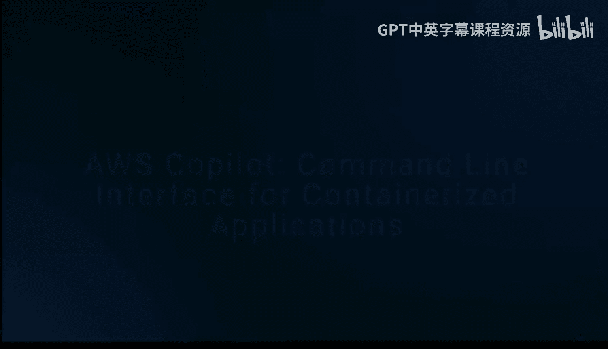
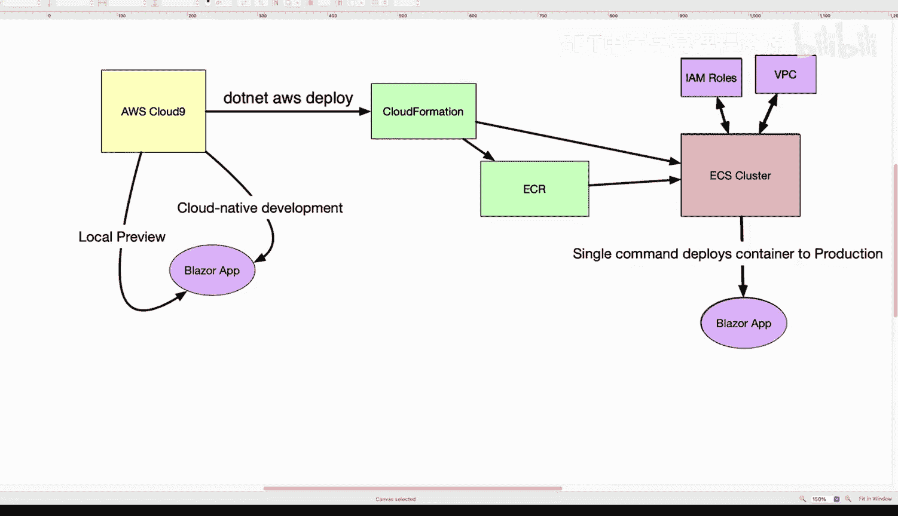
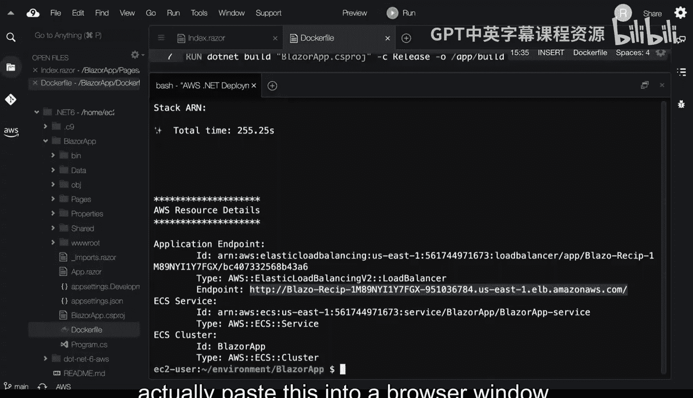
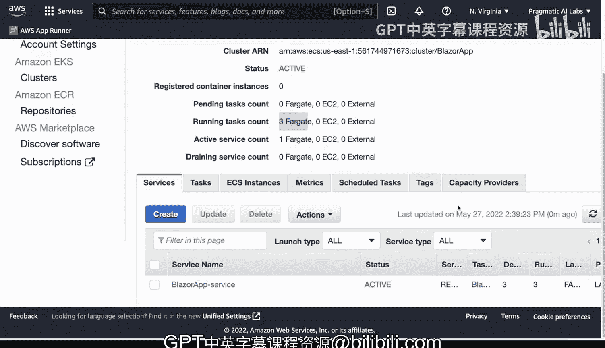

#  093：AWS Copilot容器化应用命令行界面 🚀



在本节课中，我们将学习如何使用AWS Copilot命令行界面，将一个.NET Blazor应用容器化并部署到Amazon ECS服务。整个过程将涵盖从环境准备、应用创建、容器构建到一键式云端部署的完整流程。

---

上一节我们介绍了课程目标，本节中我们来看看具体的操作环境准备。

首先，我将启动一个AWS Cloud9开发环境。我选择Cloud9是因为它能让我自由选择实例规格，例如，如果需要，我可以选择一台拥有32个核心和大内存的机器。接着，我会安装.NET 6框架，并运行一个Blazor应用进行测试。当一切准备就绪后，我会编写一个Dockerfile，然后运行 `dotnet aws deploy` 命令。这个命令将自动触发一个CloudFormation流程，构建一个ECR镜像并将其推送到ECS，同时自动配置IAM角色、VPC等资源。最终，我的Blazor应用将作为任务在ECS中运行，而这一切仅需一条命令。

让我们开始操作。



---

现在，我已经进入了AWS Cloud9环境。我选择了一台大型机器来执行开发任务。要启动Cloud9环境，你可以访问AWS控制台，选择Cloud9并配置自己的环境。在默认配置中，我唯一建议修改的是选择一台更大的机器。目前这台机器至少有8个核心和充足的内存。

首先，为了安装.NET 6，需要确保系统包是最新的。我将执行以下命令来添加Microsoft存储库：

```bash
sudo rpm -Uvh https://packages.microsoft.com/config/centos/7/packages-microsoft-prod.rpm
```

下一步是安装.NET 6 SDK：

```bash
sudo yum install dotnet-sdk-6.0
```

接着，安装ASP.NET Core运行时：

```bash
sudo yum install aspnetcore-runtime-6.0
```

最后，安装.NET运行时：

```bash
sudo yum install dotnet-runtime-6.0
```

完成这些安装后，要运行AWS部署工具，只需执行以下命令来更新工具：

```bash
dotnet tool update -g aws.deploy.tools
```

这个命令会检查并确保安装的是最新版本。由于该工具更新频繁，建议经常运行此命令。

---

上一节我们准备好了环境，本节中我们来创建并测试Blazor应用。

接下来，我将创建一个Blazor应用。使用以下命令创建一个.NET 6的Blazor Server应用：

```bash
dotnet new blazorserver -o BlazorApp -f net6.0
```

创建速度很快。然后，进入应用目录：

```bash
cd BlazorApp
```

创建完成后，要运行此应用，需要执行一个`dotnet run`命令，并指定在8080端口运行，以便启用预览功能：

```bash
dotnet run --urls=http://localhost:8080
```

此命令将在前台运行Blazor应用。为了测试它，只需点击Cloud9界面中的预览图标，然后选择“预览运行中的应用程序”。可以看到应用正在运行。我甚至可以点击页面中的计数器按钮进行交互，这证明应用运行正常。

现在，在部署之前，我可以对应用做一些修改。例如，进入 `Pages/Index.razor` 文件，将欢迎语修改为：

```html
@page "/"
<h1>Hello, AWS .NET AWS Deploy!</h1>
Welcome to your new app.
```

修改后，可以再次通过预览功能测试更改是否生效。

---

上一节我们创建并修改了应用，本节中我们将其容器化。

现在开始部署。首先，需要创建一个Dockerfile来定义如何将应用容器化。在应用根目录下执行：

```bash
touch Dockerfile
```

然后，将以下内容粘贴到Dockerfile中：

```dockerfile
FROM mcr.microsoft.com/dotnet/aspnet:6.0 AS base
WORKDIR /app
EXPOSE 80
EXPOSE 443

FROM mcr.microsoft.com/dotnet/sdk:6.0 AS build
WORKDIR /src
COPY ["BlazorApp.csproj", "./"]
RUN dotnet restore "BlazorApp.csproj"
COPY . .
WORKDIR "/src/"
RUN dotnet build "BlazorApp.csproj" -c Release -o /app/build

FROM build AS publish
RUN dotnet publish "BlazorApp.csproj" -c Release -o /app/publish

FROM base AS final
WORKDIR /app
COPY --from=publish /app/publish .
ENTRYPOINT ["dotnet", "BlazorApp.dll"]
```

这个Dockerfile使用.NET 6的SDK和运行时镜像，构建项目并暴露80和443端口。为了确保容器构建正确，可以在本地测试：

```bash
docker build -t blazorapp .
docker run -p 8080:80 blazorapp
```

然后通过Cloud9的预览功能访问 `http://localhost:8080`，确认应用在容器内运行正常。

---

上一节我们完成了容器构建，本节中我们使用AWS工具进行一键式部署。

最后，使用AWS部署命令进行云端部署。在应用目录下运行：

```bash
dotnet aws deploy
```

该工具会自动检测到Dockerfile，并提示部署选项。它会显示将“ASP.NET Core应用程序部署到使用Fargate的Amazon ECS”。这正是我们需要的。按照提示，接受默认的应用名称（如`blazorapp`）和集群设置。

部署过程将自动执行以下复杂步骤：
1.  构建Docker容器镜像。
2.  将镜像推送到Amazon ECR。
3.  使用AWS CDK库生成CloudFormation模板。
4.  创建ECS集群、服务、任务定义。
5.  配置负载均衡器、IAM角色和VPC。



部署完成后，命令行会输出应用的访问端点（URL）。复制该URL并在浏览器中打开，即可看到已成功部署的Blazor应用。

此外，可以前往AWS管理控制台的ECS服务页面，查看自动创建的资源，包括运行中的任务、服务以及相关的网络和安全配置。

---



本节课中我们一起学习了使用AWS Copilot（通过`dotnet aws deploy`工具）将.NET Blazor应用容器化并部署到Amazon ECS的完整流程。我们从设置Cloud9开发环境开始，创建并测试了Blazor应用，然后编写Dockerfile定义容器，最后通过一条命令实现了从代码到云端运行的全自动部署。这个工具极大地简化了将应用部署到AWS的复杂性，是进行高效云原生开发的有力助手。