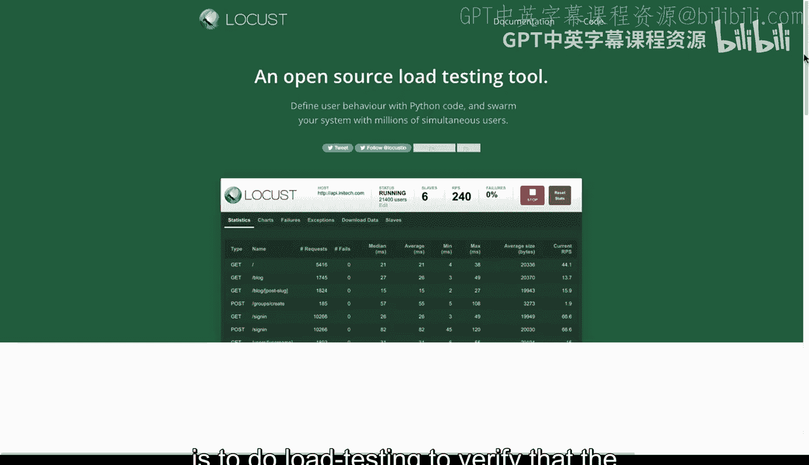
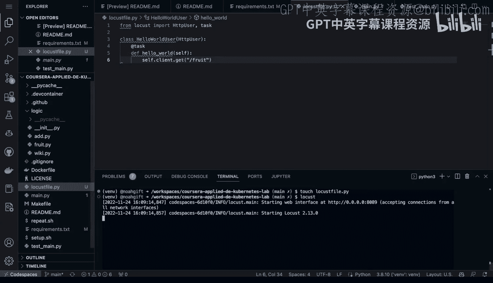
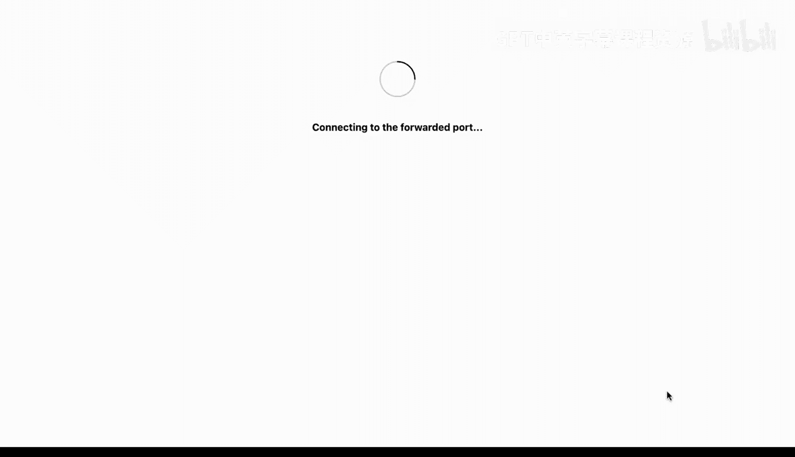
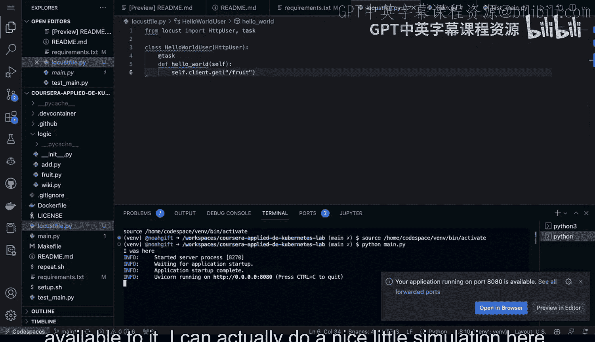
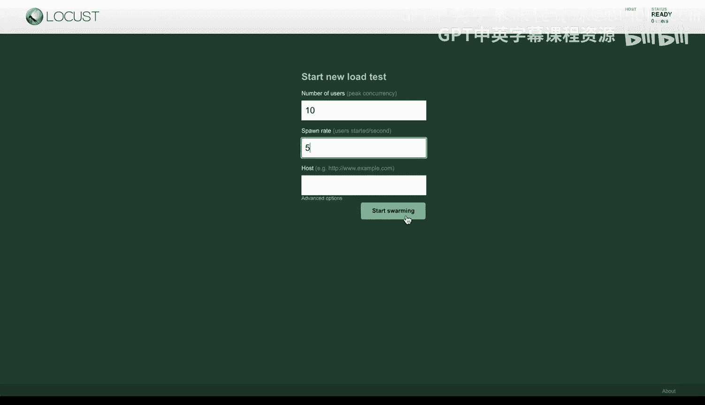
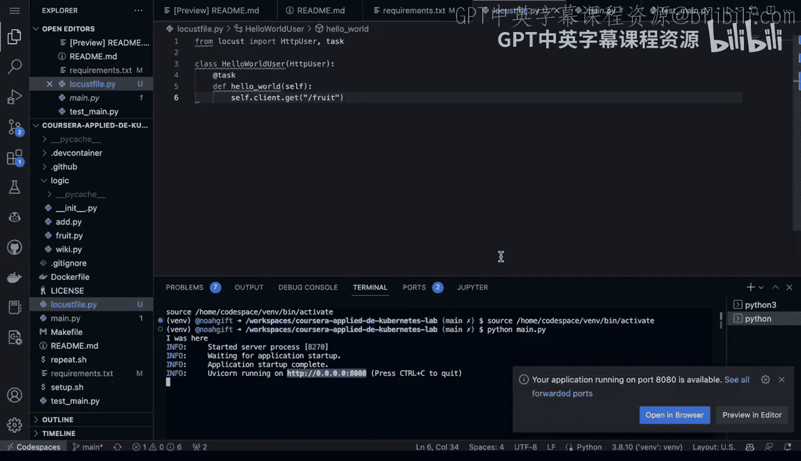
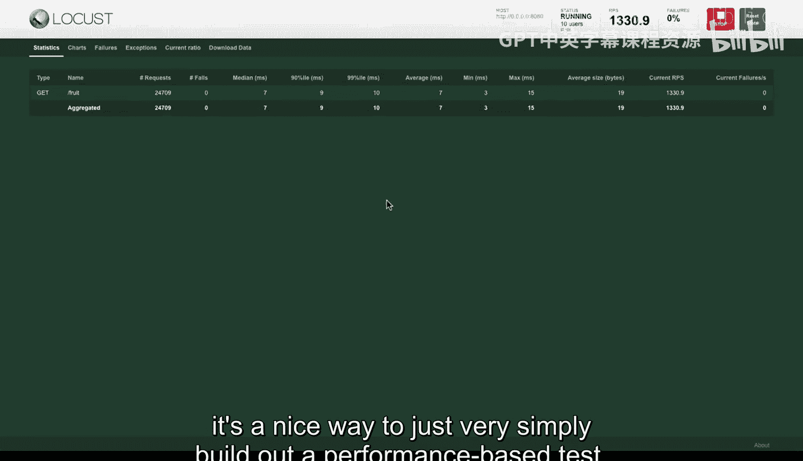
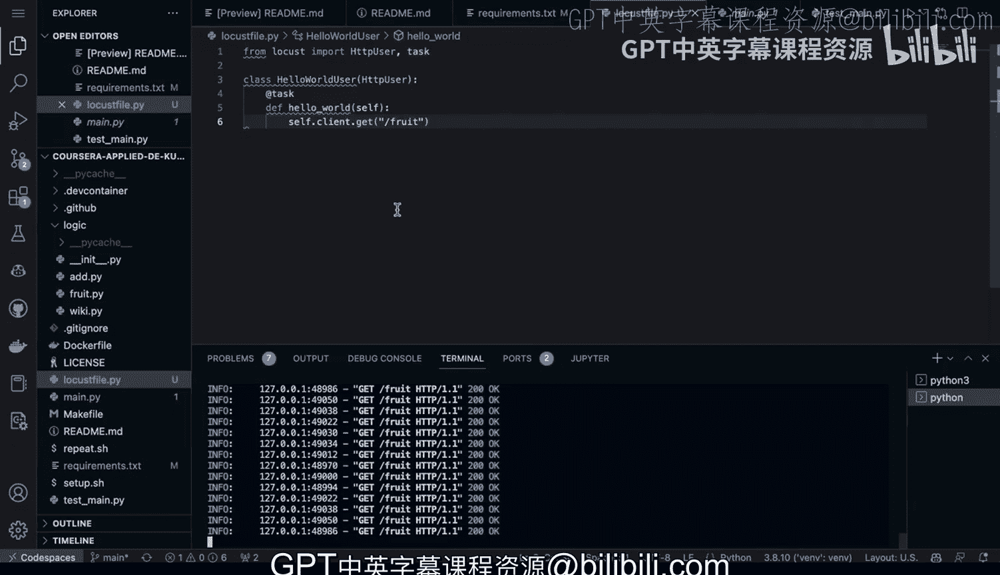

#  094：使用Locust进行负载测试 🚀


在本节课中，我们将学习如何使用开源的负载测试工具Locust，来验证我们的微服务在生产环境下的性能表现。负载测试是确保系统稳定性的重要环节。

## 概述

Locust是一个开源的负载测试工具，能够模拟数百万并发用户。它是一个非常实用的工具，可以用来测试我们的代码性能。对生产系统进行负载测试，以验证其行为能否在生产环境中复现，是开发流程中的重要部分。

## 准备工作

首先，我们需要一个待测试的应用程序。这里我们使用一个简单的、可以在Kubernetes上运行但也能在本地运行的微服务。

我们可以通过以下命令来运行这个应用：
```bash
python main.py
```
这个命令会启动我们的应用程序。

## 创建Locust测试文件



上一节我们启动了待测试的应用，本节中我们来看看如何为它编写负载测试。首先，我们需要创建一个Locust测试文件。

使用`touch`命令创建一个名为`locustfile.py`的文件：
```bash
touch locustfile.py
```
我们将在这个文件中编写我们的负载测试代码。

## 编写测试任务

以下是编写Locust测试脚本的核心步骤。我们将导入必要的模块并定义一个测试任务。



首先，从Locust导入`HttpUser`和`task`：
```python
from locust import HttpUser, task
```
我们的测试目标是调用应用程序中的一个特定接口。查看`main.py`文件，可以发现一个名为`/fruit`的路由，它会随机返回一种水果信息。

因此，我们在`task`装饰器下的方法中，让用户客户端访问这个`/fruit`端点：
```python
class WebsiteUser(HttpUser):
    @task
    def get_fruit(self):
        self.client.get("/fruit")
```



## 运行Locust测试

编写好测试脚本后，就可以运行Locust了。只需在终端输入以下命令：
```bash
locust
```
这个命令会启动Locust的Web交互界面。

## 执行负载测试



现在，我们通过Web界面来配置并执行一次负载测试。首先，在新的终端窗口中启动我们的微服务应用，确保它在运行。

然后，在浏览器中打开Locust的Web界面（通常是 `http://localhost:8089`）。在界面中，我们需要配置测试参数：
*   **Number of users**：要模拟的用户总数，例如设置为10。
*   **Spawn rate**：每秒启动的用户数，例如设置为5。
*   **Host**：被测试应用的地址，例如 `http://127.0.0.1:8000`。





配置完成后，点击“Start swarming”按钮开始测试。

## 分析测试结果

测试开始后，我们可以在Locust的Web界面上实时查看各种指标：
*   **请求数/秒**：图表显示每秒处理的请求数量。
*   **响应时间**：图表显示请求的平均响应时间、中位数等。
*   **失败情况**：可以查看是否有请求失败或出现异常。
*   **比例**：查看不同响应时间的请求分布。

这是一个非常直观的方式来构建和运行基于性能的测试。同时，我们可以看到后端应用程序正在被大量请求“冲击”。构建一个负载测试如此简单，我们没有理由不去做它。

## 集成到CI/CD流程

你还可以将Locust测试集成到持续集成/持续部署流程中。例如，在部署到生产环境之前，自动运行负载测试，并设定必须满足的性能指标阈值。Locust是实现自动化负载测试的绝佳工具。

## 总结





本节课中我们一起学习了如何使用Locust进行负载测试。我们从准备测试环境开始，逐步完成了编写测试脚本、运行测试以及分析结果的全过程。通过将负载测试集成到开发流程中，我们可以更早地发现性能瓶颈，确保应用在生产环境中的稳定性。