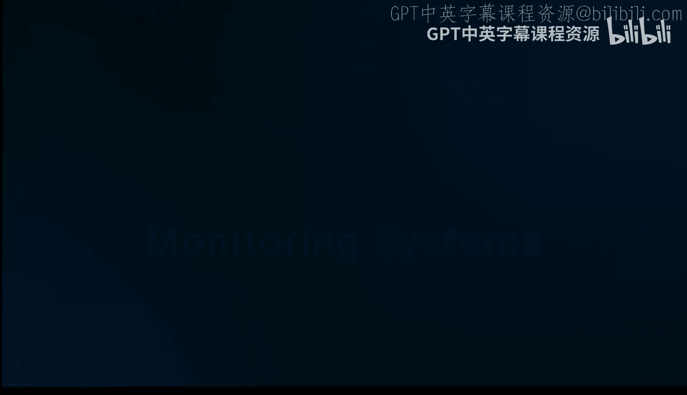
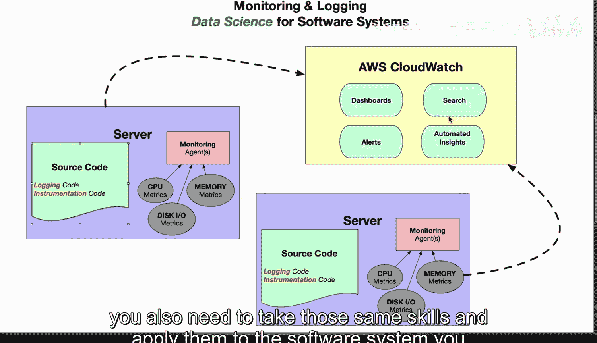

#  095：监控与日志系统

在本节课中，我们将学习如何将数据科学的思维应用于软件系统，具体探讨监控与日志在机器学习运维中的核心作用。我们将了解为什么需要监控、监控什么内容以及如何通过工具实现可视化。

## 概述：将监控视为软件系统的数据科学

监控与日志可以理解为**软件系统的数据科学**。尽管你的工作重点是机器学习运维和模型部署，但你同样需要关注所使用基础设施的“数据科学”。这意味着你需要像分析数据一样，去分析和理解你的软件系统在运行时的状态和行为。

上一节我们介绍了模型部署，本节中我们来看看如何确保部署后的系统健康、稳定运行。

## 监控与日志的核心概念

对于一个服务器系统，信息的来源主要有两个方面：

1.  **源代码本身**：这是信息的直接来源。
2.  **日志记录**：你通过代码插桩添加的日志，例如，记录执行一次特定预测所需的时间。

在监控代理方面，你需要关注一些核心指标，例如：
*   **CPU** 使用率
*   **磁盘** I/O
*   **内存** 使用情况

以下是部署机器学习模型时需要考虑的关键监控点：

*   **预测延迟**：模型进行单次预测所花费的时间。
*   **系统资源**：运行模型的服务器其CPU、内存和磁盘的使用状况。
*   **错误率**：模型预测失败或抛出异常的比例。

## 如何实现监控可视化

那么，如何查看这些监控数据呢？你可以通过 **AWS CloudWatch** 这类服务来实现。

*   你可以**拉起一个仪表盘**，直观地查看各项指标。
*   可以**查看警报**，及时响应系统异常。
*   能够**搜索特定系统**的日志，进行问题排查。
*   还能获得来自AWS CloudWatch系统的**自动化洞察**报告。

因此，将监控与日志视为软件系统的数据科学，是实现这一目标的最佳思维方式。

## 总结：可见性是系统稳定的基石

本节课中我们一起学习了监控与日志的重要性。你必须建立监控与日志体系，才能了解系统中正在发生什么，并获得系统的**可见性**。拥有数据科学素养是一项重要的能力，作为一名数据科学家，你需要将同样的技能应用于你所构建的软件系统本身，确保其可靠、高效地运行。