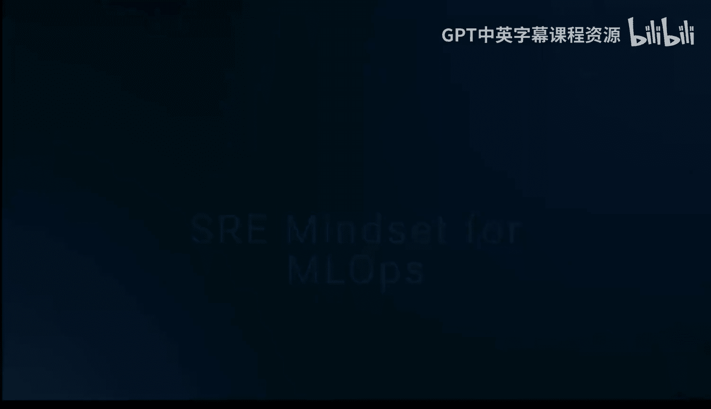
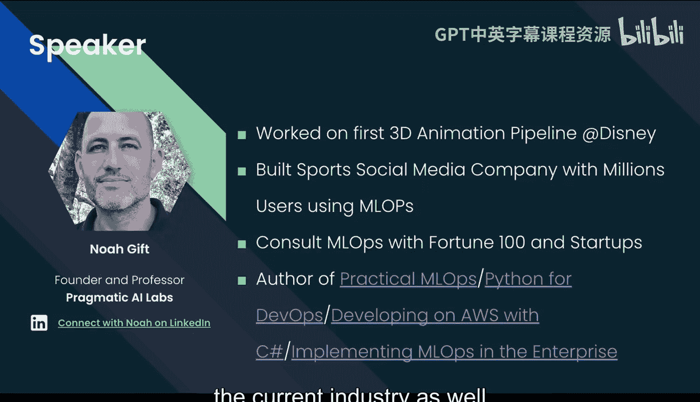
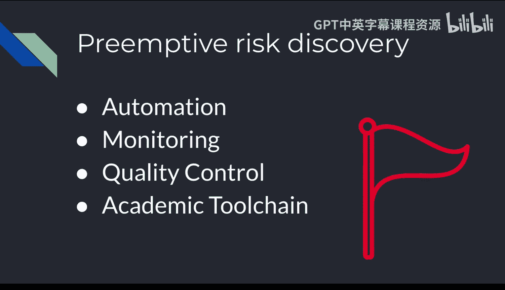
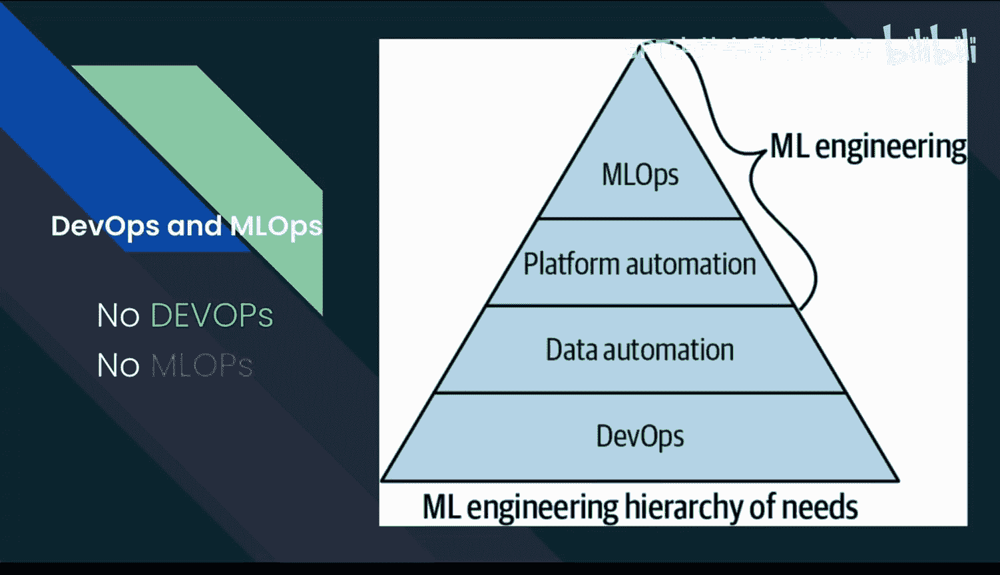
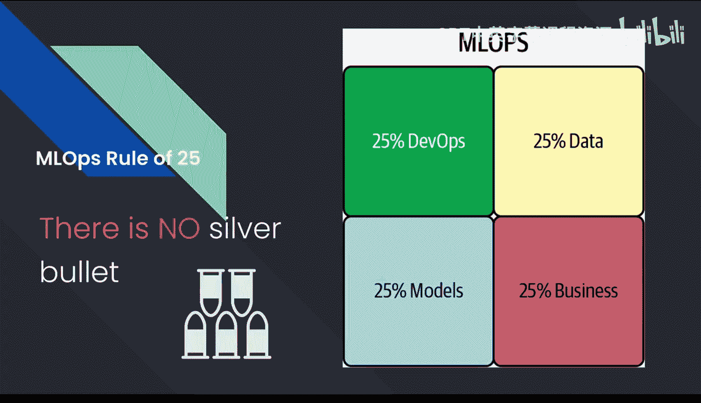
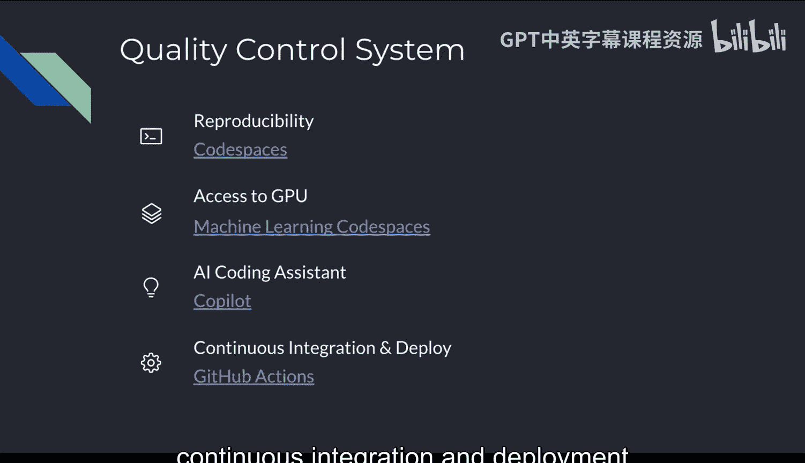
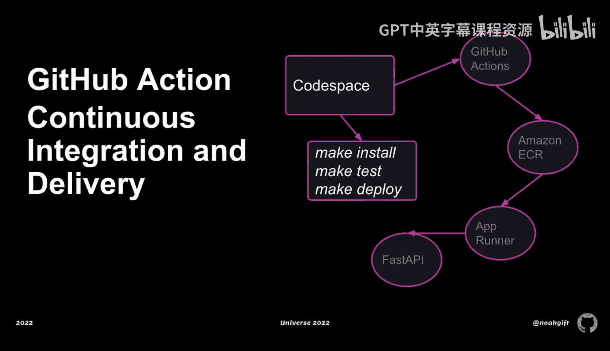
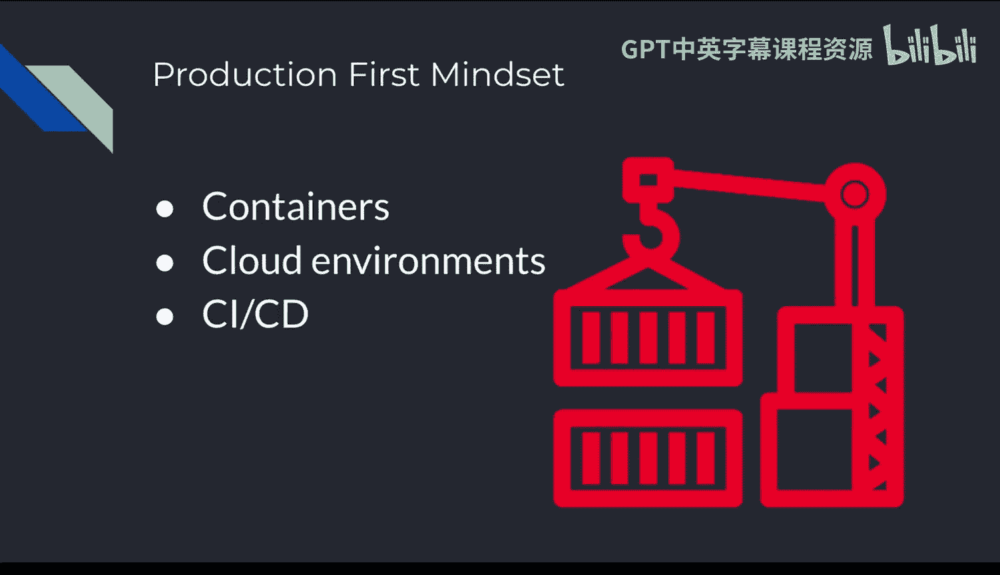

#  096：MLOps的SRE思维模式 🛠️

在本节课中，我们将要学习如何将站点可靠性工程师的思维模式应用于机器学习运维中。我们将探讨如何通过预见性风险发现、自动化、监控和质量控制来构建稳定、可扩展的ML系统。

## 概述

SRE思维模式的核心在于将软件工程的可靠性实践引入机器学习领域。这要求我们从系统设计的初始阶段就考虑自动化、监控和可重复性，以避免生产环境中的常见陷阱。

## 预见性风险发现

预见性风险发现是指在问题发生之前，主动识别并缓解系统中的潜在风险。在数据工程或MLOps系统中，这主要通过几个关键实践来实现。

以下是实现预见性风险发现的几个核心方面：

*   **自动化**：如果缺乏自动化，组织将面临巨大风险。关键在于能否实现自动部署和自动测试。
*   **监控**：如果无法监控系统状态或数据变化，就无法真正利用数据科学来洞察系统运行情况。
*   **质量控制**：是否实现了自动测试或代码链接？如果不这样做，无异于在“掷骰子”，将系统稳定性寄托于运气。
*   **避免学术工具链**：在当今时代，一个特别相关的问题是“学术工具链”概念。你可能构建了在学术研究中如同“神器”般好用的工具，但这些工具在进入生产环境时往往会引发问题。

## DevOps与MLOps的紧密关联

上一节我们介绍了风险发现，本节中我们来看看支撑这些实践的基础。实际上，DevOps和MLOps是紧密相关的。如果没有DevOps，就无法有效地进行机器学习运维。

我们可以将其视为一个需求层次结构：

1.  **基础层**：自动化基础设施即代码。这是金字塔的基石。
2.  **中间层**：在稳固的基础上，才能实现数据自动化和平台自动化。
3.  **顶层**：最终到达金字塔顶端，实现成熟的MLOps。

这是机器学习工程的需求层次结构。没有底层的稳固，就无法构建上层的复杂能力。

## MLOps的“25法则”

理解这种层次关系后，我们需要认识到一个核心原则：**MLOps不存在“银弹”**。没有一个特定的哲学或工具能解决所有问题。

你必须在这所有类别中付出艰苦的努力：

*   在 **DevOps** 上付出努力。
*   在 **数据** 上付出努力。
*   在 **模型** 上付出努力。
*   在 **业务** 上付出努力。

## 监控：软件系统的数据科学

现在，如果我们深入探讨监控，其中一个关键点是：**监控就是软件系统的数据科学**。

如果你的公司正在实践数据科学，但却没有对软件系统进行监控（即没有对其做数据科学分析），这颇具讽刺意味。监控本质上是一个质量控制系统。

以下是构建有效质量控制系统需要考虑的方面：

*   **可重复的开发环境**：能否在与生产环境完全一致的可重复环境中进行开发？例如，GitHub Codespaces 这类工具就解决了这个问题。
*   **GPU访问与快速训练**：能否访问GPU？能否以与生产环境相同的方式进行快速模型训练？
*   **使用最佳可用工具**：是否在使用诸如 GitHub Copilot 等工具，以最高效的方式协助编写代码？使用最新技术来减少错误至关重要。
*   **基于云的系统**：是否使用持续集成和持续部署等基于云的系统，来进一步提升编写代码的能力？

## 基于云系统的可重复性优势

基于云的系统为实现可重复性带来了多项优势：

*   **容器化构建**：你可以使用容器进行构建。
*   **配置即代码**：可以从一开始就构建配置。
*   **按需使用计算与存储**：你可以利用云端的计算和存储资源，从而避免搭建一个与生产环境迥异的、奇怪的本地环境。

正如之前提到的，Copilot 是增强开发反馈循环的绝佳方式。通过更好的提示、学习、测试和执行，你提高了减少代码缺陷的能力，从而增强了编写高性能代码的能力。

然后，如果你观察像 GitHub Actions 这样的基于云的系统（用于持续集成和交付），它允许你将开发环境中执行的完全相同的步骤应用到生产环境。

例如，你可以使用 GitHub Actions 将一个容器推送到 Amazon ECR，然后触发一个构建到 AWS App Runner，该部署最终会提供一个 FastAPI 端点。

## 避免“学术数据科学工具链”

总而言之，我们需要避免的是“学术数据科学工具链”。一些在学术背景下非常有意义的事情，在生产环境中可能就不那么合理了。

以下是几种需要避免的模式：

*   **Notebook作为唯一开发方式**：将 Notebook 作为开发软件系统的唯一方式，因为 Notebook 本身比较脆弱，难以充分利用软件工程的最佳实践。
*   **“神器”工具**：使用那些在一个环境或包中安装了海量不同软件的工具。这种方式在单机上可能运行良好，但在生产环境中会带来问题。
*   **“巫毒”盒子**：一个很好的例子是，你桌子底下有一台“巫毒”服务器，每个人都连接它（比如在生物实验室里）。在现实世界中，你肯定不希望这样。你需要消除这类工具。

## 生产优先的思维模式

“生产优先”的思维模式意味着，你在开发环境中做的事情应该与在生产环境中做的事情完全一致。

*   使用 **容器**。
*   使用 **基于云的环境**。
*   使用 **持续集成和持续交付**。

## 总结

本节课中，我们一起学习了将SRE思维应用于MLOps的核心要点。我们探讨了通过自动化、监控和质量控制进行预见性风险发现的重要性，理解了DevOps是MLOps的基石，并认识了“生产优先”思维模式的价值——即使用容器、云环境和CI/CD流程来确保开发与生产环境的一致性，从而避免“学术工具链”的陷阱，构建出可靠、可扩展的机器学习系统。