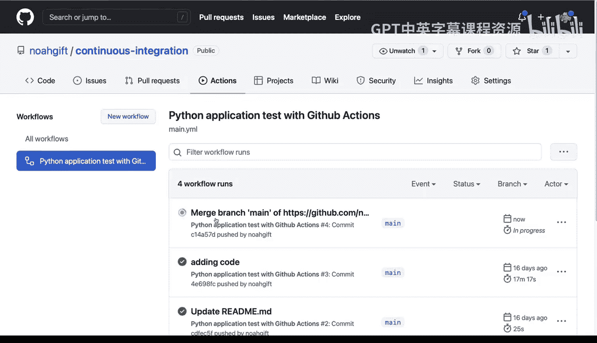
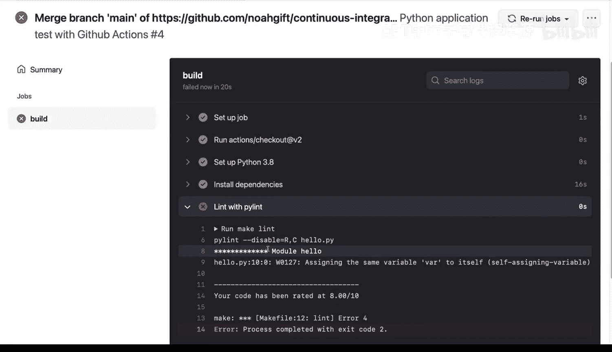
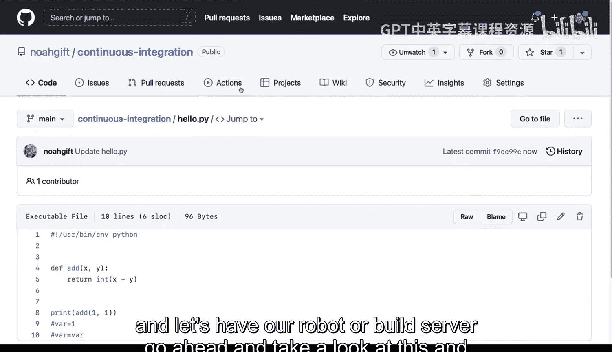
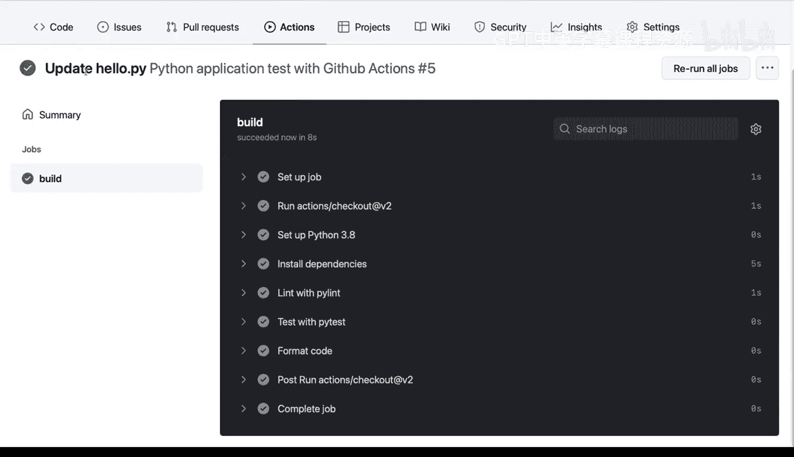
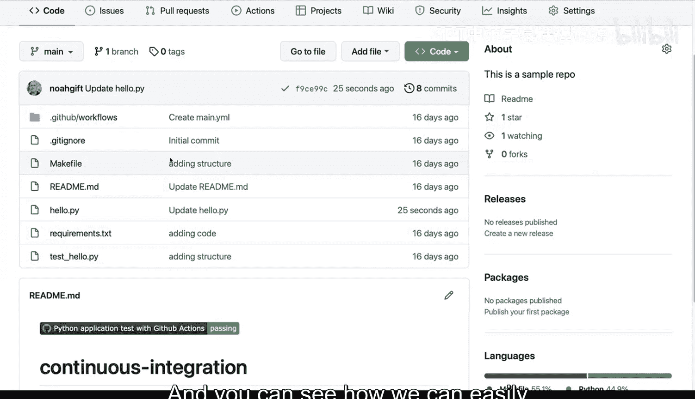

#  098：构建自动化工作流


在本节课中，我们将学习如何为微服务项目设置一个持续集成生态系统。我们将从最重要的第一步——项目结构开始，并了解如何通过自动化工具确保代码质量。

## 概述

持续集成的核心是，每当开发者将代码变更推送到基于Git的代码仓库时，系统能够自动执行测试、代码规范检查和格式化。这通过一个**Makefile**来实现，它定义了本地可执行的命令。同时，一个构建服务器（机器人）会复制这些操作，持续检查代码的规范性、格式和测试结果，为后续部署做好准备。建立本地的持续集成环境，是项目能够顺利进入生产阶段的关键。


上一节我们介绍了持续集成的核心概念，本节中我们来看看如何在实践中通过一个GitHub项目来实现它。

## 项目结构解析

一个为持续集成和持续交付做好充分准备的项目，应包含以下关键组件。

以下是项目仓库中的主要组成部分：

*   **`.github/workflows` 目录**：这是构建系统的配置所在。本例中使用的是GitHub Actions，但你也可以使用Jenkins、AWS Code Build等其他系统。这里的配置文件会指示构建系统如何测试和验证代码。
*   **`main.yml` 文件**：这是工作流配置文件。它规定在每次代码推送时，系统会在一个Ubuntu虚拟机上启动，使用Python 3.8，并依次执行 `make install`、`make lint`、`make test` 和 `make format` 命令。这种结构是所有持续集成项目的推荐做法。
*   **代码环境文件**：
    *   `README.md` 文件：项目说明文档。
    *   `main.py` 文件：一个简单的示例代码文件，例如实现两数相加。
    *   `test_main.py` 文件：用于测试 `main.py` 中代码的测试文件。
    *   `requirements.txt` 文件：列出了项目依赖的、带有版本号的Python包。这确保了开发环境与构建系统环境的一致性，使项目具有可复现性。
*   **`Makefile` 文件**：这是自动化命令的“食谱”。它定义了如 `make install`、`make test`、`make format`、`make lint` 等一系列命令（recipe），开发者只需运行简单的 `make` 命令即可触发复杂的操作流程。

了解了项目结构后，接下来我们看看如何在真实环境中使用它。我们将利用GitHub Codespaces这个云端开发环境来进行演示。

## 实践演练：在云端环境中工作

我们进入了GitHub Codespaces环境，左侧是项目代码，右侧打开了终端。我已经预先创建了一个虚拟环境。现在，我们来运行 `make all` 命令。

```bash
make all
```

这个命令会依次执行安装依赖、代码检查、运行测试等步骤。如果一切正常，我们将收到所有操作成功的反馈，形成一个高效的正向循环。

那么，如果代码有问题会怎样？让我们引入一个“小bug”：将一个变量赋值给它自身。这不会导致代码立即崩溃，但可能在未来引发问题。

当我们再次运行 `make lint` 时，代码检查工具会捕获到这个潜在问题，并给出警告或错误信息。这展示了代码检查在发现潜在缺陷方面的能力。

现在，我们将这个有问题的变更推送到远程仓库。

```bash
git add .
git commit -m "Introduce a linting issue for demo"
git push
```

推送完成后，我们可以观察持续集成系统的反应。这就是持续集成系统的优势：它是一个时刻监视代码的“机器人”，能自动发现安装、代码规范、测试等方面的问题。果然，由于我们引入了代码规范问题，这次构建失败了。



构建失败后我们该怎么办？幸运的是，修复非常简单。我们甚至不需要打开本地的开发环境，可以直接在GitHub的网页界面上编辑有问题的文件，删除那两行有问题的代码，然后提交修复。





提交后，构建服务器会自动重新运行任务。我们可以看到它正在设置环境、安装依赖，然后再次执行代码检查和格式化。最终，所有检查都通过了。

## 总结





本节课中我们一起学习了为微服务设置持续集成系统的完整流程。我们了解了核心的项目结构，包括 **`Makefile`** 和 **`.github/workflows`** 配置文件的作用，并实践了从本地开发、代码检查、问题发现到在线修复、自动验证的完整工作流。这个过程是任何进行微服务开发、命令行工具开发乃至一般Python软件开发的项目都应该具备的，它能显著提升代码质量和开发效率。