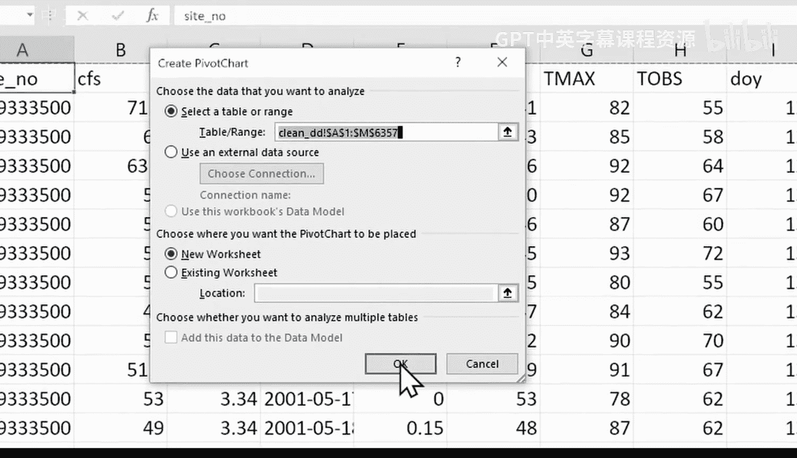
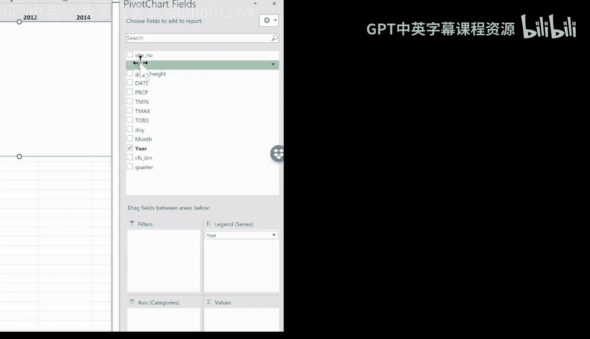
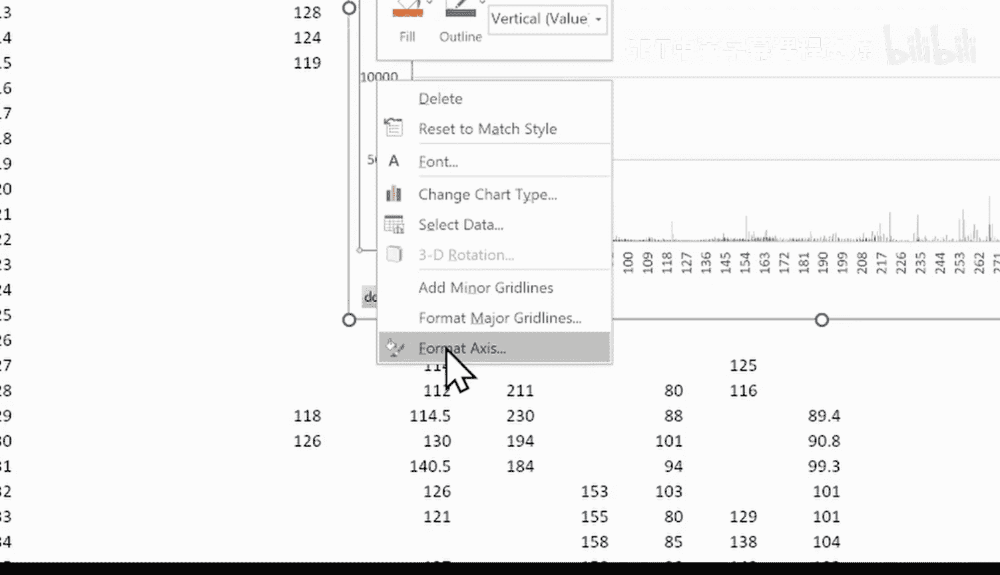
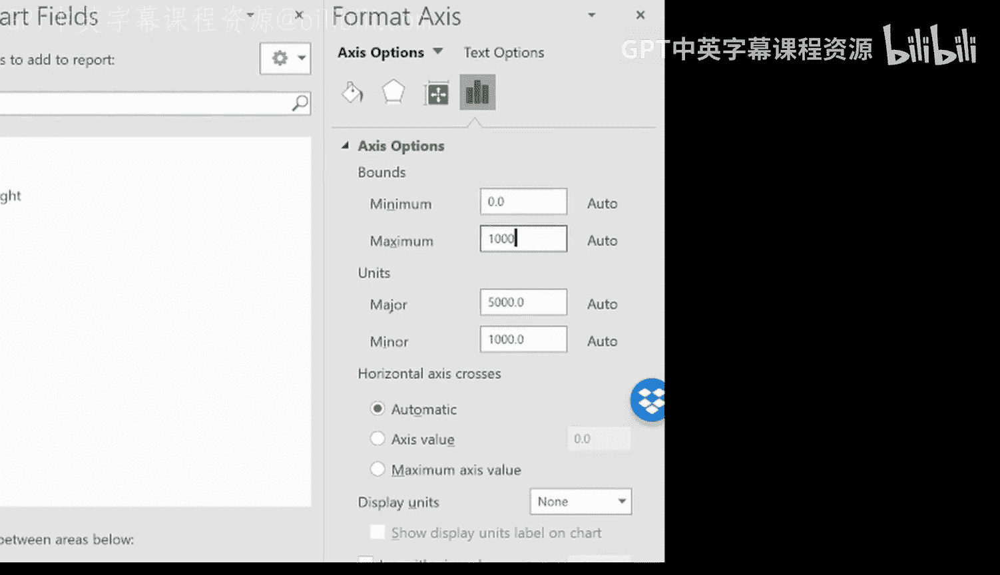
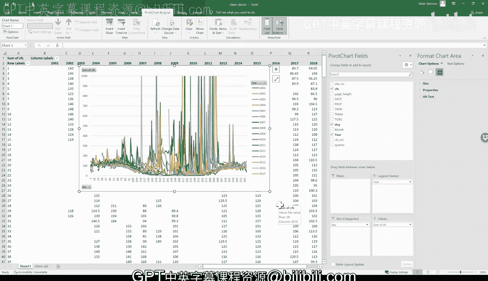

#  102：在Excel中创建折线图 📈

在本节课程中，我们将学习如何使用Excel创建折线图。我们将使用“Dirty Devil”数据集，绘制一条展示多年间每秒立方英尺流量变化的折线图。

## 准备数据与创建数据透视表

首先，我已经在Excel中加载了数据集。我们的目标是查看每年每秒立方英尺流量的变化趋势。由于数据集中包含多个年份的数据，我们需要先创建一个数据透视表来汇总这些信息。

以下是创建数据透视表和图表的步骤：

1.  转到Excel的“插入”选项卡。
2.  点击“数据透视表和数据透视图”按钮，以便直接创建数据透视图。

## 配置数据透视图字段

创建数据透视图后，右侧会出现字段列表。我们需要将相应的字段拖放到指定区域来构建图表。

以下是需要配置的字段：

*   **图例（系列）**：将“Years”（年份）字段拖入此处。
*   **值**：将“Cubic Feet Per Second”（每秒立方英尺）字段拖入此处。

此时，图表会显示每年每秒立方英尺流量的总和。但为了创建折线图，我们还需要一个维度来展示时间序列的变化。

## 添加类别轴并更改图表类型

上一节我们配置了基本的数据汇总，本节我们来看看如何将其转换为折线图。关键在于将“Day of the Year”（一年中的第几天）字段拖入“轴（类别）”区域。

现在图表显示了数据，但可能因为存在一些异常值而难以阅读。我们可以通过调整坐标轴范围来聚焦主要数据。

## 调整坐标轴以优化视图

为了使图表更清晰，我们可以调整Y轴（数值轴）的显示范围。

以下是具体操作步骤：

1.  单击图表中的Y轴。
2.  在右侧的“设置坐标轴格式”窗格中，找到“边界”选项。
3.  将“最大值”修改为一个更合适的值，例如 **1000**，以排除过高异常值的干扰。

调整后，图表视图得到了改善。但当前的图表类型看起来更像是柱形图，我们需要将其改为折线图。

## 最终完成折线图

最后一步是将图表类型更改为折线图。

1.  在图表上右键单击。
2.  选择“更改系列图表类型”。
3.  在弹出的窗口中，选择“折线图”，然后点击“确定”。

完成后的折线图清晰地展示了每年内，每日每秒立方英尺流量的变化趋势。

这与我们使用Pandas时的情况类似，都是先对数据进行聚合（按年份），然后可视化每个年份内每日的流量值。

## 总结

本节课中，我们一起学习了在Excel中创建折线图的完整流程。我们首先通过插入数据透视图来汇总数据，然后通过配置字段（年份作为图例、日序作为类别、流量作为值）来构建图表基础，接着通过调整坐标轴范围优化了数据视图，最后将图表类型更改为折线图，从而直观地展示了时间序列数据的变化趋势。