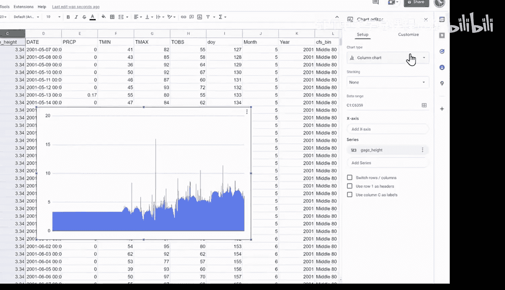
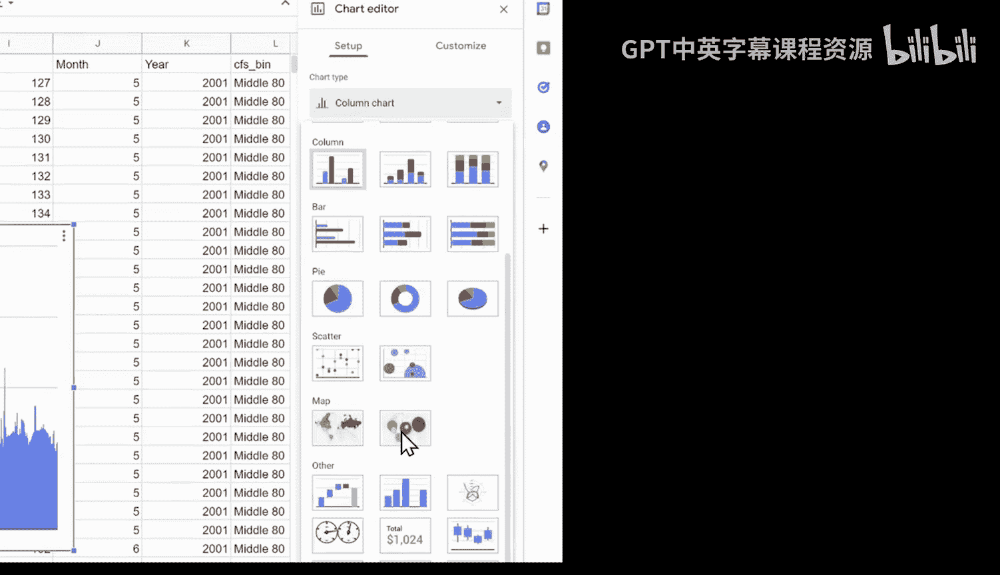
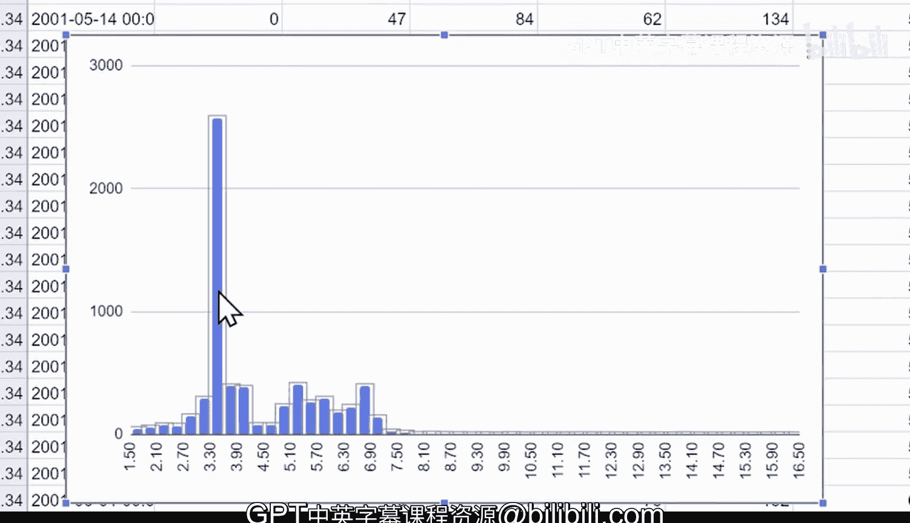

#  109：在Sheets中创建直方图 📊

在本节课程中，我们将学习如何使用Google Sheets来创建一个直方图。直方图是一种用于展示数据分布情况的图表，特别适合观察连续数据的频率分布。

上一节我们介绍了数据的基本处理，本节中我们来看看如何将数据可视化，直观地理解其分布特征。

我们将以“水位高度”这一列数据为例，创建其直方图。

以下是创建直方图的具体步骤：

1.  首先，选中包含“水位高度”数据的整列。
2.  接着，点击菜单栏中的“插入”选项。
3.  在下拉菜单中，选择“图表”。

此时，Sheets会自动生成一个默认的图表。但这个图表可能不是我们需要的类型。

我们需要对图表类型进行调整。在屏幕右侧会弹出“图表编辑器”面板。

在“图表编辑器”中，找到“图表类型”的设置项。默认的图表类型可能是“柱形图”。

我们需要向下滚动图表类型列表，找到并点击“直方图”这一选项。

完成以上步骤后，直方图就成功创建了。这个图表再次向我们展示了与在Excel中观察到的相同结论：每秒立方英尺流量数据中最常见的数值集中在3.4左右。

本节课中我们一起学习了在Google Sheets中创建直方图的方法。通过将数据可视化，我们可以更直观、快速地洞察数据的集中趋势和分布形态，这是数据分析中非常基础且重要的一步。