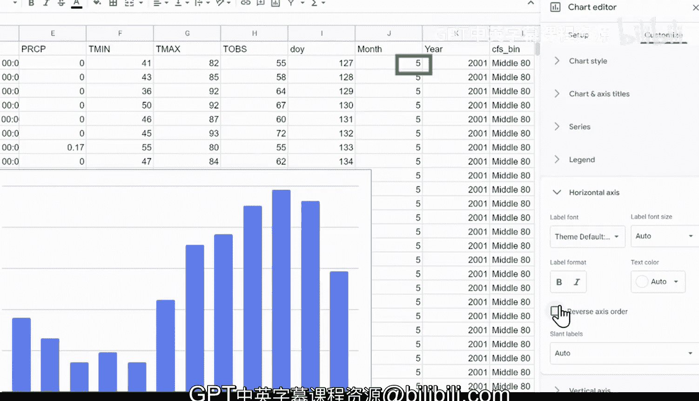

#  111：在Google Sheets中创建条形图 📊

在本节课中，我们将学习如何在Google Sheets中创建一个条形图，用于可视化每月流量的中位数（以立方英尺/秒为单位）。我们将从插入图表开始，逐步配置图表类型、数据系列和聚合方式，最终得到一个清晰展示月度数据趋势的图表。

## 概述

我们将使用Google Sheets的图表功能，基于月份和流量数据创建一个柱状图（即条形图）。核心步骤包括选择正确的图表类型、指定X轴和系列数据，并将默认的求和聚合方式更改为中位数计算。

## 创建图表

首先，我们需要在数据表中插入一个图表。以下是具体步骤。

1.  在菜单栏中点击“插入”，然后选择“图表”。
2.  在右侧打开的“图表编辑器”中，默认图表类型通常是“柱状图”，这正是我们需要的条形图类型。

## 配置X轴与数据系列

上一节我们插入了图表，本节中我们来看看如何为其配置数据。X轴将用于显示月份，而数据系列则代表流量值。

我们需要指定哪个数据列作为X轴，哪个作为数据系列（Y轴的值）。

*   **X轴**：我们选择“月份”列。这会将数据按月份分组。
*   **数据系列**：我们选择“CFS”（立方英尺/秒）列。这将是图表中柱子的高度所代表的值。

## 应用聚合计算

在配置好基本数据后，我们需要对数据系列进行聚合计算。默认情况下，Google Sheets会对同一月份的所有CFS值进行求和，但我们需要的是中位数。

1.  在“图表编辑器”的“设置”标签页下，找到“系列”部分。
2.  选中“CFS”系列，并勾选“聚合”复选框。
3.  将聚合类型从默认的“求和”更改为“中位数”。

完成此操作后，图表将显示每个月CFS值的中位数，从而消除了异常值的影响，更能反映典型情况。

## 调整X轴顺序

目前，我们的图表有一个小问题：X轴（月份）的顺序不是从1月（1）开始，而是从数据中第一个出现的月份（本例中是5月）开始。

这是因为Google Sheets会根据数据中实际存在的月份来动态生成X轴，并且在此图表类型中，无法手动将轴顺序设置为固定的1到12月。虽然可以反转现有顺序，但无法强制从特定月份开始。这是使用此类工具时需要注意的一个特性。

## 总结

本节课中，我们一起学习了在Google Sheets中创建条形图的全过程。我们掌握了如何插入柱状图、配置月份为X轴、设置流量数据为系列，并将聚合方式从求和改为中位数。最后，我们了解了图表在X轴排序上的一个限制。通过这个直观的条形图，我们可以轻松比较不同月份间的流量中位数差异。