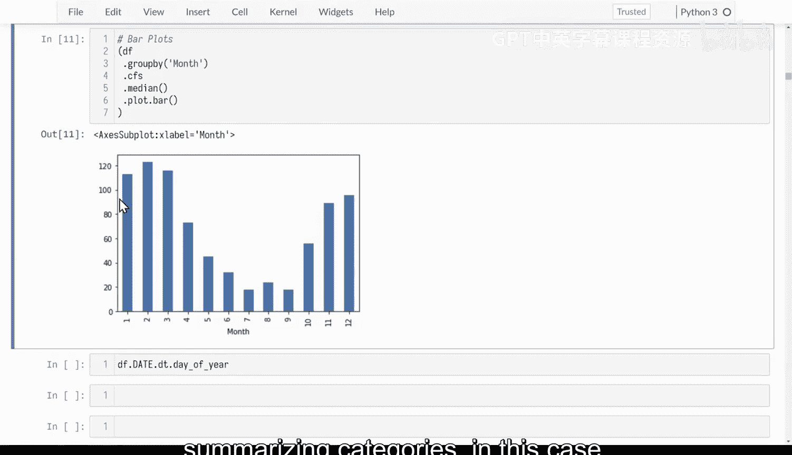

#  113：探索基础图表类型 📊


在本节课中，我们将学习如何使用Pandas库加载数据，并探索几种常见的基础图表类型。我们将通过一个河流流量数据集来演示如何创建折线图、直方图、散点图和条形图，并学习如何通过调整图表来更好地理解数据。

---

## 加载数据集

首先，我们需要加载一个名为“Di Devil”的数据集。这是一个关于犹他州南部一条河流流量的数据集。数据集包含多个列，例如：

*   **CFS**：立方英尺每秒，表示流量。
*   **gauge height**：水位高度。
*   **date**：日期。
*   **temperature**：温度信息。
*   此外，还有一些分类性质的列，如流量的分箱和季度信息。

这个数据集包含了有趣的时序信息，既有数值型数据，也有分类数据。

```python
# 示例：加载数据集（假设文件名为‘river_data.csv’）
import pandas as pd
df = pd.read_csv(‘river_data.csv’)
```

---

## 创建折线图

上一节我们加载了数据集，本节中我们来看看如何创建折线图来观察数据随时间的变化趋势。

在Pandas中创建折线图非常简单。我们可以指定X轴为日期列，Y轴为流量（CFS）列。

```python
df.plot(x=‘date’, y=‘CFS’)
```

这个图表虽然容易制作，但可能不够清晰。可以看到X轴标签非常拥挤，并且有一些异常值拉伸了Y轴，使我们难以看清主要数据的变化。

为了改善这一点，我们可以尝试将每年的数据单独绘制成一条线，以便比较不同年份间的模式。这需要对数据进行透视操作。

```python
# 假设我们已创建一个以年份为列的透视表 ‘df_pivot’
df_pivot.plot()
```

调整后的图表看起来更有趣一些，但异常值问题依然存在，并且多条彩色线条交织在一起，显得有些混乱。

我们可以使用Matplotlib库来设置Y轴的范围，从而放大我们感兴趣的数据区域。

```python
import matplotlib.pyplot as plt
df_pivot.plot()
plt.ylim([0, 1000]) # 设置Y轴显示范围
```

放大后，故事开始变得清晰，但颜色仍然繁多。通常，更好的做法是淡化所有线条的颜色，只高亮显示特定的一年来讲述故事。你可以选择关注最大值、最小值或中心趋势的年份。

此外，对于时间序列数据，常见的平滑技术是计算滚动平均值。这可以让趋势线更平滑。

```python
# 计算7日滚动平均后绘图
df_pivot.rolling(window=7).mean().plot()
```

---

## 创建直方图

接下来，我们看看如何用直方图来理解单个数值变量的分布。

直方图在Pandas中非常容易创建。我们只需选择要绘制的列，并调用`.hist()`方法。我们还可以指定分箱的数量。

以下是创建水位高度直方图的步骤：

```python
df[‘gauge height’].hist(bins=30)
```

这个直方图显示了水位高度的中心趋势。最常见的值大约在3左右。

---

## 创建散点图与理解相关性

当我们想比较两个数值变量时，散点图是一个很好的选择。在绘制之前，我们可以先计算它们之间的相关性进行总结。

我们将使用斯皮尔曼等级相关系数来总结水位高度和流量之间的关系。这个系数介于-1到1之间。1表示完全正相关（一个变量的排名上升，另一个的排名也上升），0表示无相关性，-1表示完全负相关。

```python
correlation = df[‘gauge height’].corr(df[‘CFS’], method=‘spearman’)
print(f“斯皮尔曼相关系数为：{correlation:.2f}”)
```

计算结果显示存在轻微的正相关。为了直观地理解这种关系，我们可以绘制散点图。

```python
df.plot.scatter(x=‘gauge height’, y=‘CFS’)
```

从散点图中，我们可以看到数据点有轻微向上的趋势，但在水位高度为3附近出现了一些异常行为。

如果存在这样的异常值，我们需要思考：是要聚焦于这些异常点，还是关注其他部分？我们可以再次使用Matplotlib来放大图表的Y轴范围，以便更仔细地观察主要数据区域。同时，按年份给数据点上色可能会揭示更多信息。

```python
plt.scatter(df[‘gauge height’], df[‘CFS’], c=df[‘year’], alpha=0.5)
plt.ylim([0, 5000]) # 放大Y轴
plt.colorbar(label=‘Year’)
```

当进行这样的探索时，我注意到在水位高度3处有一条垂直的线，这看起来不太自然。这个发现可能会促使我深入检查这一年的原始数据，看看是否是测量仪器出现了问题。

---

## 创建条形图

最后，我们来看看如何用条形图来理解和总结分类数据。

条形图非常适合展示不同类别下的汇总统计量（如平均值、中位数）。在本例中，我们将按月份汇总流量数据，并查看每个月流量的中位数。

以下是创建按月份流量中位数条形图的步骤：

```python
# 按月份分组并计算CFS的中位数
monthly_median = df.groupby(‘month’)[‘CFS’].median()
monthly_median.plot(kind=‘bar’)
```

通过这个条形图，我们可以快速理解数据。可以看到，二月份的流量中位数最高，而七月份的流量中位数倾向于最低。这个图表很好地说明了如何通过条形图来总结分类数据（本例中将月份视为类别）。

---

## 总结



本节课中，我们一起学习了几种常见的数据类型及其对应的基础图表。

*   我们使用**折线图**来观察时间序列趋势，并学习了通过**数据透视**、**设置坐标轴范围**和**计算滚动平均**来优化图表。
*   我们使用**直方图**来了解单个数值变量的分布情况。
*   我们通过计算**斯皮尔曼相关系数**和绘制**散点图**来探索两个数值变量之间的关系，并在过程中发现了可能需要进一步调查的异常数据。
*   最后，我们使用**条形图**来有效地总结和比较分类数据。

当你拿到数据时，首先要理解数据代表什么，然后选择一个能讲述你想要的故事的图表类型。探索性数据分析是发现数据中隐藏模式和问题的关键第一步。