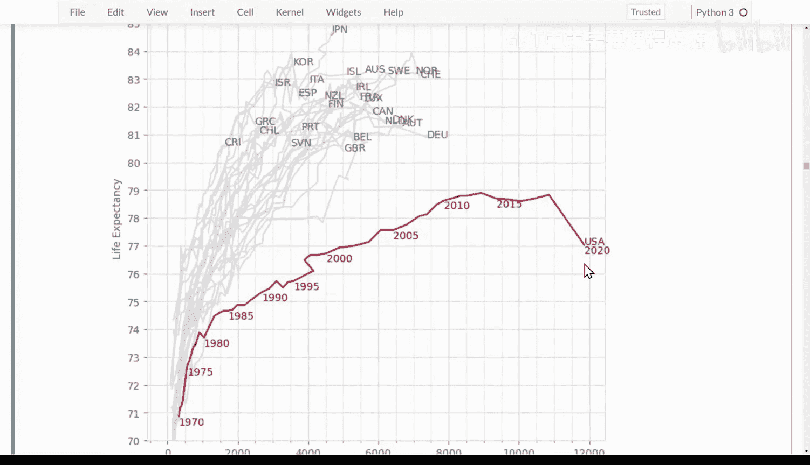

#  115：使用Pandas创建折线图 📈


在本节课中，我们将学习如何使用Pandas和Matplotlib库，从原始数据开始，逐步创建并完善一个能够讲述故事的折线图。我们将复现一个关于各国人均医疗支出与预期寿命关系的图表。

## 概述与数据准备

首先，我们需要加载必要的库和数据。我们将使用Matplotlib进行绘图，NumPy和Pandas进行数据处理。

```python
import matplotlib.pyplot as plt
import numpy as np
import pandas as pd
```

数据来源于两个数据集：医疗支出数据和预期寿命数据。以下是加载数据的代码：

```python
# 数据URL（示例）
spending_url = '...'
life_expectancy_url = '...'

spending_df = pd.read_csv(spending_url)
life_df = pd.read_csv(life_expectancy_url)
```

加载数据后，我们需要将这两个数据集合并，以便后续分析。

## 数据清洗与合并

上一节我们加载了数据，本节中我们来看看如何清洗和合并数据。我们定义一个函数 `tweak_data` 来处理数据。

以下是该函数执行的关键步骤：
1.  对支出数据框进行查询，筛选出度量标准为“人均美元”且主题为“总计”的行。
2.  按“时间”和“地点”分组，并提取每个组的第一条记录的值。
3.  将该值列重命名为“spending_USD”并转换为数据框。
4.  对预期寿命数据按“时间”和“地点”分组，计算平均值，并将列名改为“life_expectancy”。
5.  将处理后的两个数据框合并，并重置索引。

```python
def tweak_data(spending_df, life_df):
    # 处理支出数据
    spending_processed = (spending_df
                          .query('measure == "USD_cap" & subject == "TOT"')
                          .groupby(['time', 'location'])
                          .first()['value']
                          .rename('spending_USD')
                          .to_frame())
    
    # 处理预期寿命数据
    life_processed = (life_df
                      .groupby(['time', 'location'])['value']
                      .mean()
                      .rename('life_expectancy')
                      .to_frame())
    
    # 合并数据并重置索引
    merged_df = spending_processed.merge(life_processed, 
                                         left_index=True, 
                                         right_index=True)
    return merged_df.reset_index()

df = tweak_data(spending_df, life_df)
```

处理完成后，我们得到一个包含`time`（时间）、`location`（国家/地区）、`spending_USD`（人均医疗支出）和`life_expectancy`（预期寿命）列的数据框。

## 创建基础折线图

数据准备就绪后，我们现在可以开始创建图表。首先，我们尝试用最少的代码绘制一个基础版本。

核心思路是：按国家分组，为每个国家绘制一条“支出-寿命”的折线。在Pandas中，这可以通过`groupby`和`apply`方法结合绘图函数实现。

```python
# 基础绘图函数
def basic_plot(group):
    group.plot(x='spending_USD', y='life_expectancy', ax=plt.gca())

# 应用分组绘图
df.groupby('location').apply(basic_plot)
plt.show()
```

生成的图表包含了所有国家的数据线，虽然功能完整，但线条混杂，重点不突出，可读性较差。Pandas的优势在于可以轻松处理这种非单调（线条可回折）的数据序列。

## 突出显示关键数据

基础图表信息过载，本节中我们来看看如何优化它以讲述一个更清晰的故事。我们希望像原图一样，将美国的线标为红色并高亮显示，其他国家的线则用灰色淡化。

我们需要修改绘图函数，根据国家名称动态设置线条颜色，并在线尾添加国家标签。

```python
def highlighted_plot(group):
    name = group.name # 获取组名（即国家名）
    # 设定颜色：美国为红色，其他国家为灰色
    color = 'red' if name == 'United States' else '#d3d3d3'
    
    ax = plt.gca()
    # 按时间排序后绘图
    group.sort_values('time').plot(x='spending_USD', 
                                   y='life_expectancy', 
                                   color=color, 
                                   ax=ax)
    # 在线条末端添加国家标签
    ax.text(x=group['spending_USD'].iloc[-1],
            y=group['life_expectancy'].iloc[-1],
            s=name,
            color=color)
```

应用这个函数后，图表的故事性立刻增强：美国的高支出与相对较低的预期寿命形成了鲜明对比。

## 完善图表样式

图表的故事线已经清晰，但样式仍可优化。本节我们将添加网格、调整坐标轴、设置标签和标题，让图表更加专业和易读。

以下是完善图表样式的关键步骤代码：

```python
# 1. 数据过滤与分组绘图
filtered_df = df[(df['life_expectancy'].max() > 80) | (df['location'] == 'United States')]
filtered_df.groupby('location').apply(highlighted_plot)

ax = plt.gca()

# 2. 设置坐标轴范围与刻度
ax.set_ylim(70, 84)
ax.set_xlim(0, 11000)
ax.xaxis.set_major_locator(plt.MultipleLocator(2000))
ax.xaxis.set_minor_locator(plt.MultipleLocator(500))

# 3. 设置网格样式
ax.grid(which='major', linewidth=1, color='gray', zorder=0)
ax.grid(which='minor', linewidth=0.5, color='lightgray', zorder=0)

# 4. 设置边框颜色
for spine in ax.spines.values():
    spine.set_color('gray')

# 5. 添加标签和标题
ax.set_ylabel('Life Expectancy (years)')
ax.set_xlabel('Health Expenditure per Capita (USD)')
ax.set_title('Life Expectancy vs. Health Spending by Country (1970-2020)')

# 6. 添加脚注
ax.annotate('Source: Our World in Data', 
            xy=(0.5, -0.1), 
            xycoords='axes fraction', 
            ha='center', 
            fontsize=9, 
            color='gray')

plt.tight_layout()
plt.show()
```

通过以上步骤，我们得到了一个样式精美、信息完整的图表。它有效地突出了核心故事，并通过专业的视觉元素引导读者理解数据。



## 总结

本节课中我们一起学习了如何使用Pandas和Matplotlib创建并优化一个叙事性强的折线图。我们从数据加载和清洗开始，经历了创建基础图表、高亮关键数据、到最终完善图表样式的全过程。关键收获在于，通过**数据过滤**、**条件格式化**（如颜色设置）和**细致的样式调整**，我们可以将原始数据转化为一个能够清晰、有力传达信息的可视化作品。这种将数据分析与视觉叙事相结合的能力，是数据工程和可视化中的核心技能。