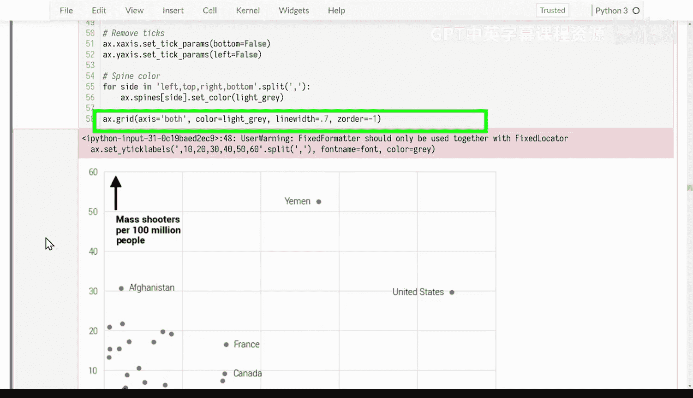

#  117：使用Pandas创建散点图 📊


在本节课中，我们将学习如何使用Pandas和Matplotlib创建散点图。散点图是一种强大的数据可视化工具，用于探索两个数值变量之间的关系。我们将从一个基础图表开始，逐步美化它，使其达到专业出版物的水准。

## 什么是散点图？

上一节我们介绍了不同类型的数据可视化图表。本节中，我们来看看散点图的具体应用。

散点图允许你观察两个数值之间的关系。每个数据点在图中的位置由其两个变量的值（X轴和Y轴）共同决定，这有助于揭示变量之间是否存在相关性、趋势或异常值。

## 准备数据

在绘制图表之前，我们需要准备好要使用的数据。以下是本节课将用到的数据集，它包含了不同国家每百人枪支拥有量和每亿人大规模枪击案数量的信息。

```python
import pandas as pd

# 假设数据已复制到剪贴板，可以使用以下方式读取
# df = pd.read_clipboard()

# 为演示，这里手动创建一个示例DataFrame
data = {
    'Country': ['United States', 'Yemen', 'Switzerland', 'Finland', 'Canada', 'Germany', 'France', 'Australia'],
    'Guns_per_100': [120.5, 54.8, 45.7, 32.4, 30.8, 19.6, 31.2, 14.5],
    'Mass_Shootings_per_100M': [4.5, 0.2, 0.1, 0.3, 0.5, 0.2, 0.1, 0.1]
}
df = pd.DataFrame(data)
print(df.head())
```

运行上述代码将加载数据并显示前几行，让我们了解数据结构。

## 创建基础散点图

现在我们已经有了数据，接下来创建第一个散点图。基础散点图的绘制非常简单。

以下是使用Pandas的`.plot.scatter()`方法创建散点图的核心代码：

```python
# 创建基础散点图
ax = df.plot.scatter(x='Guns_per_100',
                     y='Mass_Shootings_per_100M',
                     figsize=(10, 6))
ax.set_title('基础散点图：枪支拥有量与大规模枪击案的关系')
ax.set_xlabel('每百人枪支拥有量')
ax.set_ylabel('每亿人大规模枪击案数量')
```

这段代码会生成一个基础图表，其X轴代表“每百人枪支拥有量”，Y轴代表“每亿人大规模枪击案数量”。这个图表已经能讲述基本的数据故事，例如，美国在图表中的位置表明其在这两项指标上都显著高于其他国家。

## 美化散点图

基础图表功能完备，但外观可以更加精美。接下来，我们将使用Matplotlib对图表进行深度定制，使其风格更接近《纽约时报》等专业出版物。

我们首先导入Matplotlib，并进行一系列样式设置。

```python
import matplotlib.pyplot as plt

# 设置字体和颜色
plt.rcParams['font.family'] = 'sans-serif'
plt.rcParams['axes.edgecolor'] = '#d3d3d3'  # 浅灰色边框

# 创建图形和坐标轴
fig, ax = plt.subplots(figsize=(12, 8))

# 绘制散点
scatter = ax.scatter(df['Guns_per_100'],
                     df['Mass_Shootings_per_100M'],
                     color='steelblue',
                     s=100,  # 点的大小
                     alpha=0.7)  # 点的透明度

# 设置标题和坐标轴标签
ax.set_title('枪支拥有量与大规模枪击案的国际比较', fontsize=16, pad=20)
ax.set_xlabel('每百人枪支拥有量', fontsize=12)
ax.set_ylabel('每亿人大规模枪击案数量', fontsize=12)
```

## 添加数据标签和注释

为了让图表信息更清晰，我们需要为特定的数据点（国家）添加标签。以下是添加注释和标签的步骤。

首先，我们定义需要特别标注的国家列表，然后循环为它们添加文本标签。

```python
# 定义需要标注的国家
countries_to_label = ['United States', 'Yemen', 'Switzerland', 'Finland']

# 循环为特定国家添加文本标签
for country in countries_to_label:
    # 查询该国家的数据行
    row = df[df['Country'] == country].iloc[0]
    x = row['Guns_per_100']
    y = row['Mass_Shootings_per_100M']

    # 添加文本标签，根据国家位置调整标签方位
    if country in ['United States', 'Yemen']:
        # 将美国和也门的标签放在点左侧
        ax.annotate(country,
                    xy=(x, y),
                    xytext=(-80, 0),  # 文本相对于点的偏移量
                    textcoords='offset points',
                    ha='right',
                    va='center',
                    fontsize=10,
                    arrowprops=dict(arrowstyle='->',
                                    color='gray',
                                    lw=1,
                                    connectionstyle="arc3,rad=0.2"))
    else:
        # 将其他国家的标签放在点右侧
        ax.annotate(country,
                    xy=(x, y),
                    xytext=(20, 0),  # 文本相对于点的偏移量
                    textcoords='offset points',
                    ha='left',
                    va='center',
                    fontsize=10,
                    arrowprops=dict(arrowstyle='->',
                                    color='gray',
                                    lw=1,
                                    connectionstyle="arc3,rad=0.2"))
```

## 调整坐标轴与网格

最后，我们对坐标轴的刻度、样式以及网格线进行精细调整，以提升图表的可读性和美观度。

以下是调整坐标轴和添加网格的代码：

```python
# 调整刻度位置和标签（示例：自定义X轴刻度）
ax.set_xticks([0, 25, 50, 75, 100, 125])
# 可以自定义刻度标签，这里使用默认数值标签

# 移除朝向图形内部的刻度（ticks）
ax.tick_params(axis='both', which='both', length=0)

# 设置坐标轴线（脊柱）颜色为浅灰色
for spine in ax.spines.values():
    spine.set_color('#d3d3d3')
    spine.set_linewidth(1)

# 添加网格线
ax.grid(True, which='major', axis='both',
        linestyle='--', linewidth=0.5, color='lightgray', alpha=0.7)

# 自动调整布局并显示图形
plt.tight_layout()
plt.show()
```



运行全部代码后，你将得到一个信息丰富、外观专业的散点图，清晰地展示了不同国家在两个指标上的分布情况。

## 总结

本节课中我们一起学习了如何使用Pandas和Matplotlib创建并美化散点图。我们从加载数据、绘制基础图表开始，逐步深入到使用Matplotlib进行定制化设置，包括调整样式、添加数据标签与注释、以及优化坐标轴和网格。掌握这些技能后，你将能够创建出可用于专业报告和出版物的高质量数据可视化图表。