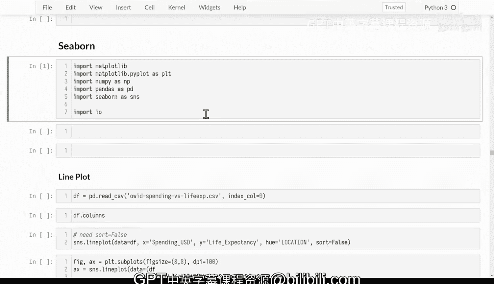

#  122：Seaborn库简介 🐍


在本节课中，我们将学习Seaborn库。Seaborn是一个基于Matplotlib和Pandas构建的优质库，它提供了一些便捷函数，用于绘制那些用其他方式实现起来可能稍显复杂的图表。

## 概述

上一节我们介绍了Matplotlib的基础绘图功能。本节中，我们来看看Seaborn库。Seaborn建立在Matplotlib之上，并与之深度集成，同时它也为Pandas数据结构提供了更好的支持。这意味着我们可以用更简洁的代码创建统计图形。

## 加载Seaborn库

要使用Seaborn，首先需要导入它。通常，我们使用`import seaborn as sns`来导入。这里有一个有趣的背景：`sns`这个别名源于美剧《白宫风云》中的一个角色Samuel Norman Seaborn，这个库正是以该角色命名的。

以下是导入Seaborn的代码：

```python
import seaborn as sns
```

## Seaborn的优势

因为Seaborn构建在Matplotlib之上，所以用Seaborn重现之前用Matplotlib绘制的图表相对容易。但更重要的是，Seaborn为某些我们想做的事情直接提供了接口，这使得绘制特定类型的图表变得更加简单。

你可以访问Seaborn官方网站，查看其教程文档，这些文档通常质量很高。

## 总结



本节课中，我们一起学习了Seaborn库的基本介绍。我们了解到Seaborn是一个基于Matplotlib和Pandas的高级可视化库，它通过提供更便捷的API简化了复杂统计图形的创建过程。在接下来的实践中，我们将用Seaborn来重现之前的图表，并体验其带来的便利性。