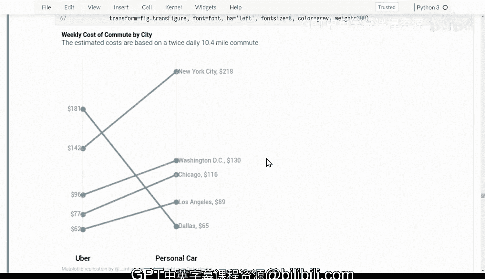

#  127：使用Seaborn创建斜率图


## 概述
在本节课中，我们将学习如何使用Seaborn库创建斜率图。斜率图并非Seaborn内置的图表类型，但我们可以通过结合Seaborn的`pointplot`功能和Pandas的数据重塑功能来实现它。我们将使用Uber数据集作为示例，演示如何将数据转换为适合绘制斜率图的格式，并最终生成清晰的图表。

---

## 理解数据与问题
首先，我们查看Uber数据集。数据中包含城市、Uber使用率和私家车使用率等信息。我们的目标是创建一个斜率图，以比较不同城市在这两种交通方式上的差异。

直接使用Seaborn绘制斜率图并不直接，因为数据格式不符合`pointplot`函数的要求。`pointplot`通常需要数据以“长格式”呈现。

---

## 使用Pandas重塑数据
为了使用`pointplot`，我们需要将数据从“宽格式”转换为“长格式”。Pandas的`melt`函数非常适合完成这个任务。

以下是数据重塑的步骤：
1.  指定保持不变的列（`id_vars`），这里是“city”。
2.  其他列（‘Uber’和‘personal car’）的名称将被整合到一个名为“variable”的新列中。
3.  这些列对应的数值将被整合到一个名为“value”的新列中。

转换后的数据结构使得每个城市都有两行数据：一行对应Uber使用率，另一行对应私家车使用率。

```python
# 假设df是原始数据框
df_melted = df.melt(id_vars='city')
```

---

## 使用Seaborn绘制基础斜率图
数据重塑完成后，我们就可以使用Seaborn的`pointplot`函数来创建斜率图了。

以下是绘制图表的核心参数：
*   `x='variable'`：在x轴上放置交通方式（Uber或personal car）。
*   `y='value'`：在y轴上放置对应的使用率数值。
*   `hue='city'`：按照城市进行分组，并用不同颜色区分。这将自动为每个城市连接其Uber和私家车的数据点，形成斜率线。

运行代码后，我们会得到一个初步的斜率图。图中每条颜色的线代表一个城市，可以直观地看到不同城市趋势的差异，例如达拉斯（Dallas）的线可能与其他城市趋势相反。

```python
import seaborn as sns
sns.pointplot(data=df_melted, x='variable', y='value', hue='city')
```

---

## 优化图表样式
由于Seaborn建立在Matplotlib之上，我们可以进一步自定义图表，使其更简洁、更符合出版要求。

以下是常见的优化步骤：
1.  移除自动生成的图例。
2.  清除或自定义Seaborn自动添加的轴标签。
3.  调整线条样式、标记点等。

经过这些调整，我们可以得到一个外观与定制化Matplotlib图表相似的、清晰专业的斜率图。

```python
import matplotlib.pyplot as plt

# 绘制点图
ax = sns.pointplot(data=df_melted, x='variable', y='value', hue='city')

# 优化样式：移除图例和调整标签
ax.legend_.remove()
ax.set_xlabel('Transportation Type')
ax.set_ylabel('Usage Rate')
plt.title('Slope Chart: Uber vs Personal Car Usage by City')

plt.show()
```

---



## 总结
本节课中，我们一起学习了如何利用Seaborn和Pandas创建斜率图。关键步骤包括：使用`melt`函数将数据重塑为长格式，然后使用`pointplot`函数并设置`hue`参数按城市分组绘制连接线。最后，我们利用Matplotlib的灵活性对图表进行了样式优化。这个方法展示了如何组合不同工具来实现特定的可视化需求。