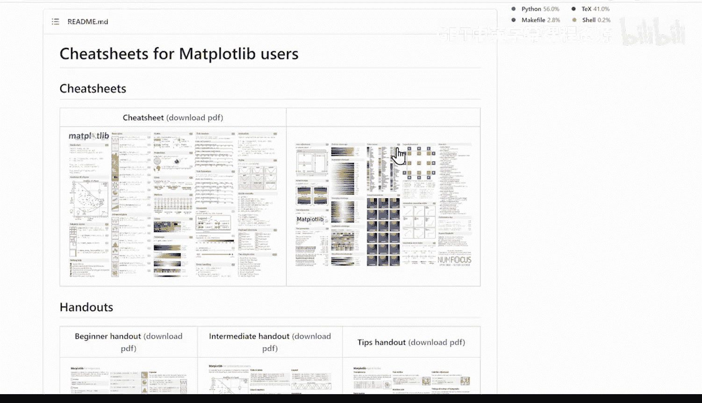

#  128：Matplotlib自定义指南 🎨

在本节中，我们将学习如何自定义Matplotlib图表。Matplotlib的一个强大之处在于，几乎图表的每个部分都可以根据你的需求进行调整。

上一节我们介绍了Matplotlib的基础绘图功能，本节中我们来看看如何对图表进行深度定制。

## 概述

在本节课中，我们将要学习如何利用Matplotlib的丰富选项来自定义图表的外观，包括颜色、样式和布局等。

## 自定义资源与文档

你需要了解，Matplotlib几乎允许你自定义任何元素。

我在此推荐一些速查表，建议你前往查阅。

以下是一些非常有用的速查表。

特别是这张颜色映射速查表。稍后当我们需要更改颜色映射时，你可能会需要这份关于使用何种颜色的参考，这些速查表在那时会非常有用。

总的来说，Matplotlib的官方文档非常出色。因此我建议，如果你有任何疑问，可以去官网查阅文档。文档中通常附有示例，并且你经常可以直接将这些示例复制到Jupyter中运行尝试。

## 总结

本节课中我们一起学习了Matplotlib图表自定义的基本理念和可用资源。我们了解到Matplotlib具有高度的可定制性，并且官方文档和社区提供的速查表是解决问题和获取灵感的重要工具。